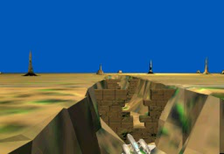
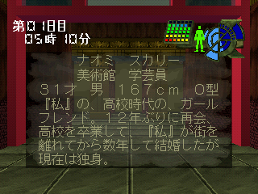
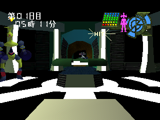
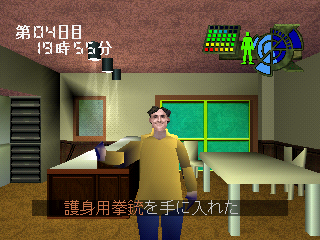
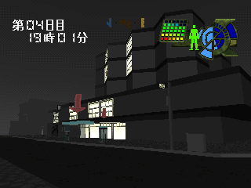

# germs-decomp

A matching decompilation of **Germs: Nerawareta Machi** (PlayStation, KAJ, 1999), retail release SLPS-02107.

<p>




</p>

<sub>Left to right: [a frame of the unused movie](docs/discoveries.md#-the-movie-on-the-disc-is-a-silent-82-second-reel-the-game-can-never-play), [Naomi's card listing her sex as male](docs/discoveries.md#-the-main-characters-all-have-lingering-thoughts-cards-that-can-never-open), [a shot that rolls a hit](docs/discoveries.md#-every-shot-is-a-roll-against-the-hit-chance-and-range-cuts-both-chance-and-damage), [Fujita's free pistol](docs/discoveries.md#-the-gun-shop-has-three-fixed-lists-of-six-and-every-weapon-it-never-sells-has-one-giver).</sub>

<p>




</p>

<sub>Left to right: [the burger shop's changed food](docs/discoveries.md#-the-burger-shop-secretly-serves-changed-food-and-even-days-swap-its-hours), [the clock stuck on day 99](docs/discoveries.md#-the-clock-counts-minutes-and-stops-at-day-99), [the grey town at night](docs/discoveries.md#-no-colour-version-of-the-town-is-left-on-the-disc), [game over at energy 0](docs/discoveries.md#-energy-at-0-is-death-and-only-a-hit-to-the-head-makes-you-wake-up-changed).</sub>

The goal is C that rebuilds the retail executable byte for byte, and through it an understanding of how the game works: the city, the scenes, the weapons, the per-limb damage and what the disc holds that the game never shows. Each finding is written for players, with the functions and addresses that prove it.

## At a glance

- **655 of 655 functions in C** (the game's 510 and the 145 of the developer's own library), compiled by GCC 2.8.1 and ASPSX 2.56 at `-O2 -G8 -funsigned-char`; `make check` compares the sha1 of the result with the retail `SLPS_021.07`, and the build is byte-identical to it. The geometry (GTE) and scratchpad code goes through PSY-Q style macros in [include/gte.h](include/gte.h), the only file that holds inline assembly. Four polygon draw handlers of the roadmap match through one never-taken branch after the clip call, commented in [src/game/roadmap.c](src/game/roadmap.c): it gives GCC the register choice of the original and leaves no code.
- **Every function in C is read**: no function body uses a placeholder name (`unk` field, compiler-made local, `Unk_` type, `D_` global). The 1,160 function and global names each carry their evidence in `config/symbol_addrs.txt`; an audit rated 2,734 of the names we gave (functions, globals, struct types and fields): 74 checked in game, 2,596 proven by the code, 64 guesses that say what is unproven ([config/name_levels.tsv](config/name_levels.tsv)).
- **36 source files** laid out the way the original programmers most likely had them, in link order between Sony's objects (24 game files, 12 of the developer's library; [docs/layout.md](docs/layout.md) gives the evidence for each boundary), with one header per file in `include/game/` and `include/kaj/`, and the Sony prototypes in `include/psyq/`. Every game function and global carries its file's prefix (`shop_` in `shop.c`).
- **Shiftable**: every pointer into the executable is a symbol, so code can be added before `main` and the game still runs. `tools/rawscan.py` relinks the build at another address and finds 0 fixed addresses, and a build with 0x100 extra bytes before `main` played the same opening as the retail one in an emulator: the 62 screenshots sampled from the logos to the office computer are identical, the program counter 0x100 higher at every sample.
- **47 findings** in [docs/discoveries.md](docs/discoveries.md), 27 of them checked in an emulator and 13 in part, five of them also heard from the emulator's sound, 39 shown in pictures; all 36 questions of [docs/mysteries.md](docs/mysteries.md) answered within the scope each answer states.

## Progress

[](docs/progress/treemap.svg)

A function is "read" when every name in its body is ours. The map is regenerated with `tools/progress_map.py` after `make check`; open it to hover each function, `docs/progress/progress.json` holds the same data. Sony's PSY-Q 4.4 libraries (138,048 bytes, 647 symbols) are recognised by their signatures and linked as Sony shipped them: they are not part of Germs.

## Highlights from the findings

- [The game has an ending](docs/discoveries.md#-the-game-has-an-ending-a-narration-in-the-office-then-a-town-at-peace), against the "no ending" some players report: a narration in the office, then every building set to "at peace" and free play.
- [Time alone never spreads the invasion](docs/discoveries.md#-time-alone-never-spreads-the-invasion-buildings-fall-on-a-schedule-when-you-pass-a-door): five buildings fall on a set day and hour, but only when you walk through a door; the rest fall as a chain.
- [The main characters all have lingering-thoughts cards that can never open](docs/discoveries.md#-the-main-characters-all-have-lingering-thoughts-cards-that-can-never-open): 29 cards with no person to open them, one of them making Naomi a man.
- [The movie on the disc is a silent 82-second reel](docs/discoveries.md#-the-movie-on-the-disc-is-a-silent-82-second-reel-the-game-can-never-play) of flying craft, stored four times, with no shot of space and no code that could play it.
- [The game times every frame](docs/discoveries.md#-the-game-times-every-frame-so-a-slow-machine-makes-it-choppy-not-slow), so a slow emulator makes it choppy: in DuckStation the coal mine runs at 20 frames a second and needs 140 % CPU for 30, and the 190 % players advise was the first setting tested where a library wait gave up, in the office.

## Where to read

| Page | What it holds |
| --- | --- |
| [docs/discoveries.md](docs/discoveries.md) | The 47 findings, for players first, with the proof folded under each one |
| [docs/mysteries.md](docs/mysteries.md) | The 36 questions the project set out to answer, ticked as they are answered |
| [docs/design-intent.md](docs/design-intent.md) | What the code says about what the creators meant, kept apart from their words and our reading |
| [docs/engine/](docs/engine/README.md) | How each system works, for a programmer opening the code: boot and the main loop, files and the CD, rendering, sound and music, menus, text and the save, scenes and scripts, town and vehicles, people and combat, player and survival |
| [docs/naming.md](docs/naming.md) | How names are given, the evidence they need, the tools and the glossary of modules |
| [docs/layout.md](docs/layout.md) | The 36 source files in link order, each cut with its evidence and how sure it is |
| [docs/community-knowledge.md](docs/community-knowledge.md) | What players, wikis, cheat makers and earlier projects already knew, with sources |
| [disks/README.md](disks/README.md) | Where to put your own dump of the disc and the names the build expects |

## Building

You need Linux x86-64 with `make`, `git`, `curl`, a C compiler (`gcc`), Python 3.12 (through `uv` or `venv`) and stable Rust (for `mipsmatch`), plus your own dump of the game disc. No game or BIOS file is provided here.

```sh
git config core.hooksPath tools/hooks
tools/setup.sh                  # pinned toolchain into tools/ and .venv/
# put your disc in disks/ (see disks/README.md)
make check-disk                 # extracts the disc, checks SLPS_021.07
make split && make check        # splits the executable, builds it from src/, compares the sha1
```

`make check-disk` must print `extract/SLPS_021.07: OK` and `make check` must print `build/SLPS_021.07: OK`.

## How it was made

The C, the names, the docs and the emulator checks were written by AI agents, mostly Claude Opus 5.5 (some matching waves by Claude Fable 5.2), with reviews by GPT-6.1 and GPT-6.2 Sol. A change was kept only when `make check` still matched.

## Legal

Fan project, not affiliated with KAJ or its successors. It ships no executable, no disc image or disc file, no audio and no dump of the game's text or images. The only game images it holds are illustrations: small emulator screenshots of the findings and three frames of the unused movie decoded from the disc. The spectrograms are pictures of sound recorded from the emulator, not game images. Building anything still needs your own original disc. A takedown request from the rights holder will be honored.

The project's own tools and the text of its documentation are under the MIT licence. The reconstructed C, the game's names, data and images, and Sony's SDK interfaces are not: [LICENSING.md](LICENSING.md) lists which files are covered and which are not.

## Credits

The disc survey and the decompilation notes of the Germs English translation project (MIT) were read as leads; no code or name was taken from them.

Built with splat, spimdisasm, maspsx, m2c, decomp-permuter, asm-differ, mipsmatch, objdiff, mkpsxiso, old-gcc and PCSX-Redux; Sony's library functions were identified with lab313ru's psx_psyq_signatures. `include/include_asm.h`, `macro.inc`, `labels.inc` and `gte_macros.inc` are splat's generated files (MIT, Copyright (c) 2021 Ethan Roseman; the full notice is in [include/LICENSE-splat.txt](include/LICENSE-splat.txt)).
