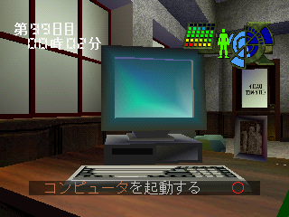
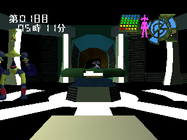
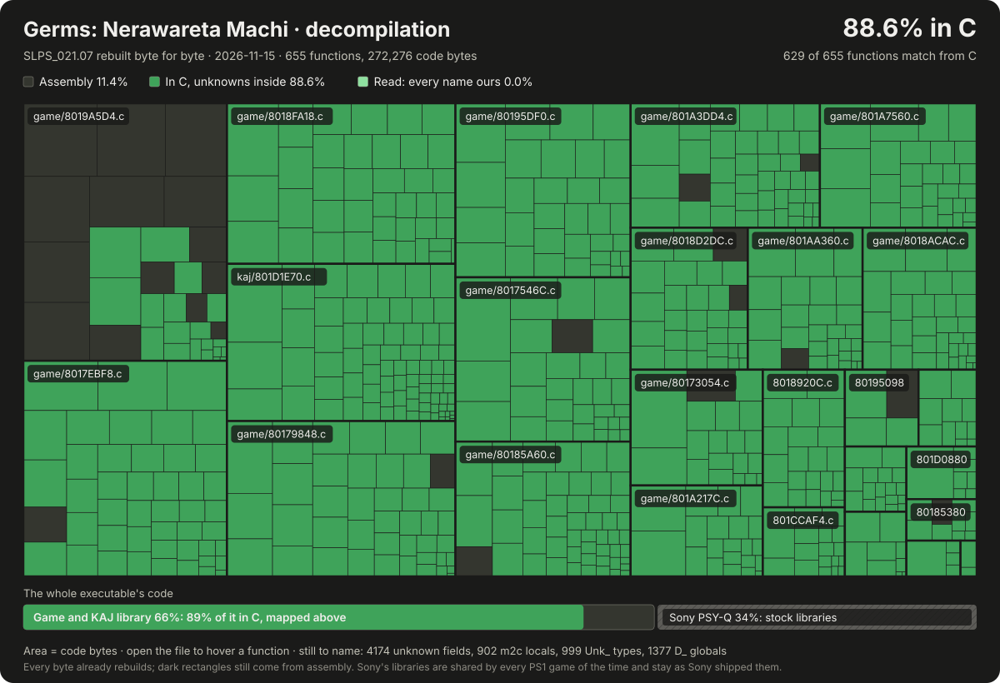

# germs-decomp

A matching decompilation of **Germs: Nerawareta Machi** (PlayStation, KAJ, 1999), retail release SLPS-02107.

The goal is C that rebuilds the retail executable byte for byte, and through it an understanding of how the
game works: the city, the scenes, the weapons, the per-limb damage and what the disc holds that the game
never shows.





## What the code taught us so far

Thirty-two findings in [docs/discoveries.md](docs/discoveries.md), sixteen of them checked in an emulator and eleven in part:

- [The game has an ending](docs/discoveries.md#-the-game-has-an-ending-a-narration-in-the-office-then-a-town-at-peace), against the "no ending" some players report: a narration in the office, then every building set to "at peace" and free play.
- [Time alone never spreads the invasion](docs/discoveries.md#-time-alone-never-spreads-the-invasion-buildings-fall-on-a-schedule-when-you-pass-a-door): five buildings fall on a set day and hour, but only when you walk through a door; the rest fall as a chain.
- [Energy at 0 is death, and only a hit to the head makes you wake up changed](docs/discoveries.md#-energy-at-0-is-death-and-only-a-hit-to-the-head-makes-you-wake-up-changed): starving is always game over, never the mine.
- [The blue wheel is the weapon's hit rate](docs/discoveries.md#-the-blue-wheel-is-the-weapons-hit-rate-and-the-five-classes-are-levels-up-to-100), not weapon experience, and the cheat value "one point below the maximum" is level 93 of 100.
- [The burger shop secretly serves changed food](docs/discoveries.md#-the-burger-shop-secretly-serves-changed-food-and-even-days-swap-its-hours) under the same menu, at hours that swap on even days.

## Status

[](docs/progress/treemap.svg)

- The executable splits and links back to the retail `SLPS_021.07` (`make check` compares the sha1).
- 635 of the 655 functions to decompile (510 of the game, 145 of the developer's own library) are matching C:
  245,568 of 272,276 code bytes (90.2 %). The rest is still assembly, 19 functions of it on purpose: they move
  the stack to the scratchpad or drive the GTE in ways plain C cannot express. Sony's PSY-Q 4.4 libraries (138,048
  bytes) stay as Sony shipped them.
- The map is regenerated after each wave with `tools/progress_map.py` (after `make check`); open it to hover
  each function, `docs/progress/progress.json` holds the same data.
- Names: all 655 functions, 96 of Sony's 109 unnamed internals and 408 globals carry names, each with its
  evidence in `config/symbol_addrs.txt` (`tools/xref.py` builds the cross-references, `tools/rename.py` applies a
  batch and rechecks the sha1). The structs each source file used to declare on its own are merged into one
  header, `include/game/types.h`, whose 80 types are all named (`PlayerStatus`, `Player`, `Inventory`,
  `GameVars`, `Npc`, `Door`, `Model`, `Block`, `Thing`, `ActionSet`, `WeaponRecord`, `Vehicle` and the developer
  library's lists, timers and tasks); the types local to one source file are named too, and about 1,250 fields
  carry names from their readers, their writers and emulator runs. Parameters and locals carry about 2,300
  names in place of the compiler's. All 635 functions in C are fully read: no address name, `unk` field,
  `Unk` type or compiler-made local is left in their body. The rules and the glossary are in
  [docs/naming.md](docs/naming.md).
- Compiler: GCC 2.8.1 with ASPSX 2.56, `-O2 -G8 -funsigned-char`, found by compiling small functions until
  they matched.

## Documents

| Page | What it holds |
|---|---|
| [docs/discoveries.md](docs/discoveries.md) | What the code taught us about the game, for players first, with the proof folded under each finding |
| [docs/mysteries.md](docs/mysteries.md) | The questions this project wants the code to answer, ticked as they are answered |
| [docs/community-knowledge.md](docs/community-knowledge.md) | What players, wikis, cheat makers and earlier projects already knew, with sources |
| [docs/naming.md](docs/naming.md) | How names are given, the evidence they need, the tools, and the glossary of modules |
| [docs/engine/](docs/engine/README.md) | How the engine works, one page per system, for a programmer opening the code: boot and the loop, files and the CD, rendering, sound, menus and the save, scenes and scripts, the town, people and combat, the player |
| [docs/design-intent.md](docs/design-intent.md) | What the code says about what the creators meant, for players: code facts, the creators' words where they exist, and our reading kept apart |
| [docs/layout.md](docs/layout.md) | The source files in link order, each cut with its evidence and how sure it is |

## Building

You need Linux x86-64 with `make`, `git`, `curl`, a C compiler (`gcc`), Python 3.12 (through `uv` or
`venv`) and stable Rust (for `mipsmatch`), plus your own dump of the game disc. No game or BIOS file is
provided here.

```sh
git config core.hooksPath tools/hooks
tools/setup.sh                  # pinned toolchain into tools/ and .venv/
# put your disc in disks/ (see disks/README.md)
make check-disk                 # extracts the disc, checks SLPS_021.07
make split && make check        # splits the executable, builds it from src/, compares the sha1
```

`make check-disk` must print `extract/SLPS_021.07: OK` and `make check` must print
`build/SLPS_021.07: OK`.

## Legal

Fan project, not affiliated with KAJ or its successors. It ships no game asset: no executable, no disc
data, no audio, no dump of the game's text or images, and you need your own copy of the game to build
anything. A takedown request from the rights holder will be honored.

## Credits

The disc survey and the decompilation notes of the Germs English translation project (MIT) were read as
leads; no code or name was taken from them.

Built with splat, spimdisasm, maspsx, m2c, decomp-permuter, asm-differ, mipsmatch, objdiff, mkpsxiso,
old-gcc and PCSX-Redux; Sony's library functions were identified with lab313ru's psx_psyq_signatures.
`include/include_asm.h`, `macro.inc`, `labels.inc` and `gte_macros.inc` are splat's generated files (MIT,
Copyright (c) 2021 Ethan Roseman).
