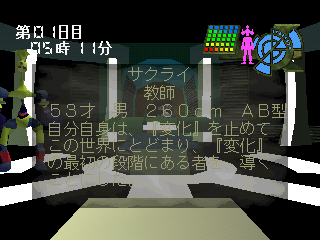
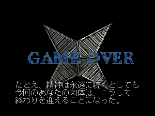

# germs-decomp

A matching decompilation of **Germs: Nerawareta Machi** (PlayStation, KAJ, 1999), retail release SLPS-02107.

The goal is C that rebuilds the retail executable byte for byte, and through it an understanding of how the
game works: the city, the scenes, the weapons, the per-limb damage and what the disc holds that the game
never shows.





## At a glance

- **All 655 functions in C** (the game's 510 and the 145 of the developer's own library), compiled by GCC 2.8.1
  and ASPSX 2.56 at `-O2 -G8 -funsigned-char`; `make check` compares the sha1 of the result with the retail
  `SLPS_021.07`. The geometry (GTE) and scratchpad code goes through PSY-Q style macros in
  [include/gte.h](include/gte.h), the only file that holds inline assembly. Four polygon draw handlers of the
  roadmap match through one never-taken branch after the clip call, commented in
  [src/game/roadmap.c](src/game/roadmap.c): it gives GCC the register choice of the original and leaves no code.
- **Every function in C is read**: no function body uses a placeholder name (`unk` field, compiler-made local,
  `Unk_` type, `D_` global). The 1,160 function and global names each carry their evidence in
  `config/symbol_addrs.txt`; an audit rated 2,734 of the names we gave (functions, globals, struct types and
  fields): 74 checked in game, 2,596 proven by the code, 64 guesses that say what is unproven
  ([config/name_levels.tsv](config/name_levels.tsv)).
- **36 source files** laid out the way the original programmers most likely had them, in link order between
  Sony's objects (24 game files, 12 of the developer's library; [docs/layout.md](docs/layout.md) gives the
  evidence for each boundary), with one header per file in `include/game/` and `include/kaj/`, and the Sony
  prototypes in `include/psyq/`. Every game function and global carries its file's prefix (`shop_` in
  `shop.c`).
- **Shiftable**: every pointer into the executable is a symbol, so code can be added before `main` and the
  game still runs. `tools/rawscan.py` relinks the build at another address and finds 0 fixed addresses, and a
  build with 0x100 extra bytes before `main` played the same opening as the retail one in an emulator: the
  62 screenshots sampled from the logos to the office computer are identical, the program counter 0x100 higher
  at every sample.
- **32 findings** in [docs/discoveries.md](docs/discoveries.md), 16 of them checked in an emulator and 11 in
  part; 27 of the 36 questions of [docs/mysteries.md](docs/mysteries.md) answered.

## Progress

[](docs/progress/treemap.svg)

A function is "read" when every name in its body is ours. The map is regenerated with `tools/progress_map.py`
after `make check`; open it to hover each function, `docs/progress/progress.json` holds the same data. Sony's
PSY-Q 4.4 libraries (138,048 bytes, 647 symbols) are recognised by their signatures and linked as Sony shipped
them: they are not part of Germs.

## Highlights from the findings

- [The game has an ending](docs/discoveries.md#-the-game-has-an-ending-a-narration-in-the-office-then-a-town-at-peace), against the "no ending" some players report: a narration in the office, then every building set to "at peace" and free play.
- [Time alone never spreads the invasion](docs/discoveries.md#-time-alone-never-spreads-the-invasion-buildings-fall-on-a-schedule-when-you-pass-a-door): five buildings fall on a set day and hour, but only when you walk through a door; the rest fall as a chain.
- [Energy at 0 is death, and only a hit to the head makes you wake up changed](docs/discoveries.md#-energy-at-0-is-death-and-only-a-hit-to-the-head-makes-you-wake-up-changed): starving is always game over, never the mine.
- [The blue wheel is the weapon's hit rate](docs/discoveries.md#-the-blue-wheel-is-the-weapons-hit-rate-and-the-five-classes-are-levels-up-to-100), not weapon experience, and the cheat value "one point below the maximum" is level 93 of 100.
- [The burger shop secretly serves changed food](docs/discoveries.md#-the-burger-shop-secretly-serves-changed-food-and-even-days-swap-its-hours) under the same menu, at hours that swap on even days.

## Where to read

| Page | What it holds |
|---|---|
| [docs/discoveries.md](docs/discoveries.md) | What the code taught us about the game, for players first, with the proof folded under each finding |
| [docs/mysteries.md](docs/mysteries.md) | The questions this project wants the code to answer, ticked as they are answered |
| [docs/community-knowledge.md](docs/community-knowledge.md) | What players, wikis, cheat makers and earlier projects already knew, with sources |
| [docs/naming.md](docs/naming.md) | How names are given, the evidence they need, the tools, and the glossary of modules |
| [docs/engine/](docs/engine/README.md) | How the engine works, one page per system, for a programmer opening the code: boot and the loop, files and the CD, rendering, sound, menus and the save, scenes and scripts, the town, people and combat, the player |
| [docs/design-intent.md](docs/design-intent.md) | What the code says about what the creators meant, for players: code facts, the creators' words where they exist, and our reading kept apart |
| [docs/layout.md](docs/layout.md) | The source files in link order, each cut with its evidence and how sure it is |

## Building

You need Linux x86-64 with `make`, `git`, `curl`, a C compiler (`gcc`), Python 3.12 (through `uv` or
`venv`) and stable Rust (for `mipsmatch`), plus your own dump of the game disc. No game or BIOS file is
provided here.

```sh
git config core.hooksPath tools/hooks
tools/setup.sh                  # pinned toolchain into tools/ and .venv/
# put your disc in disks/ (see disks/README.md)
make check-disk                 # extracts the disc, checks SLPS_021.07
make split && make check        # splits the executable, builds it from src/, compares the sha1
```

`make check-disk` must print `extract/SLPS_021.07: OK` and `make check` must print
`build/SLPS_021.07: OK`.

## How it was made

The C, the names, the docs and the emulator checks were written by AI agents, mostly Claude Opus 5.5 (some
matching waves by Claude Fable 5.2), with reviews by GPT-6.1 Sol. A change was kept only when `make check`
still matched.

## Legal

Fan project, not affiliated with KAJ or its successors. It ships no game asset: no executable, no disc
data, no audio, no dump of the game's text or images, and you need your own copy of the game to build
anything. The only game images are the small emulator screenshots that illustrate the findings. A takedown request from the rights holder will be honored.

## Credits

The disc survey and the decompilation notes of the Germs English translation project (MIT) were read as
leads; no code or name was taken from them.

Built with splat, spimdisasm, maspsx, m2c, decomp-permuter, asm-differ, mipsmatch, objdiff, mkpsxiso,
old-gcc and PCSX-Redux; Sony's library functions were identified with lab313ru's psx_psyq_signatures.
`include/include_asm.h`, `macro.inc`, `labels.inc` and `gte_macros.inc` are splat's generated files (MIT,
Copyright (c) 2021 Ethan Roseman).
