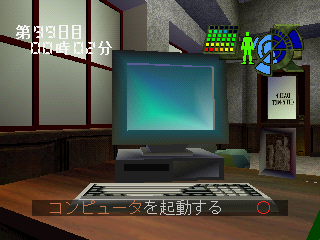
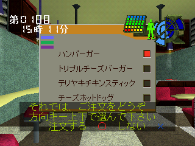
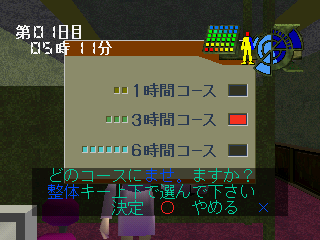
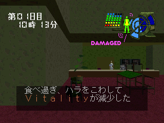
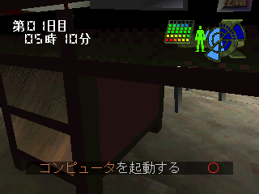
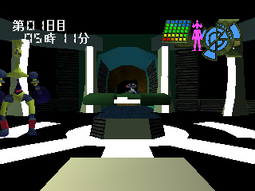
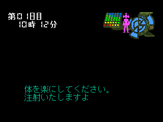
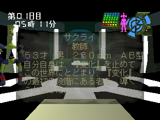
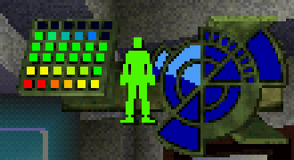

# Discoveries

What reading the game's code taught us about Germs: Nerawareta Machi. Each finding below says in plain words what happens when you play, then keeps the proof (functions, addresses, how it was checked) folded under "Technical details". What players and earlier projects already knew is in [community-knowledge.md](community-knowledge.md); open questions live in [mysteries.md](mysteries.md).

Status of each finding:

- 🎮 Checked in the game: we ran the game in an emulator, changed or watched its memory, and saw the predicted result on screen or in memory.
- 🎮 Partly checked: part of it was seen in the emulator, the rest is read in the code.
- 📖 Read in the code only: the code says so, nobody has seen it happen yet.

What the mark before each title means:

- 🆕 New: nobody had written it down before us, not the wikis, not the translation projects, not the cheat makers.
- 🧩 Known in part: players had seen it or knew some of it; we add how it works, its exact conditions or its numbers.
- ✅ Confirmed: something players or earlier projects believed, now proven by the code or the emulator.
- 🔄 Corrected: a belief that was partly wrong; the finding gives the right version.
- ❌ Myth busted: a belief the code proves false.

Names in the technical details are the ones this project gave, each with its evidence in `config/symbol_addrs.txt` and the rules in [naming.md](naming.md); a name still of the form `func_XXXXXXXX`, `D_XXXXXXXX` or `unkXX` is not understood yet. Addresses are in the executable `SLPS_021.07` as loaded in memory. The source files named are in this repository's `src/`. Emulator runs used PCSX-Redux through `tools/emu/run.sh` with a Lua driver (pad input, memory writes, captures); each finding lists what was forced.

## The findings at a glance

Time
- 🧩 [The clock counts minutes and stops at day 99](#-the-clock-counts-minutes-and-stops-at-day-99): one game minute every 600 screen refreshes, 10 seconds, which is the 6x speed players measured. 🎮
- 🧩 [The timed mails are written in the code, for days 1 to 4](#-the-timed-mails-are-written-in-the-code-for-days-1-to-4): twelve mails at eight fixed times, four of them under story conditions, two of the times nobody listed. 🎮
- 🆕 [The burger shop secretly serves changed food, and even days swap its hours](#-the-burger-shop-secretly-serves-changed-food-and-even-days-swap-its-hours): the menu on screen never changes, the food does; the only use of the day's parity. 🎮 partly

Survival
- 🧩 [Energy drains faster the longer you stay awake](#-energy-drains-faster-the-longer-you-stay-awake): 1 point every 10 game minutes, up to 32 after 96 hours awake, and a hurt torso multiplies it. 🎮
- 🔄 [Body part damage heals by the hour, unless it is at the worst level](#-body-part-damage-heals-by-the-hour-unless-it-is-at-the-worst-level): the parts are head, two arms, torso and legs, not the cheat author's order, and there are four colours, not three. 🎮
- 🧩 [Hurt legs slow you down, and one hurt arm spoils your aim](#-hurt-legs-slow-you-down-and-one-hurt-arm-spoils-your-aim): 90 % or 70 % of your speed, up to 30 % of your hit chance, and the head and the other arm do nothing. 🎮 partly
- 🧩 [The chiropractor sells time: 1, 3 or 6 hours that heal as much](#-the-chiropractor-sells-time-1-3-or-6-hours-that-heal-as-much): the 6-hour course clears any wound, and the hours are the only price. 🎮
- 🧩 [The hospital heals every wound at once, for free and without losing time](#-the-hospital-heals-every-wound-at-once-for-free-and-without-losing-time): an injection on the exam bed, but no energy, and the desk keeps 07:00 to 19:59. 🎮 partly
- 🧩 [Food adds a fixed amount of energy, and eating on a full bar hurts your torso](#-food-adds-a-fixed-amount-of-energy-and-eating-on-a-full-bar-hurts-your-torso): the limit is a full bar, not a number of meals, and changed dishes with a negative value hurt humans but feed the changed. 🎮
- 🔄 [Energy at 0 is death, and only a hit to the head makes you wake up changed](#-energy-at-0-is-death-and-only-a-hit-to-the-head-makes-you-wake-up-changed): starving is always game over. 🎮
- 🧩 [Being changed is one flag: a pink body, fast healing and no fatigue](#-being-changed-is-one-flag-a-pink-body-fast-healing-and-no-fatigue): wounds heal four times faster, even the worst ones, every stat is set to 100, and the hospital's cure gives your real stats back. 🎮

People
- ✅ [The profile panel is the lingering thoughts of the dead](#-the-profile-panel-is-the-lingering-thoughts-of-the-dead): walk into a dead body and press CIRCLE to read the card an earlier project found but never saw in play. 🎮
- 🧩 [Three civilian kills get you arrested, and five more the second time](#-three-civilian-kills-get-you-arrested-and-five-more-the-second-time): mutants never count, and nobody arrests a changed player. 🎮

Combat
- 🔄 [The blue wheel is the weapon's hit rate, and the five classes are levels up to 100](#-the-blue-wheel-is-the-weapons-hit-rate-and-the-five-classes-are-levels-up-to-100): the cheat's "one point below the maximum" is level 93. 🎮
- 🧩 [Every shot is a roll against the hit chance, and range cuts both chance and damage](#-every-shot-is-a-roll-against-the-hit-chance-and-range-cuts-both-chance-and-damage): three distances per weapon and a 20 % floor. 🎮

Data
- 🧩 [The weapon record: three requirements, accuracy, damage and three ranges](#-the-weapon-record-three-requirements-accuracy-damage-and-three-ranges): every field after the name, three of them never read. 🎮 partly
- 🧩 [A save holds 464 bytes of game state, stored twice with checksums](#-a-save-holds-464-bytes-of-game-state-stored-twice-with-checksums): five ranges of memory in a 508-byte buffer, and a second copy for when the first is damaged. 📖

Performance
- 🧩 [The game times every frame, so a slow machine makes it choppy, not slow](#-the-game-times-every-frame-so-a-slow-machine-makes-it-choppy-not-slow): 30 frames a second at best, movement scaled by the real frame time. 🎮 partly

The disc
- ✅ [The movie on the disc can never play](#-the-movie-on-the-disc-can-never-play): no code opens it and no video decoder is in the game. 📖
- 🆕 [The game still names scene files the disc does not have](#-the-game-still-names-scene-files-the-disc-does-not-have): the game still builds paths to files the disc does not have, then ignores them. 📖

## Time

### 🧩 The clock counts minutes and stops at day 99

🎮 Checked in the game.

The game clock moves one minute at a time. A timer counts screen refreshes and, every 600 of them, sends a "clock" event; at 60 refreshes a second that is one game minute every 10 seconds, so six game minutes per real minute, which matches the 6x speed players report. The number 600 is the value a known cheat writes to stop or speed up time: it is the period itself, so 2 makes a minute pass every two refreshes and 0xFFFF makes one pass about every 18 real minutes. At 60 minutes the hour goes up, at 24 hours the day goes up, and the calendar stops at day 99: every later midnight leaves the clock on day 99. Because the clock counts refreshes in an interrupt, it keeps the same pace however slowly the game draws.

Technical details

- Proof: `kaj_timer_init` (0x801D0300, src/kaj/801CFD70.c) opens an event on root counter 3 (`0xF2000003`, the vertical blank counter) with `kaj_timer_handler` as handler and sets `kaj_system.timer_period` (`0x801E6DB0`) to `0x258` (600). `kaj_timer_handler` counts ticks and posts event 4 with `kaj_event_push(4)` every period. The game's event loops answer event 4 with `event_handle_tick`, which calls `event_clock_tick` and then `event_clock_add_minute` (src/game/8018920C.c). That adds one to the minute (`action_vars.vars[0x3F]`, `0x801E03E6`), carries into the hour (`vars[0x3E]`, `0x801E03E4`) at 60 and into the zero-based day counter (`vars[0x3D]`, `0x801E03E2`) at 24, stores the counter's parity in `vars[0x40]` (`0x801E03E8`), then clamps the counter to 98. `event_draw_clock_digits` shows the counter plus one. Time skips (sleep, naps) go through `event_advance_clock`, which runs `event_clock_add_minute` once per skipped minute.
- In game: with the period untouched the minute changed at vsyncs 407, 1007 and 1607, 600 apart; after writing 60 to `0x801E6DB0` it changed every 60 vsyncs. Forced day counter 97, 23:58: at midnight the counter went to 98 and the HUD showed day 99, 00:01. Forced 23:58 again: at the second midnight the counter stayed 98, the parity went from 0 to 1, and the HUD still showed day 99 (picture).
- Question: [1](mysteries.md#time-and-days). Found and checked 2026-11-16.
- Before us: the 6x speed (Japanese Wikipedia, GameFAQs) and the address with its 600, 2 and 0xFFFF values (DuckStation cheat file). New here: what the 600 counts, the one-minute step and the day 99 limit.

### 🧩 The timed mails are written in the code, for days 1 to 4

🎮 Checked in the game (memory).

Some mails reach the office computer at fixed hours. They are not read from a data file: the code that runs every game hour holds the whole list. Before the ending, twelve mails can come on the clock, at eight times: day 1 at 10:00, 17:00 and 21:00; day 2 at 10:00 and 16:00; day 3 at 10:00 (up to three mails) and 14:00 (up to two); day 4 at 12:00 (up to two). Four of them only come if a story step is done (or not done). After the ending, no mail arrives by time.

Technical details

- Proof: `mail_check_schedule` (0x8018BB00, src/game/8018ACAC.c), called every game hour, tests the day counter and the hour directly, only while game variable 0x30 (`0x801E03C8`, set after the ending) is 0. Day counter 0: mail 0x0E at 10:00, 0x08 at 17:00, 0x17 at 21:00. Counter 1: 0x0F at 10:00, 0x1C at 16:00. Counter 2 at 10:00: 0x02 if variable 0x0B is 100 and variable 1 is 0, then 0x11, then 0x14 if variable 0x13 is 100; at 14:00: 0x15 if variable 0x11 is 10, then 0x1A. Counter 3 at 12:00: 0x1D, then 0x1F if variable 0x4D is 0. Each goes through `mail_receive` (0x8018BA48).
- In game: with a breakpoint on `mail_receive` and the clock forced to two minutes before each hour on days 1 to 5, the game called it with 0x0E (day 1 10:00), 0x1C (day 2 16:00), 0x02 and 0x11 (day 3 10:00), 0x1A (day 3 14:00), 0x1D and 0x1F (day 4 12:00) and nothing on day 5; the received count at `0x801E0426` went from 3 to 10. The mail screen was not opened.
- Question: [2](mysteries.md#time-and-days), partly: the per-minute hook in `D_801DFEDC` and the story-driven mails are still open. Found and checked 2026-11-16.
- Before us: the fandom wiki's Emails page lists Naomi on day 1 at 21:00, Sakaguchi on day 1 at 17:00, Indenco on days 1 to 3 at 10:00 and a mine mail on day 4 at 12:00. New here: day 2 at 16:00, day 3 at 14:00, the conditions and the end of the schedule after the ending.

### 🆕 The burger shop secretly serves changed food, and even days swap its hours

🎮 Partly checked: the shop and both menus were seen on day 1 at 10:00 and 15:00, with the scene and the counter prompt forced; the even-day swap is read in the code.

 

Every midnight the clock stores whether the day number is even, and only one thing in the whole game reads it: the burger shop in the shopping building. Its menu always shows the same four burgers, four drinks and fries, but at some hours the kitchen serves the changed version of what you order: you ask for a hamburger and eat a changed burger, which takes energy from a human and hurts the torso (see [food](#-food-adds-a-fixed-amount-of-energy-and-eating-on-a-full-bar-hurts-your-torso)). On odd days the normal food comes from 08:00 to 13:59 and the changed food the rest of the day; on even days it is the other way round. The hour that counts is the one at which you entered the building. After the ending it always serves normal food, and while you are changed always the changed food, which then feeds you. The menu never tells; only the staff's goodbye line changes, to one that ends in a snigger (read in the code).

Technical details

- Proof: the only reader of `0x801E03E8` (`action_vars.vars[0x40]`, the day parity) is `roadmap_shop_open_menu` (0x801A1AB8, src/game/8019A5D4.c), case 4. With game variable 10 (`0x801E037C`) at neither 1000 nor 2000 and variable 0x30 at 0: parity 0 (odd displayed day) gives the list at `0x801D7A10` when the hour of entry (`0x801E0560`, saved by `roadmap_shop_init`) is 8 to 13, else the list at `0x801D7A22`; parity 1 swaps them. Variable 10 at 1000 (after the ending) or variable 0x30 set gives the first list, variable 10 at 2000 (changed) the second. The first list is items 0x23 to 0x2A and 0x33 (four burgers, four drinks, fries), the second items 0x2B to 0x32 and 0x33 (their changed versions, same fries). Their values, read from the item table in the emulator's memory: 15, 30, 20, 10, 10, 5, 15, 20 and 10 for the normal list; -20, -40, -60, +40, -5, -10, -20, +10 and 10 for the changed one. The second list also sets `D_801E1058.unk6`, and `roadmap_shop_finish` (0x801A0EDC) then shows the other goodbye line. `roadmap_shop_init` sets up shop types 3 to 6 in one scene with 10 doors each; type 7 is the gun shop. A scene request to scene 14 (`SH1`, the shopping building) with shop type 4 loads the burger counter.
- In game: from the office on day 1, the hour forced to 10 or to 15, scene `SH1` requested with shop type 4, the counter prompt forced (`event_state` = 0x300200, state 2, flag 8) and CIRCLE pressed: the menu list pointer (`D_801E1058.unk18`) was `0x801D7A10` at 10:00 and `0x801D7A22` at 15:00, and the screen showed the same names both times (first picture). With energy forced to 100 and the first item of each page ordered by pad: at 10:00 the game fed items 0x23, 0x27 and 0x33 (energy 135, no damage); at 15:00 items 0x2B, 0x2F and 0x33 (energy 85, torso damage 25, the stomach ache line, second picture). Not checked: an even day, a changed player, walking in from the town.
- Question: [5](mysteries.md#time-and-days). Found 2026-11-16, the shop identified and checked the same day.
- Before us: nobody has reported anything that changes on alternate days, nor a shop that serves something else than its menu says.

## Survival

### 🧩 Energy drains faster the longer you stay awake

🎮 Checked in the game (memory).

The energy bar is your life, one number from 0 to 255. Every 10 game minutes it loses 1 point, more if you have been awake for long: 2 after 16 hours awake, 3 after 32, 4 after 48, 8 after 64, 16 after 80 and 32 after 96 hours. A hurt torso multiplies the loss by 1.5 (rounded down, so a loss of 1 stays 1), 2 or 4 depending on how bad it is. Every sixth drain also takes an extra amount set by the weapon in your hand (0 for the starting one). A nap of one hour takes 4 hours off the awake count; a full sleep resets it and lasts 7 hours, or until 08:00 when you go to bed from 21:00 to 02:59. Below a quarter of the bar, a warning sound starts, and stops when the bar rises again. Being changed cancels the awake-time part (see [being changed](#-being-changed-is-one-flag-a-pink-body-fast-healing-and-no-fatigue)).

Technical details

- Proof: `event_clock_tick` sets `player_status.drain_pending` when the minute modulo 10 equals `action_vars.drain_minute`; `event_update_hud` sees it and calls `event_drain_gauge` (0x80189AC0, src/game/8018920C.c). That starts from 1 and replaces it by 2, 3, 4, 8, 16 or 32 according to `player_status.hours_awake >> 4` (`0x801E0746`) unless `player_status.mutant` is set, multiplies by 3/2 rounded down, 2 or 4 for level 1, 2 or 3 of `limb_state[3]` (the torso), adds `unk24` of the record `effect_weapon_find` returns for the weapon in the current slot every sixth call (the weapon's extra energy cost, see [the weapon record](#-the-weapon-record-three-requirements-accuracy-damage-and-three-ranges)) (counter `action_vars.drain_count`), clears `player_status.infected` and subtracts the total from `player_status.energy` (`0x801E0710`). `event_draw_gauge` clamps it at 0, draws the bar, calls `sound_se_play(4)` under a quarter and `sound_se_stop(4)` above it or at 0. `event_clock_add_minute` adds one to `hours_awake` each game hour unless its fourth argument is set, as it is for sleep. `player_rest` (src/game/80195DF0.c) skips 60 minutes and takes 4 off `hours_awake` for one kind of rest; for the other it clears it and skips 420 minutes, or the minutes left until 08:00 when the hour is above 20 or below 3.
- In game: with the clock period forced to 6 (10 game minutes in 60 vsyncs) and energy forced to 250, the drop per drain was 1, 2, 3, 4, 8, 16 and 32 for hours awake 0, 0x18, 0x28, 0x38, 0x48, 0x58 and 0x68, five drains each. With hours awake 0x38 (base 4) and torso damage forced to levels 1, 2 and 3, the drops were 6, 8 and 16. The sixth-drain extra was 0 with the starting equipment. Which rest is the nap and which the night's sleep is read from the durations only.
- Question: [6 and 10](mysteries.md#survival). Found 2026-11-16, checked the same day.
- Before us: players knew the bar drains, that sleep and food matter and that fatigue speeds up the loss (Japanese Wikipedia, GameFAQs); GLADIATOR's infinite energy code already wrote 200 to `0x801E0710`. New here: the drain step, the awake-time table, the torso multiplier and the weapon's share.

### 🔄 Body part damage heals by the hour, unless it is at the worst level

🎮 Checked in the game.

 

The five body part values are, in order: the head, the arm on the left of the screen, the arm on the right of the screen, the torso and the legs. Each holds damage. Below 16 the part is fine (green), from 16 it is yellow, from 166 red, and from 240 blue, the worst; the value never goes above 240. Every game hour, each part that is not blue heals 4 points. A blue part never heals by itself; it needs treatment. One oddity: the figure and the stored levels only change when something redraws them (a hit, an item, a cure), not when a part heals by the hour. While you are changed, when every part heals fast, a part keeps its old colour, and a part marked blue keeps the blue mark, until the next redraw.

Technical details

- Proof: the five damage values are `action_vars.limb_damage[0..4]`, `0x801E041C` to `0x801E0424`, the halfwords the "InfLimbHealth" cheat zeroes. `event_draw_limb_status` (0x80189DE8, src/game/8018920C.c) turns each into a level in `player_status.limb_state[i]` (thresholds `0x10`, `0xA6`, `0xF0`, clamping at `0xF0`) and writes palette entry `0x40 + i` from `event_limb_colors` (0x801D7730): green (10,31,0), yellow (31,31,0), red (31,0,0), blue (0,0,31), and pink (31,10,31) for an undamaged part while `player_status.mutant` is set. The hourly branch of `event_clock_add_minute` subtracts 4 from each part whose stored level is not 3, or 16 from every part when `mutant` is set. It never calls `event_draw_limb_status`; `event_update_hud` does when `player_status.limb_redraw` is set.
- In game: damage forced to 0xB0, 0x20, 0xF0, 0, 0 with `limb_redraw` (`0x801E0756`) set: red head, yellow arm on the screen's left, blue arm on the screen's right, green torso and legs (first picture). With 0x20, 0xB0, 0xF0, 0x08, 0x60, torso green and legs yellow tell the last two apart (second picture). Over two game hours every part lost 4 per hour except the one at 0xF0: the values went from 32, 176, 240, 8, 96 to 24, 168, 240, 0, 88. The changed flag was then forced with a redraw, and over two more hours every part lost 16 per hour, the one at 0xF0 included, down to 0, 136, 208, 0, 56, while the stored levels stayed 1, 2, 3, 0, 1 and the figure kept its colours.
- Question: [8](mysteries.md#survival); what each level changes besides the torso's drain is in [hurt legs and arm](#-hurt-legs-slow-you-down-and-one-hurt-arm-spoils-your-aim). Found 2026-11-16, checked the same day.
- Before us: the five parts, green, red and blue, and the chiropractor (fandom wiki, manual); the cheat author's order was left arm, torso, legs, right arm, head. Corrected here: the order is head, arm, arm, torso, legs, and there is a yellow step between green and red. New: the thresholds, the hourly healing and the stale level.

### 🧩 Hurt legs slow you down, and one hurt arm spoils your aim

🎮 Partly checked: the leg slowdown was measured in the emulator; the aim and defence effects are read in the code.

The colour of a body part is more than a warning, but only for three of the five parts. Legs at the red level make you walk, run and turn at 90 % of your normal speed, at the blue level at 70 %; they also weaken your guard in close combat, where one of the rolls that soften a blow is cut to two thirds (red) or half (blue). The arm on the left of the body figure lowers your chance to hit by 10 % (red) or 30 % (blue), whatever the weapon. A hurt torso makes you hungry faster ([energy](#-energy-drains-faster-the-longer-you-stay-awake)), and a hit on the head takes energy ([energy at 0](#-energy-at-0-is-death-and-only-a-hit-to-the-head-makes-you-wake-up-changed)). The head's own colour and the other arm's change nothing: no game rule reads them.

Technical details

- Proof: `event_draw_limb_status` (0x80189DE8, src/game/8018920C.c) turns the five damage values into levels 0 to 3 in `player_status.limb_state[0..4]` (`0x801E074A`), in the order head, arm, arm, torso, legs ([body parts](#-body-part-damage-heals-by-the-hour-unless-it-is-at-the-worst-level)). Besides the resets and the hourly healing, four places read a level, all in src/game/80195DF0.c except the last: `player_handle_pad` (0x80199548) multiplies the forward speed (`Player.unk50`) and the turn speed (`Player.unk4E`) by 9/10 when `limb_state[4]` (legs) is 2 and by 7/10 when it is 3; `player_shoot_target` (0x80198720) multiplies the hit chance the same way for `limb_state[1]` (the arm on the screen's left of the figure, see the [hit roll](#-every-shot-is-a-roll-against-the-hit-chance-and-range-cuts-both-chance-and-damage)); `player_take_hit` (0x801981D0), for attack types 0 and 1, scales its `rand() % stat1` defence term by 2/3 or 1/2 for `limb_state[4]`; `event_drain_gauge` (src/game/8018920C.c) multiplies the drain for `limb_state[3]`. Nothing reads `limb_state[0]` or `limb_state[2]`.
- In game: from a quiet hospital room, leg damage (`0x801E0424`) forced to 0, 200 or 240 with a figure redraw, then TRIANGLE held for 30 refreshes: the player walked 1200, 1080 and 840 units, exactly 1, 0.9 and 0.7 times (picture: the figure with blue legs). The turn speed, the aim and the defence were not measured.
- Question: [8](mysteries.md#survival). Found and checked 2026-11-16.
- Before us: leg damage slows walking and running (fandom Player, manual). New here: the factors, the turn speed, the guard, the arm's aim penalty, and that the head and the other arm have no effect of their own.

### 🧩 The chiropractor sells time: 1, 3 or 6 hours that heal as much

🎮 Checked in the game (the counter prompt forced).

The chiropractor offers three courses, of 1, 3 and 6 hours. A course takes that much game time and removes 60, 180 or 360 points of damage from every body part at once, so the 6-hour course clears any wound, the worst level included. The hours pass on the clock as usual, so each of them also brings the normal hourly healing, and they count as rest, not as time awake (read in the code). With no wound a course only passes the time, and the line says your body feels lighter. Nothing is paid: the game has no money.

Technical details

- Proof: the chiropractor is shop type 9. `roadmap_shop_open_menu` (0x801A1AB8, src/game/8019A5D4.c) case 9 opens a three-line menu from the list at `0x801DFD74` (items 300, 301, 302); `roadmap_shop_finish` (0x801A0EDC) case 9 fades the screen and calls `effect_item_use` (0x801882AC, src/game/80185A60.c) with the chosen item. In the scene's item table (`ItemRecord`, at `object_scene_tables.unk48`) these three are of kind 3, with values 60, 180 and 360. For kind 3, `effect_item_use` calls `player_is_injured`; if a part is hurt it subtracts the value from each of `action_vars.limb_damage[0..4]` (floor 0) and redraws the figure, then calls `event_advance_clock(value, 1)`, which runs `event_clock_add_minute` once per minute with the flag that keeps `hours_awake` from growing. The line depends on the value and on whether a part was hurt.
- In game: at the chiropractor's desk on day 1 at 05:11, the part damage forced to 200, 32, 240, 96, 120 with a redraw, the counter prompt forced (`event_state` = 0x300700, state 2, flag 8), then CIRCLE, DOWN, CIRCLE by pad: the menu opened (picture), the 3-hour course ran, and the clock read 08:12 with the parts at 8, 0, 48, 0, 0. That is 180 off each part, then 4 an hour for the three hours: the course redraws the levels before moving the clock, so the part that was at the worst level heals by the hour too.
- Question: [11](mysteries.md#survival). Found and checked 2026-11-16.
- Before us: the chiropractor heals body parts and can pass time until the next event (fandom Player, manual, Japanese Wikipedia, GameFAQs). New here: the three fixed courses, the amounts, and that the time spent is the price.

### 🧩 The hospital heals every wound at once, for free and without losing time

🎮 Partly checked: the healing was seen with the bed event forced; the way to the bed through the reception, the exam room door and the doctor is read in the hospital's script.

At the hospital the doctor gives you an injection on the exam bed; you pass out and wake up at the same minute with every body part fully healed, the worst ones included. It costs nothing and no time, but it does not touch the energy bar. The outpatient desk is open from 07:00 to 19:59; outside those hours the exam rooms open only at some points of the story. For a human the doctor and the bed also need one story flag whose source is still unknown; for a changed player the same bed is the cure (see [being changed](#-being-changed-is-one-flag-a-pink-body-fast-healing-and-no-fatigue)).

Technical details

- Proof: every "lie down and pass out" event ends in `block_on_effect_done` (0x8017D604, src/game/80179848.c). On effect 10, with the player flag 8 that the bed script sets through `player_move_to_done` (0x8019A07C), it calls `player_recover` (0x80199370, src/game/80195DF0.c) with the bed position from `block_wake_positions[block_wake_index]` and a fourth argument of 1; only in shop type 9 (the chiropractor) does it pass `player_recover(500, 0, 0x3390, 0)`. `player_recover` sets the five `player_status.limb_state` and the five `action_vars.limb_damage` to 0, redraws the gauge and the figure, puts the player on the bed, and calls `event_advance_clock(60, 1)` only when its fourth argument is 0. It never writes `player_status.energy`. The hospital's script (scene 20, `HPL`, in `SCE.S`): the desk's action set 412 tests game variable 62 (the hour, `0x801E03E4`) for 7 to 19; the exam room door (sets 422 and 423) tests the same hour, or variable 76 for 2 to 100; the doctor (set 424) and the bed (set 427, trigger 0xF0233C, which sets `block_wake_index` to 5 in `block_on_enter`) need game variable 144 (`0x801E0488`) non-zero for a human, and variable 6 at 1 in their changed-player versions. No script was found that sets variable 144.
- In game: from a quiet hospital room at 10:10, the parts forced to 200, 32, 240, 96, 120, energy to 100 and variable 144 to 1, the bed prompt forced (`event_state` = 0xF0233C, action set 427, `block_wake_index` 5), one CIRCLE: the injection line, the fade, the "fully healed" line; parts and levels all 0, energy still 100, clock 10:10 to 10:11 (no hour added). With variable 144 at 0 the bed did nothing. At the reception, at 10:00 with the desk prompt forced, the nurse gave the hours line and variable 144 stayed 0 (a write breakpoint never fired).
- Question: [11](mysteries.md#survival), and the desk hours for [4](mysteries.md#time-and-days). Found 2026-11-16, the healing checked the same day.
- Before us: HP is healed at the hospital (Japanese Wikipedia, GameFAQs) and the hospital keeps short hours (GameFAQs buildings). New here: all parts at once, no time cost, no energy, and the desk hours from the script.

### 🧩 Food adds a fixed amount of energy, and eating on a full bar hurts your torso

🎮 Checked in the game (energy and inventory forced).

Every dish and drink adds a fixed amount to the energy bar, from 5 to 80 points out of 255; when a dish fills the bar, a second line says your vitality is back to full. The limit is the full bar, not a number of meals: eat while the bar is full and you get sick, losing half the dish's value and taking its whole value as torso damage, and a hurt torso then makes you hungry faster ([energy](#-energy-drains-faster-the-longer-you-stay-awake)). Some menus serve "changed" food with a negative value: a human loses that much energy and takes it as torso damage, while a changed player is fed by it. In a restaurant you order up to three dishes; if you sit down with a full bar, or one dish fills it, the next ones make you sick. The most filling dish is the Italian restaurant's chef's choice, 80 points. Every restaurant is free: the game has no money. One oddity, read in the code: sickness never takes the torso past red, so overeating with a torso at the worst level brings it back to red.

Technical details

- Proof: food is item kind 0 in `effect_item_use` (0x801882AC, src/game/80185A60.c), with the amount in `ItemRecord.value`. A value of 0 or more without the full flag goes through `player_add_hp` (capped at 255), and the function returns 1 when energy is then 255, with the "back to full" line. A value of 0 or more with the full flag takes `value / 2` from energy and adds `value` to the torso with `player_heal_part(3, 2, -value)`, which caps the result at `player_part_damage_caps[2]` (166, the start of red); the gauge shows DAMAGED. A negative value gives `-value` energy to a changed player (`player_status.mutant`), and takes it from a human with the same torso damage. Items 0x27 to 0x2A and 0x2F to 0x32 get the "drank" wording. The item menu (`effect_item_use_selected`) passes `effect_item_full` (0x801DFEC6) as the full flag: set when the menu opens at 255 and after a dish that filled the bar. Restaurants call `effect_item_use` from `roadmap_shop_finish` (0x801A0EDC) once per ordered dish with the order's flag `D_801E1058.unkE`, set when you sit down at 255 or after a dish that filled the bar; each order also adds 1 to `action_vars` +0x92 (a meals counter). No money value is read or written there. Values, read from the item table in the emulator's memory (items 3 to 60 are food): family restaurant 10 to 50, Italian restaurant 5 to 80, burger shop 5 to 30, deli 5 to 40, changed dishes -5 to -100, and three changed dishes positive (30, 40, 10).
- In game: from a quiet hospital room (a human, 10:10), energy forced to 100 and the inventory to four dishes, each eaten from the item menu by pad: a dish of 40 took energy from 100 to 140; with energy forced to 240, a dish of 50 gave 255 and the "back to full" line; the menu reopened at 255, a dish of 40 gave 235 and torso damage 0 to 40 with DAMAGED (picture); the menu reopened at 235, a changed dish of -100 gave 135 and torso 40 to 140 with the stomach ache line. Not checked: a changed player eating changed food, an order that fills the bar half way, the meals counter.
- Question: [9](mysteries.md#survival). Found and checked 2026-11-16.
- Before us: no money, every restaurant is free, and eating too much makes you sick and hurts you (atwiki, GameFAQs, fandom Player). New here: the amounts, the rule that sickness comes from a full bar, its cost, and changed food.

### 🔄 Energy at 0 is death, and only a hit to the head makes you wake up changed

🎮 Checked in the game (energy and flag forced).

  

When energy reaches 0 you fall to the ground. What comes next depends on one flag: if an enemy hit you on the head since the last 10-minute energy tick, you wake up changed in the coal mine with a full bar. Otherwise it is GAME OVER, a short closing narration, and back to the title screen. Starving to 0 always goes through an energy tick, which clears that flag first, so starving is always game over. Only hits to the head take energy at all; hits elsewhere damage the body part. After the ending, every death is game over.

Technical details

- Proof: `player_update` (0x801979B4, src/game/80195DF0.c) calls `player_start_death` when `player_status.energy` is 0 or less. After the fall, `player_finish_death` (0x80197688) checks game variable 0x30 (`0x801E03C8`, set after the ending by `object_room_init`) and `player_status.infected` (`0x801E075A`). With 0x30 clear and `infected` set, it refills energy to 255, clears `hours_awake`, sets `mutant` and loads the mine scene through `mail_goto_building(1, "CMN", ...)`; otherwise it sets `0x801E0348`, which ends the game loop in `main`, and `main` starts again at the title. `infected` is set only by `player_take_hit` (0x801981D0) when the hit lands on part 0 (the head) and the attacking person's field +2 (`Npc.unk2`, read as `arg0->unk2`) is non-zero (all 11 people of the mine scene had 1). It is cleared by every energy tick (`event_drain_gauge`), by `player_add_hp` with a negative amount and on every scene entry (`player_place_for_scene`). Only part 0 subtracts the hit from energy.
- In game: energy forced to 0 in the office: the dying flag 0x800 appeared on `player_character.flags`, the view dropped to the floor, then GAME OVER with the narration and the title screen, with the game state reset to day 1 05:00. Energy 0 with `infected` forced to 1: the same fall, then energy 255, `mutant` 1, level and stats 100, and the player awake in the coal mine among mutants with a pink figure.
- Question: [10](mysteries.md#survival). Found and checked 2026-11-16. Not played: a real death in a fight.
- Before us: "stamina at 0 kills outright" (Japanese Wikipedia) and "killed by an enemy, you wake up changed in the mine" (fandom Mutation, GameFAQs), which seemed to disagree. Both hold, and the rule between them is new: a recent head hit from an enemy. Corrected: "being hit lowers stamina" holds for the head only.

### 🧩 Being changed is one flag: a pink body, fast healing and no fatigue

🎮 Checked in the game (set by the game in one run, forced in others; the cure seen with the hospital bed event forced).

  

Being "changed" is one flag in memory, at `0x801E073C`. The game sets it when you wake up in the mine (see above) and clears it when the hospital cures you. While it is set, the undamaged parts of the body figure turn pink and a shape appears around the head; every body part heals 16 points an hour, even the worst ones; lack of sleep no longer speeds up the energy drain; and your level and ten stats are set to 100, while the game keeps your real ones. The cure is the same injection on the hospital's exam bed that heals a human ([the hospital](#-the-hospital-heals-every-wound-at-once-for-free-and-without-losing-time)): you pass out, the figure turns green, a line says you recovered from the mutant state, and your real level and stats come back, with the story flags the change had overwritten. Every wound is healed too, and neither the clock nor the energy bar moves.

Technical details

- Proof: `player_status.mutant` (`0x801E073C`) is written only by `player_finish_death` (sets 1), `player_recover` (0x80199370, clears it when its fourth argument is non-zero; its only caller is `block_on_effect_done`, which passes 1 for every bed but the chiropractor's) and `menu_card_load` (restores it from the save). On setting it, `player_finish_death` also sets game variable 6 (`0x801E0374`) to 1, saves the level and ten stats (the four stats, the five class levels and `defense_level`) into `0x801E03CA` and sets them to 100, and saves game variables 9 to 27 before setting them to 2000. `player_recover` with the flag set clears it and variable 6, copies the eleven values and variables 9 to 27 back, clears palette entry 0x45 (the head shape), shows the recovery line, then zeroes the five parts like any bed. Readers: `event_drain_gauge` (no awake-time step), `event_draw_limb_status` (pink), `event_clock_add_minute` (16 an hour), `menu_card_save`, `mail_goto_ofc`, `object_room_check_calls`.
- In game: in the death run above, the game set the flag itself, with the pink figure, energy 255 and level and stats 100. Forced on another state: the undamaged torso and legs turned pink and the head shape appeared (first picture); with hours awake at 0x68, the drain stayed 1 per 10 minutes instead of 32, and every part lost 16 an hour, the one at 240 included. The cure: from that changed player in the mine, the hour forced to 10 and the hospital requested in its changed-player version, the bed prompt forced (`event_state` = 0xF0233C, action set 427, `block_wake_index` 5) and one CIRCLE, with no other input. The game moved the player onto the bed, showed the injection line with the pink figure (second picture) and the pass-out line, then the recovery line with a green figure (third picture). The flag and variable 6 went from 1 to 0, the level and ten stats from 100 back to 1 (the new-game values saved at death), variables 9 to 27 from 2000 back to their old values; energy stayed 255 and the clock went from 10:12 to 10:13. Walking from the mine to the hospital was not played.
- Question: [7](mysteries.md#survival). Found 2026-11-16, checked the same day, the cure included.
- Before us: the changed state, enemies turning friendly and the hospital cure (Japanese Wikipedia, fandom Mutation, GameFAQs, nico sm1144846). New here: its address, the fast healing, the end of fatigue and the stats at 100, which explain why a changed player is so strong, and that the cure is the exam bed's injection, gives your real stats back and costs no time.

## People

### ✅ The profile panel is the lingering thoughts of the dead

🎮 Checked in the game (the person's death flag forced, then pad only).

 

A dead person does not block your way: you can walk into the body. When you do, a line says that thoughts remain in the body, with a circle button icon; pressing CIRCLE opens a card with the person's name, job, age, sex, height and blood type, and a few lines of what they were thinking. The translation project had found the code that draws this four-line panel but never saw it in play; it is this card. Mutants have cards too: the mine's twenty people include heights of 250 to 320 cm.

Technical details

- Proof: the walk collision (src/game/80195098.c) treats an object whose trigger is 0xFC0000 plus a person's id as that person; when the person's `Npc.unkF` is 6 (dead) the player keeps moving through it and the prompt kind becomes 0xFC, else the player stops. Entering it runs `action_run_npc_event` (0x801752F4, src/game/80173054.c), which for a dead person runs the scene's action set 0x400 instead of the person's own, and the prompt gets its flag 8. `text_draw_line` (0x80182D34) has one caller, `text_show_profile` (0x80183618, src/game/8017EBF8.c), which has one caller, `block_on_action` (case 0xFC, the person trigger), reached on the action button when the current prompt (state 2 of `event_state`) has its flag 8. `text_show_profile` finds the person in `object_scene_tables.npc_bodies` (0xCC bytes each: id, height, sex, age, blood type, three 32-byte lines), formats "age, sex, height cm, blood type", draws four lines on sprite 0x40D and sets `0x801E05B6` the first time.
- In game: from a saved state of a changed player in the mine, person 0x0F was marked dead (its `Npc.unkF`, `0x80060D8B`, set to 6); after that, pad input only. Walking into the body set the prompt (`event_state` 0xFC000F, kind 0xFC, state 2, flag 8) and showed the line with the circle icon (first picture); CIRCLE opened the card with "53, male, 260 cm, AB" and its lines, and `0x801E05B6` read 1 afterwards. Since only the flag was forced, the body kept its standing pose and the card was drawn over it. The second picture is from an earlier run that forced the call itself (`text_show_profile` with a0 = 0x0F at the start of `event_update_hud`) and drew the same card. A real death in a fight was not played.
- Question: [27](mysteries.md#hidden-and-cut-content). Found 2026-11-16, the way to it played the same day.
- Before us: the manual and Japanese Wikipedia describe the "lingering thoughts" profile; the translation project's disc survey asked what opens the panel. Confirmed: it is that screen, not unused code. New here: you walk into the body to reach it.

### 🧩 Three civilian kills get you arrested, and five more the second time

🎮 Checked in the game (the counters forced, the arrest triggered by pad).

The game counts the civilians you kill, and only them: mutants and other enemies never count. With 3 kills, you are arrested the next time the game loads your office: when you come back to it, close the office computer, write the diary, or load a save made there. After that, 5 more kills give the second arrest, which also sets the story flag players tie to the police station turning against you. While you are changed, or after the ending, nobody arrests you; kills made while changed still count, so the arrest can wait for the cure (read in the code). The office computer's status page shows your total as up to 16 red figures. After an arrest, leaving the office refills your energy bar. The office phone has one message once you have killed someone and another after the first arrest.

Technical details

- Proof: three counters in `player_status`: `unk32` (`0x801E0742`, the total, never reset), `unk2E` (`0x801E073E`, kills since the last arrest) and `unk30` (`0x801E0740`, arrests, 0 to 2). `npc_apply_damage` (0x80175FA8, src/game/8017546C.c) adds 1 to both kill counters when a hit takes a person's HP (`Npc.unkC`) to 0 or below and the person's type (`Npc.unk2`) is 0; other types multiply the experience the kill gives (by 2 for types 1 and 2, 3 for 3 to 5, 4 for 16 to 18, 6 for 19) and are not counted. `mail_goto_ofc` (0x8018C414, src/game/8018ACAC.c), the request that loads the office, returns early when game variable 0x30 (after the ending) or `player_status.mutant` is set; otherwise, with no arrest yet and at least 3 kills, it sets the arrests to 1; with one arrest, at least 5 kills and game variable 0x11 (`0x801E038A`) not 100, it sets that variable to 100 and the arrests to 2. Both reset the kill counter and load the office as its variant 1 (`scene_request.unk0[3]` = 1). Its callers: `action_cmd_change_scene` (case 0, one of its two forms skips the check), `menu_handle_input` (closing the computer), `object_room_run` (after the diary), the save loader and the title screen. `object_room_init` sets `D_801DFD54` in variant 1, and `object_room_quit` then calls `player_add_hp(0xFF, 0)`. `object_room_check_calls` queues phone message 0x72 when the total is above 0 with no arrest, and 0x73 after the first arrest. `menu_status_page` (0x80180D8C) draws the total.
- In game: a forced `npc_apply_damage` on a person of the mine whose type was set to 0 killed it and took both counters from 0 to 1; the same on a person of type 1 left them unchanged. In the office, the kills since the last arrest forced to 2 and the office reloaded by a forced call: no arrest; at 3: arrest. By pad only: counters forced to 3 (and the total to 8), the computer opened and closed with CIRCLE and CROSS: the office reloaded with the arrests at 1, the counter at 0 and phone message 0x73 queued (with no arrest yet, 0x72). From that state, the counter at 5 and the computer opened and closed: the arrests at 2 and variable 0x11 from 0 to 100. The status page showed the 8 red figures (picture). The office looked the same after an arrest for the 25 seconds watched, and the phone messages were not heard: the emulator ran muted.
- Question: [16](mysteries.md#people-police-and-mutation). Found and checked 2026-11-16. That variable 0x11 is the police station's state is taken from the players' account, not checked.
- Before us: too many kills gets you arrested, and two arrests turn the police station into an enemy building (manual, GameFAQs, Japanese Wikipedia). New here: the counts, which kills count, when the arrest happens, and the energy refill.

## Combat

### 🔄 The blue wheel is the weapon's hit rate, and the five classes are levels up to 100

🎮 Checked in the game (values forced, the rate recomputed by a forced call).

  

Each of the five weapon classes (bare hands, throwing, short range, long range and special weapons) has a level from 1 to 100 and an experience count toward the next level; a sixth pair of the same kind is your skill at evading attacks. A hit adds twice the damage that got through to the class of the weapon used, and being hit adds to evasion. Going from level 1 to 2 takes 324 points, from 2 to 3 takes 405, and each later level 162 more than the one before, so reaching level 100 from level 1 takes 810,000 points. The blue ring on the HUD is not this experience: it shows the current weapon's hit rate, from 20 to 100 %, in 16 cells. That rate is the weapon's accuracy, lowered when your level, one of your four stats or the class level is below what the weapon asks for; above those requirements (5 to 50 for the class) more levels add nothing. The class levels are the bars on the second status page of the office computer. The known cheat value `0x3B2A005D` is level 93 with 15,146 points, one point short of level 94, not the maximum, which is `0x00000064`. The classes: hand to hand holds the baton, knife, stun gun, morning star and katana; throwing only the boomerang; short range the self-defence pistol, crossbow, Beretta and MP5K; long range the Ithaca M37, M47 Dragon and M16A1; special the five special weapons.

Technical details

- Proof: the six pairs are `player_status.weapon0_level`/`weapon0_exp` to `weapon4_level`/`weapon4_exp` and `defense_level`/`defense_exp` (`0x801E0724` to `0x801E073B`, a 16-bit level then 16-bit experience each). `player_add_skill_exp` (0x80197BB0, src/game/80195DF0.c) adds to one pair, does nothing at level 100, and levels up when the experience reaches 324 (0x144) at level 1, else 405 + 162 x (level - 2), keeping the rest; a level-up of classes 0 to 4 recomputes both carried weapons' rates. Writers: `npc_apply_damage` (0x80175FA8) adds twice the damage left after the target's defence to the weapon's class; `player_take_hit` (0x801981D0) adds 10 times its defence roll to pair 5; `player_finish_death` and `menu_card_load`. `effect_weapon_calc_rate` (0x80187978, src/game/80185A60.c) stores into `Inventory.weapon_rate` (`0x801E0778`): accuracy (weapon record +0x50) x (2 x L + S + K) / 4, clamped to 20..100, where L is the player level over the required level (+0x30), S the stat chosen by +0x38 over the required stat (+0x3C), K the class level over the required class level (+0x48), each capped at 1 (see [the weapon record](#-the-weapon-record-three-requirements-accuracy-damage-and-three-ranges)). `event_update_hud` and `event_draw_hud` (src/game/8018920C.c) light `weapon_rate x 16 / 100` ring cells (palette 0x400, entries 0x50 to 0x5F). `menu_status_page` (0x80180D8C) draws the five class bars as `level x 16 / 100 + 1` cells. The class of each weapon is its record's +0x02, read in the emulator's memory.
- In game: in the office at the start of a game, `0x3B2A005D` written to `0x801E0724`: level 93, experience 15,146, the rate still 59 (it is only recomputed on a level-up or a weapon change); a forced `player_add_skill_exp(0, 1)`: level 94, experience 0, rate 79, as the formula gives. Class level 3 and a forced `effect_weapon_calc_rate(0)`: rate 69 (formula 69). Stat 1 and class 0 at 100: rate 100, the whole ring lit (second picture); stat 1 at 1 and the Hieronymus Machine in hand: rate 20, the floor, three cells lit (first picture). Class levels 100, 50, 25, 75 and 1 written, then the status page opened by pad: bars full, half, a quarter, three quarters and one cell (third picture).
- Question: [13](mysteries.md#combat). Found and checked 2026-11-16.
- Before us: "each weapon class has experience shown on a blue wheel; two weapons of one type share it" (fandom Weapons) and "one point below the maximum" (the cheat file). Corrected here: the wheel is the hit rate, a class holds one to five weapons, and the cheat value is level 93 of 100.

### 🧩 Every shot is a roll against the hit chance, and range cuts both chance and damage

🎮 Checked in the game (aim and fire forced; the movement penalty and the height limit are read in the code).

When your attack animation reaches its firing frame, the game picks the nearest person in your aim who has noticed you and rolls a number from 0 to 99; the shot hits when the number is below the hit chance. Each weapon has three distances. Closer than the first, the chance is only 20 %, but a hit does full damage. Between the first and the second, the chance is the weapon's hit rate (the [blue wheel](#-the-blue-wheel-is-the-weapons-hit-rate-and-the-five-classes-are-levels-up-to-100)) and the damage is full. From the second to the third, chance and damage both fall off in a straight line. Beyond the third the shot only alerts the target, and so does a shot so close to the third distance that the chance rounds down to 0 (an MP5K at 29,999 of its 30,000 units). Otherwise, within range, the chance never drops below 20 %, but two penalties come after that floor: 10 % less while you are in one of the movement states, and 10 % or 30 % less when the arm on the left of the body figure is red or blue. Hand-to-hand weapons also need the target at about your height. A hit then loses a random part of the target's defence, two thirds of it unless the target resists that class. Three special weapons have favourite targets: the electromagnetic wave gun does double damage to one kind of mutant, and the Crystal and the Hieronymus Machine half damage to humans and to that same kind.

Technical details

- Proof: `player_shoot_target` (0x80198720, src/game/80195DF0.c) runs every frame and acts once when player flag 0x400 (`player_character.flags`, `0x801E0662`) is set, which `effect_weapon_check_fire_frame` does on the weapon's fire frame (record +0x4C). The target is `player_status.target_npc`, picked by `player_pick_target` (0x801985AC): the nearest person in the aim cone (`ai_in_aim_cone`) that is not dead (`Npc.unkE` 2), lacks flag 0x200 of `Npc.unk12` and has its flag 2. Distance: `dist = max(0, Npc.unk40 - (npc_get_radius(target) + 600))`. With a, b, c the record's +0x54, +0x58, +0x5C times 10: below a, chance 20 and full damage; a to b, factor 1 and the chance is `Inventory.weapon_rate`; b to c, factor (c - dist) / (c - b) on both; c and beyond, or a chance that rounds down to 0 in the falloff band, `npc_apply_damage(target, class, 0, 0)` and no roll (the MP5K at dist 29999: factor (1 << 12) / 20000 = 0, so chance 0). Class 0 weapons return without effect unless the target's height is inside a window of 3200 units around the player's. A chance from 1 to 19 becomes 20, a chance of 0 returns before the roll; then `Player.move_state` 1 or 3 multiplies it by 9/10, `limb_state[1]` at 2 or 3 by 9/10 or 7/10. Roll: `rand() % 100 < chance`. Damage: record +0x52 times the factor; weapon 14 doubles it against `Npc.unk2` type 4, weapons 16 and 17 halve it against types 0 and 4. `npc_apply_damage` (0x80175FA8) subtracts `rand() % defence`, cut to 2/3 unless the target's resist bit for that class is set. What move states 1 and 3 are on screen is not settled.
- In game: in the mine as a changed player (every stat 100), the MP5K written into the hand (ranges 3000, 10000, 30000) and the rate recomputed (90), the player's heading turned each frame toward one mutant and the fire flag set, with breakpoints in `player_shoot_target` and `npc_apply_damage`: at distance 4625, chance 90, roll 56, a hit for 200; with the left arm forced to blue, chance 63, roll 80, a miss; with the baton (reach 2000) at distance 4442, no roll and a hit for 0. With the second range of the MP5K's record changed in memory to 2000, the same shot fell in the falloff band: chance 81, damage 181, as computed; with the first range changed to 6000, the target was too close: chance 20, two misses on rolls of 80 and 71.
- Question: [12](mysteries.md#combat), and the target picker for [24](mysteries.md#hidden-and-cut-content). Found and checked 2026-11-16.
- Before us: no hitbox, a marker over a target in range, a roll against the weapon's accuracy that grows with use (Japanese Wikipedia, atwiki, GameFAQs). New here: the three ranges, the 20 % floor, the arm and movement penalties, the special weapons' targets, and that use raises the class level, which raises the rate only up to the weapon's requirement.

## Data

### 🧩 The weapon record: three requirements, accuracy, damage and three ranges

🎮 Partly checked: the 18 records were read in the emulator's memory and their main fields seen at work in the two combat findings; the rest is read in the code.

The disc holds one record of 96 bytes for each of the 18 weapons. After the name come: an extra energy cost taken every sixth drain of the energy bar (0 for most weapons, 20 for the Hieronymus Machine); a required player level (0 to 50), a required stat with which of your four stats it is, and a required class level (5 to 50), which together set how much of the weapon's accuracy you get; the frame of the attack animation that fires; the accuracy (60 to 100); the damage (30 to 255); and the three distances of the [hit roll](#-every-shot-is-a-roll-against-the-hit-chance-and-range-cuts-both-chance-and-damage). The gun shop uses the required level to choose and sort what it sells. Three fields are never read by the game: one always 0, one a copy of the class, and one holding values from 3 to 60 whose meaning is lost.

Technical details

- Proof: the 18 records of 0x60 bytes are loaded at `object_scene_tables.unk58` (the `WEPN` table of `RES.R`); every reader goes through `effect_weapon_find` (0x80188FEC), and none of them is left in assembly. The record type is still `Unk_80188FEC`. Fields, with their readers and the values read in the emulator:

| Offset | Field | Read by | Values |
|---|---|---|---|
| +0x00 | id | `effect_weapon_find` | 0 to 17 |
| +0x02 | class | `effect_weapon_calc_rate`, `npc_apply_damage`, `player_shoot_target`, `effect_weapon_draw_panel`, the status page | 0 to 4 |
| +0x04 | name, 32 bytes | `roadmap_shop_finish` | |
| +0x24 | extra energy cost every sixth drain | `event_drain_gauge` | 0 for most; 2 MP5K and Ithaca; 5 morning star, katana, M16A1; 10 M47 Dragon and electromagnetic wave gun; 20 Hieronymus Machine |
| +0x26 | none | | 3 to 60 |
| +0x28 | level requirement on | `effect_weapon_calc_rate` | 1 in all |
| +0x2C | none | | 0 in all |
| +0x30 | required player level | `effect_weapon_calc_rate`, `roadmap_shop_pick_weapons`, `roadmap_shop_finish`, the panels | 0 to 50 |
| +0x34 | stat requirement on | `effect_weapon_calc_rate` | 1 in all |
| +0x38 | which stat (0 to 3 for `player_status.stat0` to `stat3`) | `effect_weapon_calc_rate` | 0 to 3 |
| +0x3C | required stat | `effect_weapon_calc_rate` | 5 to 50 |
| +0x40 | class requirement on | `effect_weapon_calc_rate` | 1 in all |
| +0x44 | none (a copy of the class) | | 0 to 4 |
| +0x48 | required class level | `effect_weapon_calc_rate` | 5 to 50 |
| +0x4C | fire frame of the attack animation | `effect_weapon_check_fire_frame` | 4 to 25 |
| +0x50 | accuracy | `effect_weapon_calc_rate`, the panels | 60 to 100 |
| +0x52 | damage | `player_shoot_target`, the panels | 30 to 255 |
| +0x54, +0x58, +0x5C | too close, end of full power, maximum reach, in tens of units | `player_shoot_target` | hand to hand 0, 200, 200; boomerang 0, 1000, 1500; pistols up to 300, 500 to 1000, 1500 to 3000; long guns 300 to 500, 1000 to 2000, 2000; specials 0, 2000, 4000 |

- In game: the table was read from memory after loading a game; the roles of +0x30, +0x3C, +0x48 and +0x50 were seen through the [blue wheel](#-the-blue-wheel-is-the-weapons-hit-rate-and-the-five-classes-are-levels-up-to-100), those of +0x50 to +0x5C through the [hit roll](#-every-shot-is-a-roll-against-the-hit-chance-and-range-cuts-both-chance-and-damage). The extra energy cost is the weapon's share of the [energy drain](#-energy-drains-faster-the-longer-you-stay-awake).
- Question: [15](mysteries.md#combat). Found 2026-11-16.
- Before us: the translation project read the names and left the fields after +0x24 unknown. New here: every field after it.

### 🧩 A save holds 464 bytes of game state, stored twice with checksums

📖 Read in the code only.

A save keeps where you saved (the office diary or a public phone), all the game variables (story flags, building states, the clock, the body part damage, the mail count), the two settings of the options page, your energy, level, stats, weapon skills, kill and arrest counters and body part levels, your weapons and items, and your position in town. Those 464 bytes go into a 508-byte buffer whose last 44 bytes stay zero; the buffer is cut into four pieces; each is written twice with a checksum, and loading uses the second copy of a piece when the first is damaged. The state of the scene you are in and of the shops is not saved: it is rebuilt on loading.

Technical details

- Proof: `menu_card_save` (0x8017F6F4, src/game/8017EBF8.c) writes one block file: frame 0 a header with the title built from `menu_str_save_title` (day, hour, minute, record number), frame 1 the icon `menu_card_icon_image`, then a 0x1FC-byte buffer (cleared with `memset`, 464 bytes filled, the last 44 left zero) cut into four 0x7F-byte pieces, each followed by an XOR checksum byte and written to frames 2 + 2i and 3 + 2i. `menu_card_load` (0x8017EFEC) reads frame 2 + 2i, checks the XOR, else reads 3 + 2i, else fails with message 0x68. The buffer:

| Save offset | Size | Source |
|---|---|---|
| 0x000 | 2 | where you saved: non-zero for the office diary (loads the office through `mail_goto_ofc`), zero for a public phone (loads the town at the saved position through `mail_goto_twn`) |
| 0x002 | 0x100 | `action_vars` `0x801E0368` to `0x801E0467`: game variables 0 to 0x59 (story and building states, the after-ending flag 0x30, the clock 0x3D to 0x40), `limb_damage`, the received-mail count (`0x801E0426`) and the phone flags |
| 0x102 | 4 | `action_vars.car_speed_setting` and `text_speed_setting`, the options page |
| 0x106 | 0x4E | `player_status` `0x801E0710` to `0x801E075D`: energy, level, experience, the four stats, the six skill pairs, `mutant`, the kill and arrest counters, `hours_awake`, `limb_state`, the redraw flags, `infected`, and the low half of `target_npc` (the copy stops two bytes into it; harmless, the target is picked again every frame) |
| 0x154 | 0x44 | `player_inventory` `0x801E0770` to `0x801E07B3`: the current slot, the two weapon ids and their hit rates, the 18 stored-weapon counts, the 8 item ids |
| 0x198 | 0x38 | the first 0x38 bytes of `player_character` (`0x801E0620`, offsets 0 to 0x37), with the town position (+0x1C, +0x20, +0x24) that `mail_goto_twn` reads back; the value the loader also passes from +0x38 is outside this copy, so it is not restored by it |
| 0x1D0 | 0x2C | nothing: left zero |

- After loading, the drain counter (`action_vars.drain_count`) is reset and the drain minute set to the minute modulo 10. Not saved: the rest of `action_vars` (per-scene and shop state), `player_character` from +0x38 on, the weapon and scene tables (read again from the disc).
- In game: not checked; no memory card was written in the emulator.
- Question: [36](mysteries.md#data-and-formats). Found 2026-11-16.
- Before us: saves go to the office diary or a public phone and take one memory card block (manual, Japanese Wikipedia). New here: what is in it.

## Performance

### 🧩 The game times every frame, so a slow machine makes it choppy, not slow

🎮 Partly checked: the frame times were seen in memory.

The game draws at most 30 frames a second. After each frame it measures how many screen refreshes the frame really took and moves doors, text, turning, enemies and timers by that much, and skips animation frames when it runs late. So when the console, or an emulator, cannot keep up, the game gets choppy rather than slower. The clock does not depend on it at all. In the emulator used here the office runs at full speed (30 frames a second) and the coal mine at 12 to 15.

Technical details

- Proof: `kaj_view_flip` (0x801D1AAC, src/kaj/801D12A8.c) waits with `VSync(2)` (never faster than every second refresh), reads `VSync(-1)` and stores the refreshes since the previous frame in `kaj_system.vsync_delta` (`0x801E6DB4`). Doors, texts, turning, enemy AI and timers add `step * speed`; `mod_set_anim` (0x8018DA2C) moves model animations 1 frame per draw for a step up to 3, 2 for 4 or 5, 3 for 6 or more. The clock counts vertical blanks in an interrupt ([the clock](#-the-clock-counts-minutes-and-stops-at-day-99)).
- In game: `0x801E6DB4` read 2 in the office, 4 to 5 in the mine and 9 on the title screen (PCSX-Redux, dynamic recompiler).
- Question: [31](mysteries.md#bugs), partly: why players still need 190 % CPU is read in the code only; no run with another emulated CPU speed. Found 2026-11-16.
- Before us: the advice to run DuckStation at 190 % CPU (Romhack Plaza) and the translation project's "frame step, 3 normally". New here: the step is measured each frame, 2 at full speed, and what it drives.

## The disc

### ✅ The movie on the disc can never play

📖 Read in the code only.

The disc carries two identical 50 MB video files, `M.STR` and `D.STR`, dated 1995-10-20, four years before the rest of the disc. Players who extracted them describe spacecraft flying through a canyon and into space, and say the game never shows it. The code agrees: the executable never names either file and has no code that drives the PlayStation's video decoder, so the movie cannot play.

Technical details

- Proof: the executable's strings name `\RES.R;1`, `\SCE.S;1`, `\S\%s.S;1`, `\S\OFC.S;1`, `\S\TWN.S;1`, `\B\%c\%s.B;1`, `\M\%c\%s.RM;1`, `\F\%c\%s.F;1` and the three `\C\CITY.*` files, and no string containing `STR`. Nothing in `src/` touches the decoder registers at `0x1F801820`, and no streaming or decoder library function (`StSetStream`, `StGetNext`, `DecDCT*`) appears in `config/` (which lists the linked Psy-Q functions in `symbol_addrs.psyq.txt`) or `src/`. `cmp` finds the two files identical; their ISO dates are 1995-10-20 against 1999-06-14 for `RES.R`.
- In game: nothing to check; the files play in standard STR players.
- Question: [21](mysteries.md#hidden-and-cut-content). Found 2026-11-16.
- Before us: players already said there is no way to see the movie (atwiki, GameFAQs). New here: the proof that no code can open it.

### 🆕 The game still names scene files the disc does not have

📖 Read in the code only.

All 24 scenes live in one big file, `SCE.S`. Yet the game still writes the path of a separate file for each scene, such as `\S\OFC.S` for the office and `\S\TWN.S` for the town, and these files are not on the disc. The loader ignores those paths: it opens `SCE.S` and jumps to the scene through a table of offsets. One guess is that the scenes were separate files earlier in development and were packed together late; the code does not prove it.

Technical details

- Proof: two functions in src/game/8018ACAC.c store `"\\S\\OFC.S;1"` and `"\\S\\TWN.S;1"` in a scene descriptor's `unkC`, and src/game/80179848.c builds `"\\S\\%s.S;1"` with `sprintf` before calling `object_load_scene`. `object_load_scene` (src/game/8018FA18.c) calls `object_iff_open(&ctx, 0, scene)`, which only ever calls `CdSearchFile` on `"\\SCE.S;1"` (or `"\\RES.R;1"` for resources) and seeks by the offset in `object_sce_offsets[scene]` (`object_res_offsets` for `RES.R`). The other `CdSearchFile` calls, in src/kaj/801D1E70.c, take their path from their caller.
- In game: not checked.
- Question: [22](mysteries.md#hidden-and-cut-content). Found 2026-11-16.
- Before us: nobody had written about these paths.

