# Discoveries

What reading the game's code taught us about Germs: Nerawareta Machi. Each finding below says in plain words what happens when you play, then keeps the proof (functions, addresses, how it was checked) folded under "Technical details". What players and earlier projects already knew is in [community-knowledge.md](community-knowledge.md); open questions live in [mysteries.md](mysteries.md).

Status of each finding:

- 🎮 Checked in the game: we ran the game in an emulator, changed or watched its memory, and saw the predicted result on screen or in memory.
- 🎮 Partly checked: part of it was seen in the emulator, the rest is read in the code.
- 📖 Read in the code only: the code says so, nobody has seen it happen yet.

What the mark before each title means:

- 🆕 New: nobody had written it down before us, not the wikis, not the translation projects, not the cheat makers.
- 🧩 Known in part: players had seen it or knew some of it; we add how it works, its exact conditions or its numbers.
- ✅ Confirmed: something players or earlier projects believed, now proven by the code or the emulator.
- 🔄 Corrected: a belief that was partly wrong; the finding gives the right version.
- ❌ Myth busted: a belief the code proves false.

Names in the technical details are the ones this project gave, each with its evidence in `config/symbol_addrs.txt` and the rules in [naming.md](naming.md); a name still of the form `func_XXXXXXXX`, `D_XXXXXXXX` or `unkXX` is not understood yet. Addresses are in the executable `SLPS_021.07` as loaded in memory. The source files named are in this repository's `src/`. Emulator runs used PCSX-Redux through `tools/emu/run.sh` with a Lua driver (pad input, memory writes, captures); each finding lists what was forced.

## The findings at a glance

Time
- 🧩 [The clock counts minutes and stops at day 99](#-the-clock-counts-minutes-and-stops-at-day-99): one game minute every 600 screen refreshes, 10 seconds, which is the 6x speed players measured. 🎮
- 🧩 [The timed mails are written in the code, for days 1 to 4](#-the-timed-mails-are-written-in-the-code-for-days-1-to-4): twelve mails at eight fixed times, four of them under story conditions, two of the times nobody listed; the clock sends mail and nothing else. The other twenty: three at the start and seventeen sent by story scenes, each mail by exactly one sender. 🎮 partly
- 🆕 [The burger shop secretly serves changed food, and even days swap its hours](#-the-burger-shop-secretly-serves-changed-food-and-even-days-swap-its-hours): the menu on screen never changes, the food does; the only code that reads the day's parity. 🎮 partly
- 🧩 [Only three shops close at night: the opening hours sit in the town's door scripts](#-only-three-shops-close-at-night-the-opening-hours-sit-in-the-towns-door-scripts): the burger shop, the Italian restaurant and the shop the code calls `MPS`; the chiropractor and every big building never shut. 🎮 partly

Survival
- 🧩 [Energy drains faster the longer you stay awake](#-energy-drains-faster-the-longer-you-stay-awake): 1 point every 10 game minutes, up to 32 after 96 hours awake, and a hurt torso multiplies it. 🎮
- 🔄 [Body part damage heals by the hour, unless it is at the worst level](#-body-part-damage-heals-by-the-hour-unless-it-is-at-the-worst-level): the parts are head, two arms, torso and legs, not the cheat author's order, and there are four colours, not three. 🎮
- 🧩 [Hurt legs slow you down, and one hurt arm spoils your aim](#-hurt-legs-slow-you-down-and-one-hurt-arm-spoils-your-aim): 90 % or 70 % of your speed, up to 30 % of your hit chance, and the head and the other arm do nothing. 🎮 partly
- 🧩 [The chiropractor sells time: 1, 3 or 6 hours that heal as much](#-the-chiropractor-sells-time-1-3-or-6-hours-that-heal-as-much): the 6-hour course clears any wound, and the hours are the only price. 🎮
- 🧩 [The hospital heals every wound at once, for free and without losing time](#-the-hospital-heals-every-wound-at-once-for-free-and-without-losing-time): an injection on the exam bed, but no energy, and only when you come in with a wound; one of its two town doors opens at any hour, the other and the desk keep 07:00 to 19:59. 🎮
- 🧩 [The status page shows your wounds and hours awake, never your energy](#-the-status-page-shows-your-wounds-and-hours-awake-never-your-energy): the "HP, fatigue and stamina" players name are three different things, and only two are on the page. 🎮
- 🧩 [Food adds a fixed amount of energy, and eating on a full bar hurts your torso](#-food-adds-a-fixed-amount-of-energy-and-eating-on-a-full-bar-hurts-your-torso): the limit is a full bar, not a number of meals, and changed dishes with a negative value hurt humans but feed the changed. 🎮
- 🔄 [Energy at 0 is death, and only a hit to the head makes you wake up changed](#-energy-at-0-is-death-and-only-a-hit-to-the-head-makes-you-wake-up-changed): starving is always game over. 🎮
- 🧩 [Being changed is one flag: a pink body, fast healing and no fatigue](#-being-changed-is-one-flag-a-pink-body-fast-healing-and-no-fatigue): wounds heal four times faster, every stat is set to 100, four places shut their doors, and the cure puts every building's state back. 🎮

People
- ✅ [The profile panel is the lingering thoughts of the dead](#-the-profile-panel-is-the-lingering-thoughts-of-the-dead): walk into a dead body and press CIRCLE to read the card an earlier project found but never saw in play. 🎮
- 🧩 [Three civilian kills get you arrested, and five more the second time](#-three-civilian-kills-get-you-arrested-and-five-more-the-second-time): mutants never count, nobody arrests a changed player, and the second arrest locks you in an invaded police station. 🎮
- 🧩 [The dead come back when you return, unless their death script records the kill](#-the-dead-come-back-when-you-return-unless-their-death-script-records-the-kill): there is no respawn rule, and only 55 of the 412 person records have a death script that writes a story value. 🎮
- 🧩 [Faceless people were built without a face, not left blank](#-faceless-people-were-built-without-a-face-not-left-blank): on the disc their heads carry no texture at all, modelled for flat colour rather than left waiting for a face; whether faces were planned earlier cannot be told. 🎮

Combat
- 🔄 [The blue wheel is the weapon's hit rate, and the five classes are levels up to 100](#-the-blue-wheel-is-the-weapons-hit-rate-and-the-five-classes-are-levels-up-to-100): the cheat's "one point below the maximum" is level 93. 🎮
- 🧩 [Every shot is a roll against the hit chance, and range cuts both chance and damage](#-every-shot-is-a-roll-against-the-hit-chance-and-range-cuts-both-chance-and-damage): three distances per weapon, a 20 % floor and 10 % less while walking or side-stepping; Naomi is out of reach because she is not a person to the game, and her model has no hit animation. 🎮
- 🧩 [The gun shop has three fixed lists of six, and seven weapons are never sold](#-the-gun-shop-has-three-fixed-lists-of-six-and-seven-weapons-are-never-sold): the "better weapons" of a changed player are the level 40 list, and nothing can be sold back. 🎮

The town
- 🧩 [Each building's invasion state is one number, and the computer's dots show it](#-each-buildings-invasion-state-is-one-number-and-the-computers-dots-show-it): 0, 100, 10, 1000 or 2000, and the same number picks which version of the building you enter. 🎮
- 🆕 [Time alone never spreads the invasion: buildings fall on a schedule when you pass a door](#-time-alone-never-spreads-the-invasion-buildings-fall-on-a-schedule-when-you-pass-a-door): five buildings have a day and hour, the rest fall as a chain. 🎮 partly
- 🔄 [The town is a grid of 50 m blocks, about 4.8 km across](#-the-town-is-a-grid-of-50-m-blocks-about-48-km-across): the box's 2.5 km square is the area, not the shape. 🎮 partly
- 🧩 [Seventeen buildings have a door spot on the street and nothing behind it](#-seventeen-buildings-have-a-door-spot-on-the-street-and-nothing-behind-it): City Hall and the Yamasaki mansion are candidates, but no data names them, and the blue door is the town's common blue panel. 🎮
- 🧩 [No colour version of the town is left on the disc](#-no-colour-version-of-the-town-is-left-on-the-disc): grey palettes and grey vertices outside, coloured rooms inside, and warm windows at night. 🎮

The story
- 🔄 [Kouda's reward needs an agent tally of exactly 7, before the ending](#-koudas-reward-needs-an-agent-tally-of-exactly-7-before-the-ending): the three agents add 1, 2 and 4, only the total is tested, a second warehouse talk can spoil it, and mine level 2 has a working door back. 🎮 partly
- ❌ [The game has an ending: a narration in the office, then a town at peace](#-the-game-has-an-ending-a-narration-in-the-office-then-a-town-at-peace): every building set to its "after" state, the clock to 05:00 (of the next day if it was 05:00 or later), and free play in a town of 37 calm people. 🎮

Data
- 🧩 [The weapon record: three requirements, accuracy, damage and three ranges](#-the-weapon-record-three-requirements-accuracy-damage-and-three-ranges): every field after the name, three of them never read. 🎮 partly
- 🧩 [A save holds 464 bytes of game state, stored twice with checksums](#-a-save-holds-464-bytes-of-game-state-stored-twice-with-checksums): five ranges of memory in a 508-byte buffer, and a second copy for when the first is damaged. 📖
- 🧩 [The scene data: four counts per place, door triggers and people records](#-the-scene-data-four-counts-per-place-door-triggers-and-people-records): what the fields players could not read hold, the fighters' stat blocks included; no enemy throws. 📖

Performance
- 🧩 [The game times every frame, so a slow machine makes it choppy, not slow](#-the-game-times-every-frame-so-a-slow-machine-makes-it-choppy-not-slow): 30 frames a second at best, movement scaled by the real frame time; the mine needs about 3.3 refreshes of CPU work a frame and drops to 15. 🎮 partly

Bugs
- 🧩 [Boss music starts in the boss's talk zone, and four bosses leave it on when they die](#-boss-music-starts-in-the-bosss-talk-zone-and-four-bosses-leave-it-on-when-they-die): the power plant, `PSG`, the cathedral and the warehouses; at `PSG` the talk's own condition then fails. 🎮 partly
- 🧩 [Mine level 1 has no music track of its own, so no boss fight stops its sound](#-mine-level-1-has-no-music-track-of-its-own-so-no-boss-fight-stops-its-sound): no stop call is skipped; the mine's one looped note plays on under Komuro's track until the music takes its voice. 🎮 partly
- ✅ [The game never asks what kind of pad is plugged in](#-the-game-never-asks-what-kind-of-pad-is-plugged-in): with a pad in analog mode no button reaches the game, because the console's routine drops it. 🎮
- 🔄 [The car climbs any kerb but stops dead when a corner leaves the ground](#-the-car-climbs-any-kerb-but-stops-dead-when-a-corner-leaves-the-ground): pavements only slow it to a third; walls and tunnel sides stop it, and backing up frees it. 🎮

The disc
- ✅ [The movie on the disc can never play](#-the-movie-on-the-disc-can-never-play): no code opens it and no video decoder is in the game. 📖
- 🆕 [The game still names scene files the disc does not have](#-the-game-still-names-scene-files-the-disc-does-not-have): the game still builds paths to files the disc does not have, then ignores them. 📖

## Time

### 🧩 The clock counts minutes and stops at day 99

🎮 Checked in the game.

The game clock moves one minute at a time. A timer counts screen refreshes and, every 600 of them, sends a "clock" event; at 60 refreshes a second that is one game minute every 10 seconds, so six game minutes per real minute, which matches the 6x speed players report. The number 600 is the value a known cheat writes to stop or speed up time: it is the period itself, so 2 makes a minute pass every two refreshes and 0xFFFF makes one pass about every 18 real minutes. At 60 minutes the hour goes up, at 24 hours the day goes up, and the calendar stops at day 99: every later midnight leaves the clock on day 99. Because the clock counts refreshes in an interrupt, it keeps the same pace however slowly the game draws.

Technical details

- Proof: `kaj_timer_init` (0x801D0300, src/kaj/timer.c) opens an event on root counter 3 (`0xF2000003`, the vertical blank counter) with `kaj_timer_handler` as handler and sets `kaj_system.timer_period` (`0x801E6DB0`) to `0x258` (600). `kaj_timer_handler` counts ticks and posts event 4 with `kaj_event_push(4)` every period. The game's event loops answer event 4 with `event_handle_tick`, which calls `event_clock_tick` and then `event_clock_add_minute` (src/game/event.c). That adds one to the minute (`action_vars.vars[0x3F]`, `0x801E03E6`), carries into the hour (`vars[0x3E]`, `0x801E03E4`) at 60 and into the zero-based day counter (`vars[0x3D]`, `0x801E03E2`) at 24, stores the counter's parity in `vars[0x40]` (`0x801E03E8`), then clamps the counter to 98. `event_draw_clock_digits` shows the counter plus one. Time skips (sleep, naps) go through `event_advance_clock`, which runs `event_clock_add_minute` once per skipped minute.
- In game: with the period untouched the minute changed at vsyncs 407, 1007 and 1607, 600 apart; after writing 60 to `0x801E6DB0` it changed every 60 vsyncs. Forced day counter 97, 23:58: at midnight the counter went to 98 and the HUD showed day 99, 00:01. Forced 23:58 again: at the second midnight the counter stayed 98, the parity went from 0 to 1, and the HUD still showed day 99 (picture).
- Question: [1](mysteries.md#time-and-days). Found and checked 2026-11-16.
- Before us: the 6x speed (Japanese Wikipedia, GameFAQs) and the address with its 600, 2 and 0xFFFF values (DuckStation cheat file). New here: what the 600 counts, the one-minute step and the day 99 limit.

### 🧩 The timed mails are written in the code, for days 1 to 4

🎮 Partly checked: the timed mails were checked in memory; of the story mails, the three sent by the power plant's switch were seen arriving, with the place loaded and the switch prompt forced; the other fourteen are read in the scene scripts.

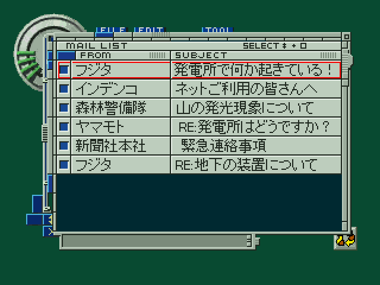

Some mails reach the office computer at fixed hours. They are not read from a data file: the code that runs every game hour holds the whole list. Before the ending, twelve mails can come on the clock, at eight times: day 1 at 10:00, 17:00 and 21:00; day 2 at 10:00 and 16:00; day 3 at 10:00 (up to three mails) and 14:00 (up to two); day 4 at 12:00 (up to two). Four of them only come if a story step is done (or not done). After the ending, no mail arrives by time. Sending these mails is all the clock does to the story: it never moves the invasion, which spreads only when you pass certain doors ([the invasion schedule](#-time-alone-never-spreads-the-invasion-buildings-fall-on-a-schedule-when-you-pass-a-door)).

The game has 32 mails, and each one has exactly one sender. Three are already there when a new game starts. The other seventeen come from story scenes: throwing the power plant's switch sends two, and a third from Fujita asking about the basement device if you never saw it with him (picture); a spot in the invaded cathedral sends one, and killing the last of four people there another; the deaths of the hotel's boss, the coal mine's boss and one person in `OMH` send three, two or three, and one; Kouda's reward sends one; and three follow-ups arrive when you leave the office a set number of days after a story step: 2 days after you saw the power plant's device with Fujita, 3 days after the warehouse boss died, and 1 day after a scene in `F1H`, while the warehouses are still invaded. Nothing sends mail every minute: the per-minute hook only runs the trains.

Technical details

- Proof: `mail_check_schedule` (0x8018BB00, src/game/mail.c), called every game hour, tests the day counter and the hour directly, only while game variable 0x30 (`0x801E03C8`, set after the ending) is 0. Day counter 0: mail 0x0E at 10:00, 0x08 at 17:00, 0x17 at 21:00. Counter 1: 0x0F at 10:00, 0x1C at 16:00. Counter 2 at 10:00: 0x02 if variable 0x0B is 100 and variable 1 is 0, then 0x11, then 0x14 if variable 0x13 is 100; at 14:00: 0x15 if variable 0x11 is 10, then 0x1A. Counter 3 at 12:00: 0x1D, then 0x1F if variable 0x4D is 0. Each goes through `mail_receive` (0x8018BA48).
- In game: with a breakpoint on `mail_receive` and the clock forced to two minutes before each hour on days 1 to 5, the game called it with 0x0E (day 1 10:00), 0x1C (day 2 16:00), 0x02 and 0x11 (day 3 10:00), 0x1A (day 3 14:00), 0x1D and 0x1F (day 4 12:00) and nothing on day 5; the received count at `0x801E0426` went from 3 to 10. The mail screen was not opened.
- The clock's code writes only the day, hour, minute and parity (game variables 61 to 64, in `event_clock_add_minute`), and `mail_check_schedule` writes only mail state (the received count and the mail bits from variable 96 up); the invasion states are written by scene scripts ([the invasion schedule](#-time-alone-never-spreads-the-invasion-buildings-fall-on-a-schedule-when-you-pass-a-door)).
- Proof, every mail: only two places write a mail's received mark. One is `mail_receive`, reached from `mail_check_schedule` and from `mail_cmd_receive` (0x8018BD60), which `action_update` (src/game/action.c) calls for script command 13; the other is the new game in `main` (src/game/main.c), which sets the count (variable 0x5F, `0x801E0426`) to 3 and writes mails 0x01, 0x00 and 0x0B straight into the mail words. A mail is a byte in word 0x60 + id / 2: 0x80 plus its arrival order, plus 0x40 once read (`mail_list_close`). `event_tick_hook` (0x801DFEDC), called once a game minute by `event_handle_tick`, is only ever set to `sprite_station_update` (the station trains, src/game/sprite.c) or `town_train_tick_hook` (the train's door timer, src/game/town.c), and cleared by src/game/building.c and src/game/main.c: it sends no mail. The 17 command-13 senders in `SCE.S` (scene, version as `SCE.S` entry, set):

| Mail | Where | When |
|---|---|---|
| 0x06, 0x13 | power plant `PSN` (2), entry 2, set 5 | the switch prompt (trigger 0x601514): variable 11 loses 20, variable 12 (`PSG`) goes to 10, then both mails and set 8 |
| 0x03 | `PSN` entry 2, set 8 | after the switch, only while variable 82 is 0: the basement device was not seen with Fujita (set 60 sets it to 1 and stores the day in variable 68) |
| 0x09 | cathedral `CDL` (4), entry 2, set 37 | the prompt of trigger 0xA0198C, while variable 14 is 0 to 10 |
| 0x0A | `CDL` entry 2, sets 180 to 183 | the death sets 306 to 309 of persons 6 to 9 each add a bit to variable 72; the one that finds the other three bits sends the mail, while variable 14 is 100 |
| 0x0D | `OMH` (8), entry 2, set 400 | death of person 0 (variable 21 to 10) |
| 0x10, 0x1B | hotel `HTL` (16), entry 2, set 324 | death of the boss, person 24 (variable 18 to 10) |
| 0x18 or 0x19 | `HTL` entry 2, set 330 or 331 | the same death, 0x18 if variable 76 is 2 to 100, else 0x19 |
| 0x16 | `HTL` entries 2 and 3, set 606 | Kouda's reward ([Kouda's reward](#-koudas-reward-needs-an-agent-tally-of-exactly-7-before-the-ending)) |
| 0x12, 0x1E | coal mine `CMN` (21), entry 2, set 318 | death of the boss, person 18 (variable 24 to 10, 23 to 100) |
| 0x0C | `CMN` entry 2, set 319 | the same death, if variable 21 (`OMH`) is 100; it then sets 21 to 90 |
| 0x04, 0x05, 0x07 | office `OFC` (0), entry 1, sets 40, 41, 42 and 43 | leaving the office (trigger 0xF0FF28, sets 15 and 16) once the day is 2 past variable 68 (the device scene), 3 past variable 70 (the warehouse boss's death) or 1 past variable 79 (`F1H` set 106) with the warehouses (variable 15) still at 100, each sent once |

- In game: from a new game in the office on day 1, the hour forced to 10, the power plant's invaded version loaded by a forced scene request, the switch prompt forced (trigger 0x601514, kind 0x60, CIRCLE set 5) and CIRCLE pressed, then the office reloaded by a forced `main_goto_ofc(1, 0, 1, 0)` and the computer's prompt forced: the mail words went from three mails (0x01, 0x00, 0x0B) to six, with 0x06, 0x13 and 0x03 in arrival order 3, 4 and 5; variable 11 went from 100 to 80, variable 12 from 100 to 10, variable 82 stayed 0; the mail list showed six rows, the last from Fujita about the underground device (picture). The other senders were not run.
- Question: [2](mysteries.md#time-and-days) and [3](mysteries.md#time-and-days). Found and checked 2026-11-16; the story mails found 2026-11-18, the power plant's checked the same day.
- Before us: the fandom wiki's Emails page lists Naomi on day 1 at 21:00, Sakaguchi on day 1 at 17:00, Indenco on days 1 to 3 at 10:00 and a mine mail on day 4 at 12:00, and "others after quest steps"; the fandom pages on Fujita and the Emails say he asks by mail to see the power plant's device if you went alone. Confirmed, the second in the emulator. New here: day 2 at 16:00, day 3 at 14:00, the conditions, the end of the schedule after the ending, and the sender of every story mail.

### 🆕 The burger shop secretly serves changed food, and even days swap its hours

🎮 Partly checked: the shop and both menus were seen on day 1 at 10:00 and 15:00, with the scene and the counter prompt forced; the even-day swap is read in the code.

 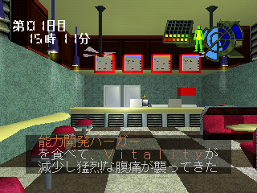

Every midnight the clock stores whether the day number is even, and only one piece of the game's code reads it: the burger shop in the shopping building. The scene scripts test it too, to pick which version of the room you walk into at the burger shop, the chain restaurant the code calls `FMR` and the Italian restaurant, and which person serves at some counters. Its menu always shows the same four burgers, four drinks and fries, but at some hours the kitchen serves the changed version of what you order: you ask for a hamburger and eat a changed burger, which takes energy from a human and hurts the torso (see [food](#-food-adds-a-fixed-amount-of-energy-and-eating-on-a-full-bar-hurts-your-torso)). The shop's door lets you in from 08:00 to 21:59 ([opening hours](#-only-three-shops-close-at-night-the-opening-hours-sit-in-the-towns-door-scripts)). On odd days the normal food comes from 08:00 to 13:59 and the changed food from 14:00 to closing time; on even days it is the other way round. The hour that counts is the one at which you entered the building. After the ending it always serves normal food, and while you are changed always the changed food, which then feeds you. The menu never tells; only the staff's goodbye line changes, to one that ends in a snigger (read in the code).

Technical details

- Proof: the only code that reads `0x801E03E8` (`action_vars.vars[0x40]`, the day parity) is `shop_open_menu` (0x801A1AB8, src/game/shop.c), case 4. With game variable 10 (`0x801E037C`) at neither 1000 nor 2000 and variable 0x30 at 0: parity 0 (odd displayed day) gives the list at `0x801D7A10` when the hour of entry (`0x801E0560`, saved by `shop_init`) is 8 to 13, else the list at `0x801D7A22`; parity 1 swaps them. Variable 10 at 1000 (after the ending) or variable 0x30 set gives the first list, variable 10 at 2000 (changed) the second. The town's door script tests the same hours: the burger doors' set 32 refuses entry outside 8 to 21, and sets 65 to 71 pick the shop's entry by hour (8 to 13 or 14 to 21) and parity. Other script tests of variable 64 (read in `SCE.S`): the town's `FMR` doors (sets 79 to 81, entries 2, 3 and 5) and `RTN` doors (sets 88 to 92, entries 0 to 4) pick an entry by hour and parity, the Italian restaurant's set 33 (scene 13) and the shopping building's sets 40 to 43 (scene 14) pick which person speaks. The first list is items 0x23 to 0x2A and 0x33 (four burgers, four drinks, fries), the second items 0x2B to 0x32 and 0x33 (their changed versions, same fries). Their values, read from the item table in the emulator's memory: 15, 30, 20, 10, 10, 5, 15, 20 and 10 for the normal list; -20, -40, -60, +40, -5, -10, -20, +10 and 10 for the changed one. The second list also sets `shop_state.alt_speaker`, and `shop_finish` (0x801A0EDC) then shows the other goodbye line. `shop_init` sets up shop types 3 to 6 in one scene with 10 doors each; type 7 is the gun shop. A scene request to scene 14 (`SH1`, the shopping building) with shop type 4 loads the burger counter.
- In game: from the office on day 1, the hour forced to 10 or to 15, scene `SH1` requested with shop type 4, the counter prompt forced (`event_state` = 0x300200, state 2, flag 8) and CIRCLE pressed: the menu list pointer (`shop_state.list`) was `0x801D7A10` at 10:00 and `0x801D7A22` at 15:00, and the screen showed the same names both times (first picture). With energy forced to 100 and the first item of each page ordered by pad: at 10:00 the game fed items 0x23, 0x27 and 0x33 (energy 135, no damage); at 15:00 items 0x2B, 0x2F and 0x33 (energy 85, torso damage 25, the stomach ache line, second picture). Not checked: an even day, a changed player, walking in from the town.
- Question: [5](mysteries.md#time-and-days), and the hours for [4](mysteries.md#time-and-days). Found 2026-11-16, the shop identified and checked the same day.
- Before us: nobody has reported anything that changes on alternate days, nor a shop that serves something else than its menu says.

### 🧩 Only three shops close at night: the opening hours sit in the town's door scripts

🎮 Partly checked: the burger shop's door was run at 23:00 and at 12:00, with the hour and the door prompt forced; the other hours are read in the town's script.

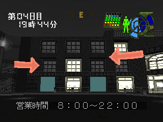 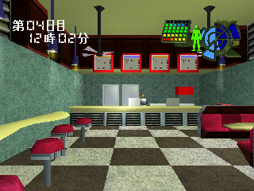

There is no table of opening hours: each shop door in the town runs a small script that reads the hour when you press CIRCLE. Only three places ever close: the burger shop (open 08:00 to 21:59), the Italian restaurant (11:00 to 21:59) and a shop the code calls `MPS` (05:00 to 23:59). Outside those hours the door shows the opening hours and does not open. The deli, the army shop, the chiropractor, the chain restaurant the code calls `FMR` and every big building have no hour test on their doors. Indenco lets you in by its main door from 08:00 to 21:59 and by another door the rest of the time. The hospital has two town doors: one always opens, the other lets a human in only from 07:00 to 19:59, the hours of the outpatient desk and of one exam room inside; a changed player gets in by both at any hour ([the hospital](#-the-hospital-heals-every-wound-at-once-for-free-and-without-losing-time)). Inside buildings the hour moves people instead (in the hotel, for example), and inside Indenco it puts you back at the door outside 08:00 to 21:59 (read in the scripts). In the first picture the HUD clock still reads 19:44: the hour was forced to 23:00 in memory and the HUD only redraws at the next minute, while the game clock read 23:01.

Technical details

- Proof: the town is scene 1 of `SCE.S`. Each shop door is a trigger whose enter set shows the door prompt; CIRCLE runs a set that tests game variable 62 (the hour, `0x801E03E4`). Burger shop (`SH1` entries 0 to 2, triggers 0xF80201 to 0xF80206): set 32 refuses outside 8 to 21. Italian restaurant (`RTN`, triggers 0xF80401 to 0xF80406): set 37 refuses outside 11 to 21. `MPS` (trigger 0xF80601): set 132 opens from 5 to 23, set 135 shows a line from 0 to 4. No hour test: the deli (`SH1` entry 3, set 35), the army shop (entry 4, set 64), the chiropractor (trigger 0xF80701, set 126: entry 5, or 6 for a changed player), `FMR` (13 doors, set 30; sets 72 to 82 only pick a room by hour and day parity), and the doors of the power plant, `PSG`, the police, `F1H`, the cathedral, `SB1`, `OMH`, Grand Station, the warehouses, `STH`, the hotel and the mine. Indenco (trigger 0x501C00): set 62 opens entry 0 from 8 to 21 when variable 16 is 0 to 100, else set 162 opens entry 4 for the same values, and only 1000 or 2000 reach the refusal, set 163. Hospital: trigger 0x501700 shows prompt 136, whose CIRCLE runs set 137 (entry 3 when variable 23 is 2000); otherwise its fallback, set 156, opens entry 0 when the hour is 7 to 19 and falls to the closed line of set 157. Trigger 0x50170A shows prompt 138, then set 139 (entry 4 at 2000) falls to set 158, which opens entry 1 with no hour test. Inside, the desk (scene 20 set 412) and the first exam room door (set 11 of the calm version) test 7 to 19.
- In game: from a town save on day 4 at 19:40, the hour forced to 23:00 (`0x801E03E4`, `0x801E03E6`), the burger door prompt forced (`event_state` = 0xF80201, state 2, flag 8, CIRCLE set 32) and CIRCLE pressed: the scene stayed the town and the hours line appeared (first picture). Hour forced to 12:00, the same prompt and CIRCLE: scene 14 (`SH1`) loaded with the counter (second picture). The other doors were not run.
- Question: [4](mysteries.md#time-and-days). Found 2026-11-16, the burger door checked the same day.
- Before us: the "24-hour chiropractor" (Japanese Wikipedia, GameFAQs buildings) and the hospital's short hours (GameFAQs buildings). Confirmed: the chiropractor's door tests no hour. Corrected in part: one hospital door and its desk keep short hours, the other door does not. New: every other door's hours.

## Survival

### 🧩 Energy drains faster the longer you stay awake

🎮 Checked in the game (memory).

The energy bar is your life, one number from 0 to 255. Every 10 game minutes it loses 1 point, more if you have been awake for long: 2 after 16 hours awake, 3 after 32, 4 after 48, 8 after 64, 16 after 80 and 32 after 96 hours. A hurt torso multiplies the loss by 1.5 (rounded down, so a loss of 1 stays 1), 2 or 4 depending on how bad it is. Every sixth drain also takes an extra amount set by the weapon in your hand (0 for the starting one). A nap of one hour takes 4 hours off the awake count; a full sleep resets it and lasts 7 hours, or until 08:00 when you go to bed from 21:00 to 02:59. Below a quarter of the bar, a warning sound starts, and stops when the bar rises again. Being changed cancels the awake-time part (see [being changed](#-being-changed-is-one-flag-a-pink-body-fast-healing-and-no-fatigue)).

Technical details

- Proof: `event_clock_tick` sets `player_status.drain_pending` when the minute modulo 10 equals `action_vars.drain_minute`; `event_update_hud` sees it and calls `event_drain_gauge` (0x80189AC0, src/game/event.c). That starts from 1 and replaces it by 2, 3, 4, 8, 16 or 32 according to `player_status.hours_awake >> 4` (`0x801E0746`) unless `player_status.mutant` is set, multiplies by 3/2 rounded down, 2 or 4 for level 1, 2 or 3 of `limb_state[3]` (the torso), adds `drain_extra` of the record `effect_weapon_find` returns for the weapon in the current slot every sixth call (the weapon's extra energy cost, see [the weapon record](#-the-weapon-record-three-requirements-accuracy-damage-and-three-ranges)) (counter `action_vars.drain_count`), clears `player_status.infected` and subtracts the total from `player_status.energy` (`0x801E0710`). `event_draw_gauge` clamps it at 0, draws the bar, calls `sound_se_play(4)` under a quarter and `sound_se_stop(4)` above it or at 0. `event_clock_add_minute` adds one to `hours_awake` each game hour unless its fourth argument is set, as it is for sleep. `player_rest` (src/game/player.c) skips 60 minutes and takes 4 off `hours_awake` for one kind of rest; for the other it clears it and skips 420 minutes, or the minutes left until 08:00 when the hour is above 20 or below 3.
- In game: with the clock period forced to 6 (10 game minutes in 60 vsyncs) and energy forced to 250, the drop per drain was 1, 2, 3, 4, 8, 16 and 32 for hours awake 0, 0x18, 0x28, 0x38, 0x48, 0x58 and 0x68, five drains each. With hours awake 0x38 (base 4) and torso damage forced to levels 1, 2 and 3, the drops were 6, 8 and 16. The sixth-drain extra was 0 with the starting equipment. Which rest is the nap and which the night's sleep is read from the durations only.
- Question: [6 and 10](mysteries.md#survival). Found 2026-11-16, checked the same day.
- Before us: players knew the bar drains, that sleep and food matter and that fatigue speeds up the loss (Japanese Wikipedia, GameFAQs); GLADIATOR's infinite energy code already wrote 200 to `0x801E0710`. New here: the drain step, the awake-time table, the torso multiplier and the weapon's share.

### 🔄 Body part damage heals by the hour, unless it is at the worst level

🎮 Checked in the game.

 

The five body part values are, in order: the head, the arm on the left of the screen, the arm on the right of the screen, the torso and the legs. Each holds damage. Below 16 the part is fine (green), from 16 it is yellow, from 166 red, and from 240 blue, the worst; the value never goes above 240. Every game hour, each part that is not blue heals 4 points. A blue part never heals by itself; it needs treatment. One oddity: the figure and the stored levels only change when something redraws them (a hit, an item, a cure), not when a part heals by the hour. While you are changed, when every part heals fast, a part keeps its old colour, and a part marked blue keeps the blue mark, until the next redraw.

Technical details

- Proof: the five damage values are `action_vars.limb_damage[0..4]`, `0x801E041C` to `0x801E0424`, the halfwords the "InfLimbHealth" cheat zeroes. `event_draw_limb_status` (0x80189DE8, src/game/event.c) turns each into a level in `player_status.limb_state[i]` (thresholds `0x10`, `0xA6`, `0xF0`, clamping at `0xF0`) and writes palette entry `0x40 + i` from `event_limb_colors` (0x801D7730): green (10,31,0), yellow (31,31,0), red (31,0,0), blue (0,0,31), and pink (31,10,31) for an undamaged part while `player_status.mutant` is set. The hourly branch of `event_clock_add_minute` subtracts 4 from each part whose stored level is not 3, or 16 from every part when `mutant` is set. It never calls `event_draw_limb_status`; `event_update_hud` does when `player_status.limb_redraw` is set.
- In game: damage forced to 0xB0, 0x20, 0xF0, 0, 0 with `limb_redraw` (`0x801E0756`) set: red head, yellow arm on the screen's left, blue arm on the screen's right, green torso and legs (first picture). With 0x20, 0xB0, 0xF0, 0x08, 0x60, torso green and legs yellow tell the last two apart (second picture). Over two game hours every part lost 4 per hour except the one at 0xF0: the values went from 32, 176, 240, 8, 96 to 24, 168, 240, 0, 88. The changed flag was then forced with a redraw, and over two more hours every part lost 16 per hour, the one at 0xF0 included, down to 0, 136, 208, 0, 56, while the stored levels stayed 1, 2, 3, 0, 1 and the figure kept its colours.
- Question: [8](mysteries.md#survival); what each level changes besides the torso's drain is in [hurt legs and arm](#-hurt-legs-slow-you-down-and-one-hurt-arm-spoils-your-aim). Found 2026-11-16, checked the same day.
- Before us: the five parts, green, red and blue, and the chiropractor (fandom wiki, manual); the cheat author's order was left arm, torso, legs, right arm, head. Corrected here: the order is head, arm, arm, torso, legs, and there is a yellow step between green and red. New: the thresholds, the hourly healing and the stale level.

### 🧩 Hurt legs slow you down, and one hurt arm spoils your aim

🎮 Partly checked: the leg slowdown was measured in the emulator; the aim and defence effects are read in the code.

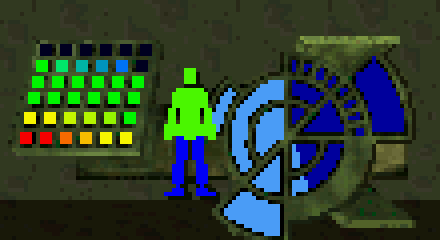

The colour of a body part is more than a warning, but only for three of the five parts. Legs at the red level make you walk, run and turn at 90 % of your normal speed, at the blue level at 70 %; they also weaken your guard in close combat, where one of the rolls that soften a blow is cut to two thirds (red) or half (blue). The arm on the left of the body figure lowers your chance to hit by 10 % (red) or 30 % (blue), whatever the weapon. A hurt torso makes you hungry faster ([energy](#-energy-drains-faster-the-longer-you-stay-awake)), and a hit on the head takes energy ([energy at 0](#-energy-at-0-is-death-and-only-a-hit-to-the-head-makes-you-wake-up-changed)). The head's own colour and the other arm's change nothing: no game rule reads them.

Technical details

- Proof: `event_draw_limb_status` (0x80189DE8, src/game/event.c) turns the five damage values into levels 0 to 3 in `player_status.limb_state[0..4]` (`0x801E074A`), in the order head, arm, arm, torso, legs ([body parts](#-body-part-damage-heals-by-the-hour-unless-it-is-at-the-worst-level)). Besides the resets and the hourly healing, four places read a level, all in src/game/player.c except the last: `player_handle_pad` (0x80199548) multiplies the forward speed (`Player.walk_speed`) and the side-step speed (`Player.strafe_speed`) by 9/10 when `limb_state[4]` (legs) is 2 and by 7/10 when it is 3; `player_shoot_target` (0x80198720) multiplies the hit chance the same way for `limb_state[1]` (the arm on the screen's left of the figure, see the [hit roll](#-every-shot-is-a-roll-against-the-hit-chance-and-range-cuts-both-chance-and-damage)); `player_take_hit` (0x801981D0), for attack types 0 and 1, scales its `rand() % stat1` defence term by 2/3 or 1/2 for `limb_state[4]`; `event_drain_gauge` (src/game/event.c) multiplies the drain for `limb_state[3]`. Nothing reads `limb_state[0]` or `limb_state[2]`.
- In game: from a quiet hospital room, leg damage (`0x801E0424`) forced to 0, 200 or 240 with a figure redraw, then TRIANGLE held for 30 refreshes: the player walked 1200, 1080 and 840 units, exactly 1, 0.9 and 0.7 times (picture: the figure with blue legs). The turn speed, the aim and the defence were not measured.
- Question: [8](mysteries.md#survival). Found and checked 2026-11-16.
- Before us: leg damage slows walking and running (fandom Player, manual). New here: the factors, the turn speed, the guard, the arm's aim penalty, and that the head and the other arm have no effect of their own.

### 🧩 The chiropractor sells time: 1, 3 or 6 hours that heal as much

🎮 Checked in the game (the counter prompt forced).

The chiropractor offers three courses, of 1, 3 and 6 hours. A course takes that much game time and removes 60, 180 or 360 points of damage from every body part at once, so the 6-hour course clears any wound, the worst level included. The hours pass on the clock as usual, so each of them also brings the normal hourly healing, and they count as rest, not as time awake (read in the code). With no wound a course only passes the time, and the line says your body feels lighter. Nothing is paid: the game has no money.

Technical details

- Proof: the chiropractor is shop type 9. `shop_open_menu` (0x801A1AB8, src/game/shop.c) case 9 opens a three-line menu from the list at `0x801DFD74` (items 300, 301, 302); `shop_finish` (0x801A0EDC) case 9 fades the screen and calls `effect_item_use` (0x801882AC, src/game/effect.c) with the chosen item. In the scene's item table (`ItemRecord`, at `object_scene_tables.items`) these three are of kind 3, with values 60, 180 and 360. For kind 3, `effect_item_use` calls `player_is_injured`; if a part is hurt it subtracts the value from each of `action_vars.limb_damage[0..4]` (floor 0) and redraws the figure, then calls `event_advance_clock(value, 1)`, which runs `event_clock_add_minute` once per minute with the flag that keeps `hours_awake` from growing. The line depends on the value and on whether a part was hurt.
- In game: at the chiropractor's desk on day 1 at 05:11, the part damage forced to 200, 32, 240, 96, 120 with a redraw, the counter prompt forced (`event_state` = 0x300700, state 2, flag 8), then CIRCLE, DOWN, CIRCLE by pad: the menu opened (picture), the 3-hour course ran, and the clock read 08:12 with the parts at 8, 0, 48, 0, 0. That is 180 off each part, then 4 an hour for the three hours: the course redraws the levels before moving the clock, so the part that was at the worst level heals by the hour too.
- Question: [11](mysteries.md#survival). Found and checked 2026-11-16.
- Before us: the chiropractor heals body parts and can pass time until the next event (fandom Player, manual, Japanese Wikipedia, GameFAQs). New here: the three fixed courses, the amounts, and that the time spent is the price.

### 🧩 The hospital heals every wound at once, for free and without losing time

🎮 Checked in the game (the exam room door and the bed prompts forced; the way from the reception to that door is read in the hospital's script).

At the hospital the doctor gives you an injection on the exam bed; you pass out and wake up at the same minute with every body part fully healed, the worst ones included. It costs nothing and no time, but it does not touch the energy bar. The building itself never closes: of its two doors in the town, one lets a human in only from 07:00 to 19:59, the other at any hour ([opening hours](#-only-three-shops-close-at-night-the-opening-hours-sit-in-the-towns-door-scripts)). The outpatient desk inside is open from 07:00 to 19:59. There is no story flag to earn: when you pass an exam room door, the game adds up the damage of your five body parts, and the doctor and the bed only treat you if that total is not zero. Come in unhurt and the bed does nothing. In the calm hospital one exam room keeps 07:00 to 19:59 and the other opens at any hour; in the invaded and freed hospital only one of the two is open. For a changed player the same bed is the cure (see [being changed](#-being-changed-is-one-flag-a-pink-body-fast-healing-and-no-fatigue)).

Technical details

- Proof: every "lie down and pass out" event ends in `building_on_effect_done` (0x8017D604, src/game/building.c). On effect 10, with the player flag 8 that the bed script sets through `player_move_to_done` (0x8019A07C), it calls `player_recover` (0x80199370, src/game/player.c) with the bed position from `building_wake_positions[building_wake_index]` and a fourth argument of 1; only in shop type 9 (the chiropractor) does it pass `player_recover(500, 0, 0x3390, 0)`. `player_recover` sets the five `player_status.limb_state` and the five `action_vars.limb_damage` to 0, redraws the gauge and the figure, puts the player on the bed, and calls `event_advance_clock(60, 1)` only when its fourth argument is 0. It never writes `player_status.energy`. The hospital's script (scene 20, `HPL`, in `SCE.S`): the desk's action set 412 tests game variable 62 (the hour, `0x801E03E4`) for 7 to 19, and so does the line of set 422. The two exam room doors are triggers of kind 0xA0. In the calm version (entry 1), door 0xA0230A runs set 11 only when the hour is 7 to 19, and door 0xA02346 runs set 23 at any hour; both first call set 500 (script command 11 form 1), then move you into the room (to the doctor and bed 427, or to bed 440). Set 500 writes game variable 144 (`0x801E0488`) as the sum of variables 90 to 94, the five `action_vars.limb_damage` values (script command 10 forms 6 and 8: copy, then add). In the invaded version (entry 2) set 11 needs variable 76 at 0 or 1 and the second door is shut; in the freed version (entry 3) the first door is shut and the second runs set 500. The doctor (set 424) and the beds (sets 427, 433 and 440; 427 on trigger 0xF0233C, which sets `building_wake_index` to 5 in `building_on_enter`) run only when variable 144 is not 0, and the beds set it back to 0; their changed-player versions test variable 6 at 1 instead. The town's two hospital doors: for a human, trigger 0x501700 ends in set 156, which tests the hour for 7 to 19, and trigger 0x50170A in set 158, which tests none; for a changed player, sets 137 and 139, run first from each door, open the hospital at any hour when variable 23 is 2000.
- In game: from a quiet hospital room at 10:10, the parts forced to 200, 32, 240, 96, 120, energy to 100 and variable 144 to 1, the bed prompt forced (`event_state` = 0xF0233C, action set 427, `building_wake_index` 5), one CIRCLE: the injection line, the fade, the "fully healed" line; parts and levels all 0, energy still 100, clock 10:10 to 10:11 (no hour added). With variable 144 at 0 the bed did nothing. At the reception, at 10:00 with the desk prompt forced, the nurse gave the hours line and variable 144 stayed 0 (a write breakpoint never fired). The door, on 2026-11-18: from a new game on day 1, the hour forced to 10 and the calm hospital loaded by a forced scene request, the head's damage forced to 0x40 with a figure redraw, the exam room door's prompt forced (trigger 0xA0230A, kind 0xA0, CIRCLE set 11) and CIRCLE pressed: variable 144 went from 0 to 0x40; the bed prompt then forced as above and CIRCLE: the injection line with the head yellow on the figure, then the healed line with a green figure, the damage and variable 144 back to 0. The same run with no wound: variable 144 stayed 0 and the bed showed nothing. The room behind the forced door move draws a plain olive background, a side effect of forcing the move.
- Question: [11](mysteries.md#survival), and the desk hours for [4](mysteries.md#time-and-days). Found 2026-11-16, the healing checked the same day; the wound test found and checked 2026-11-18.
- Before us: HP is healed at the hospital (Japanese Wikipedia, GameFAQs) and the hospital keeps short hours (GameFAQs buildings). Corrected in part: one town door, the desk and one exam room keep hours, the other door and the other exam room do not. New here: all parts at once, no time cost, no energy, the desk hours from the script, and that the doctor treats only a wounded visitor.

### 🧩 The status page shows your wounds and hours awake, never your energy

🎮 Checked in the game (the values forced, the page opened by pad).

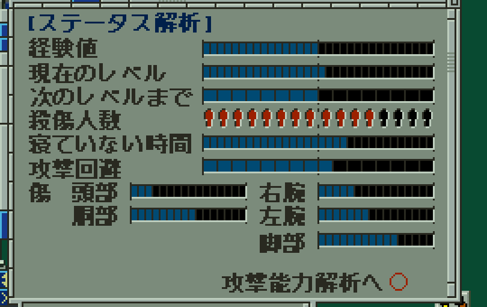

Players speak of three survival values, HP, fatigue and stamina. The game has all three, but as three different things, and its status page shows only two of them. "HP", what the hospital and the chiropractor heal, is the damage of the five body parts: the page's five wound bars. "Fatigue" is the count of hours awake: a bar of its own on the page. "Stamina" is the energy bar, your life ([energy](#-energy-drains-faster-the-longer-you-stay-awake)): it is on the field HUD and nowhere on the status page. The first page of the office computer's status screen shows, from the top: experience, current level, progress to the next level, civilians killed (up to 16 red figures, see [arrests](#-three-civilian-kills-get-you-arrested-and-five-more-the-second-time)), hours awake (full at 32), evasion skill, then the wounds of the head and torso in the left column and of the two arms and the legs in the right one. The page labels the arm that spoils your aim, the one on the left of the HUD figure, as the right arm: the figure faces you. CIRCLE turns to the second page, the five weapon class levels and the two carried weapons ([the blue wheel](#-the-blue-wheel-is-the-weapons-hit-rate-and-the-five-classes-are-levels-up-to-100)). Your four stats are not shown on either page.

Technical details

- Proof: `dialog_menu_status_page` (0x80180D8C, src/game/dialog.c), opened from the office computer's menu by `dialog_menu_confirm` (0x80181A64), lights palette entries of sprite 0x23A, one per cell: experience `player_status.exp / 6329`, at least 1 when the experience is not 0, at most 32 cells; level `level x 32 / 50 + 1`, at most 32; to the next level `exp x 16 / next_exp`, at least 1 when the experience is not 0, at most 16; `humans_killed`, at most 16; `hours_awake`, at most 32; evasion `defense_level x 16 / 100 + 1` (16); then `(damage + 15) / 16` cells (at most 15) for game variables 90 (head), 93 (torso), 91, 92 and 94 (legs), the five `action_vars.limb_damage` values, in the order the labels are drawn. The labels put variable 91 under "right arm" and 92 under "left arm". Neither page reads `player_status.energy` (`0x801E0710`) or `stat0` to `stat3`.
- In game: from a new game in the office, experience forced to 101,264 with 202,528 to the next level, level 25, 12 kills, 20 hours awake, evasion 50, the five damage values to 0x30, 0x50, 0x70, 0x90 and 0xB0, the class levels to 10, 30, 50, 70 and 90 and energy to 40; the computer opened and the status item chosen by pad: experience 16 of 32 cells, level 17 of 32, to the next level 8 of 16, 12 red figures, hours awake 20 of 32, evasion 9 of 16, head 3 cells, right arm 5, left arm 7, torso 9, legs 11, as the formulas give (picture). CIRCLE turned to the five class bars. The energy of 40 showed on neither page.
- Question: [6](mysteries.md#survival). Found and checked 2026-11-18.
- Before us: HP healed at the hospital or the chiropractor, fatigue by sleep, stamina by food (Japanese Wikipedia, GameFAQs). Confirmed as three values; new here: what each one is in memory, and that the status page never shows the energy.

### 🧩 Food adds a fixed amount of energy, and eating on a full bar hurts your torso

🎮 Checked in the game (energy and inventory forced).

Every dish and drink adds a fixed amount to the energy bar, from 5 to 80 points out of 255; when a dish fills the bar, a second line says your vitality is back to full. The limit is the full bar, not a number of meals: eat while the bar is full and you get sick, losing half the dish's value and taking its whole value as torso damage, and a hurt torso then makes you hungry faster ([energy](#-energy-drains-faster-the-longer-you-stay-awake)). Some menus serve "changed" food with a negative value: a human loses that much energy and takes it as torso damage, while a changed player is fed by it. In a restaurant you order up to three dishes; if you sit down with a full bar, or one dish fills it, the next ones make you sick. The most filling dish is the Italian restaurant's chef's choice, 80 points. Every restaurant is free: the game has no money. One oddity, read in the code: sickness never takes the torso past red, so overeating with a torso at the worst level brings it back to red.

Technical details

- Proof: food is item kind 0 in `effect_item_use` (0x801882AC, src/game/effect.c), with the amount in `ItemRecord.value`. A value of 0 or more without the full flag goes through `player_add_hp` (capped at 255), and the function returns 1 when energy is then 255, with the "back to full" line. A value of 0 or more with the full flag takes `value / 2` from energy and adds `value` to the torso with `player_heal_part(3, 2, -value)`, which caps the result at `player_part_damage_caps[2]` (166, the start of red); the gauge shows DAMAGED. A negative value gives `-value` energy to a changed player (`player_status.mutant`), and takes it from a human with the same torso damage. Items 0x27 to 0x2A and 0x2F to 0x32 get the "drank" wording. The item menu (`effect_item_use_selected`) passes `effect_item_full` (0x801DFEC6) as the full flag: set when the menu opens at 255 and after a dish that filled the bar. Restaurants call `effect_item_use` from `shop_finish` (0x801A0EDC) once per ordered dish with the order's flag `shop_state.deal_level` (the gun shop's level band, reused), set when you sit down at 255 or after a dish that filled the bar; each order also adds 1 to `action_vars` +0x92 (a meals counter). No money value is read or written there. Values, read from the item table in the emulator's memory (items 3 to 60 are food): family restaurant 10 to 50, Italian restaurant 5 to 80, burger shop 5 to 30, deli 5 to 40, changed dishes -5 to -100, and three changed dishes positive (30, 40, 10).
- In game: from a quiet hospital room (a human, 10:10), energy forced to 100 and the inventory to four dishes, each eaten from the item menu by pad: a dish of 40 took energy from 100 to 140; with energy forced to 240, a dish of 50 gave 255 and the "back to full" line; the menu reopened at 255, a dish of 40 gave 235 and torso damage 0 to 40 with DAMAGED (picture); the menu reopened at 235, a changed dish of -100 gave 135 and torso 40 to 140 with the stomach ache line. Not checked: a changed player eating changed food, an order that fills the bar half way, the meals counter.
- Question: [9](mysteries.md#survival). Found and checked 2026-11-16.
- Before us: no money, every restaurant is free, and eating too much makes you sick and hurts you (atwiki, GameFAQs, fandom Player). New here: the amounts, the rule that sickness comes from a full bar, its cost, and changed food.

### 🔄 Energy at 0 is death, and only a hit to the head makes you wake up changed

🎮 Checked in the game (energy and flag forced).

 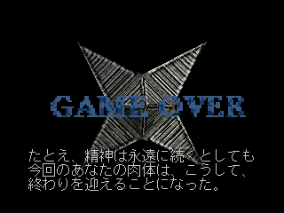 

When energy reaches 0 you fall to the ground. What comes next depends on one flag: if an enemy hit you on the head since the last 10-minute energy tick, you wake up changed in the coal mine with a full bar. Otherwise it is GAME OVER, a short closing narration, and back to the title screen. Starving to 0 always goes through an energy tick, which clears that flag first, so starving is always game over. Only hits to the head take energy at all; hits elsewhere damage the body part. After the ending, every death is game over.

Technical details

- Proof: `player_update` (0x801979B4, src/game/player.c) calls `player_start_death` when `player_status.energy` is 0 or less. After the fall, `player_finish_death` (0x80197688) checks game variable 0x30 (`0x801E03C8`, set after the ending by `object_room_init`) and `player_status.infected` (`0x801E075A`). With 0x30 clear and `infected` set, it refills energy to 255, clears `hours_awake`, sets `mutant` and loads the mine scene through `main_goto_building(1, "CMN", ...)`; otherwise it sets `0x801E0348`, which ends the game loop in `main`, and `main` starts again at the title. `infected` is set only by `player_take_hit` (0x801981D0) when the hit lands on part 0 (the head) and the attacking person's field +2 (`Npc.kind`, read as `npc->kind`) is non-zero (all 11 people of the mine scene had 1). It is cleared by every energy tick (`event_drain_gauge`), by `player_add_hp` with a negative amount and on every scene entry (`player_place_for_scene`). Only part 0 subtracts the hit from energy.
- In game: energy forced to 0 in the office: the dying flag 0x800 appeared on `player_character.flags`, the view dropped to the floor, then GAME OVER with the narration and the title screen, with the game state reset to day 1 05:00. Energy 0 with `infected` forced to 1: the same fall, then energy 255, `mutant` 1, level and stats 100, and the player awake in the coal mine among mutants with a pink figure.
- Question: [10](mysteries.md#survival). Found and checked 2026-11-16. Not played: a real death in a fight.
- Before us: "stamina at 0 kills outright" (Japanese Wikipedia) and "killed by an enemy, you wake up changed in the mine" (fandom Mutation, GameFAQs), which seemed to disagree. Both hold, and the rule between them is new: a recent head hit from an enemy. Corrected: "being hit lowers stamina" holds for the head only.

### 🧩 Being changed is one flag: a pink body, fast healing and no fatigue

🎮 Checked in the game (set by the game in one run, forced in others; the cure seen with the hospital bed event forced; a shut door seen at Indenco with its door script run by hand, the rest of what changes for the story read in the scene scripts).

  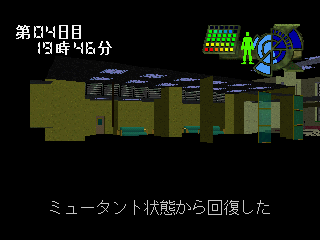

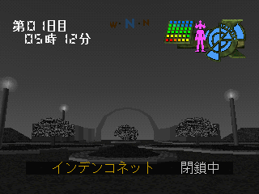

Being "changed" is one flag in memory, at `0x801E073C`. The game sets it when you wake up in the mine (see above) and clears it when the hospital cures you. While it is set, the undamaged parts of the body figure turn pink and a shape appears around the head; every body part heals 16 points an hour, even the worst ones; lack of sleep no longer speeds up the energy drain; and your level and ten stats are set to 100, while the game keeps your real ones. The cure is the same injection on the hospital's exam bed that heals a human ([the hospital](#-the-hospital-heals-every-wound-at-once-for-free-and-without-losing-time)): you pass out, the figure turns green, a line says you recovered from the mutant state, and your real level and stats come back, with the story flags the change had overwritten. Every wound is healed too, and neither the clock nor the energy bar moves.

Playing on while changed leads nowhere, as a player wrote in 2008. On the change, the game saves the state of every building ([invasion state](#-each-buildings-invasion-state-is-one-number-and-the-computers-dots-show-it)) and sets them all to the "changed" value, so every door loads a fifth, changed version of the building. Indenco, the two places the code calls `OMH` and `STH`, and the second level of the mine have no such version: their doors only show a line (Indenco's "closed" line, picture above). The changed versions send no mail, never lead to the ending and write almost no story value, and the cure puts every building's state back as it was. It does not undo everything: the few other story values the changed versions write (variables 65, 78 and 142) stay as they are. The restaurants, the burger shop, the chiropractor and the hospital still let you in, the hospital at any hour (read in the scripts). The gun shop has no special list: it picks by level, and yours is 100, so it shows its strongest six ([the gun shop](#-the-gun-shop-has-three-fixed-lists-of-six-and-seven-weapons-are-never-sold)).

Technical details

- Proof: `player_status.mutant` (`0x801E073C`) is written only by `player_finish_death` (sets 1), `player_recover` (0x80199370, clears it when its fourth argument is non-zero; its only caller is `building_on_effect_done`, which passes 1 for every bed but the chiropractor's) and `card_load` (restores it from the save). On setting it, `player_finish_death` also sets game variable 6 (`0x801E0374`) to 1, saves the level and ten stats (the four stats, the five class levels and `defense_level`) into `0x801E03CA` and sets them to 100, and saves game variables 9 to 27 (the building states) into variables 29 to 47 before setting them to 2000. `player_recover` with the flag set clears it and variable 6, copies the eleven values and variables 9 to 27 back, clears palette entry 0x45 (the head shape), shows the recovery line, then zeroes the five parts like any bed. Readers: `event_drain_gauge` (no awake-time step), `event_draw_limb_status` (pink), `event_clock_add_minute` (16 an hour), `card_save`, `main_goto_ofc`, `object_room_check_calls`.
- Proof, mutant play (read in the scene scripts of `SCE.S`): with the building variables at 2000, `main_goto_building` (0x8018C554) loads variant 4 of every scene. `OMH`, `STH`, `IDC` and `CM2` have no variant 4, and their town doors test a range that 2000 misses: Indenco's set 62 falls to 162, then to the closed line of set 163; `OMH`'s sets 40 and 141 and `STH`'s sets 58 and 60 fall to a line (166 for `STH`); `CM2` is reached only from a door of mine level 1's variant 2 (scene 21 set 7). Across all variant 4 sets, the only variable writes are 65 (scene 12 set 301, scene 13 set 316), 142, 78 (scene 19 set 89) and, in the mine, scene 21 set 318 (variable 24 to 10, 23 to 100), which the cure overwrites; `player_recover` restores only variables 9 to 27, so the writes to 65, 142 and 78 stay; no variant 4 set sends a mail (command 13) or leads to the ending. Doors that test 2000 and let you in: town sets 30 (`FMR`), 65 (`SH1` entry 1, the burger shop), 83 (`RTN`), 126 (the chiropractor, `SH1` entry 6) and 137 and 139 (the hospital).
- In game: in the death run above, the game set the flag itself, with the pink figure, energy 255 and level and stats 100. Forced on another state: the undamaged torso and legs turned pink and the head shape appeared (first picture); with hours awake at 0x68, the drain stayed 1 per 10 minutes instead of 32, and every part lost 16 an hour, the one at 240 included. The cure: from that changed player in the mine, the hour forced to 10 and the hospital requested in its changed-player version, the bed prompt forced (`event_state` = 0xF0233C, action set 427, `building_wake_index` 5) and one CIRCLE, with no other input. The game moved the player onto the bed, showed the injection line with the pink figure (second picture) and the pass-out line, then the recovery line with a green figure (third picture). The flag and variable 6 went from 1 to 0, the level and ten stats from 100 back to 1 (the new-game values saved at death), variables 9 to 27 from 2000 back to their old values; energy stayed 255 and the clock went from 10:12 to 10:13. Walking from the mine to the hospital was not played. Mutant play: from the changed mine save, the town loaded by a forced scene request, the hour forced to 12 and Indenco's door set 62 run by hand (`object_room_play_call(62)`, 0x80194F08, which runs one action set): the closed line appeared and the scene stayed the town (fourth picture); with variable 16 forced to 0, the same call loaded Indenco's variant 0. The other doors were not entered.
- Question: [7](mysteries.md#survival), and [19](mysteries.md#people-police-and-mutation). Found 2026-11-16, checked the same day, the cure included; mutant play the same day.
- Before us: the changed state, enemies turning friendly and the hospital cure (Japanese Wikipedia, fandom Mutation, GameFAQs, nico sm1144846). New here: its address, the fast healing, the end of fatigue and the stats at 100, which explain why a changed player is so strong, and that the cure is the exam bed's injection, gives your real stats back and costs no time. Confirmed: "as a mutant the story does not advance; the gun shop sells better weapons" (nico sm986645); new: which doors shut, that the cure undoes the buildings, and that the shop has no second list.

## People

### ✅ The profile panel is the lingering thoughts of the dead

🎮 Checked in the game (the person's death flag forced, then pad only).

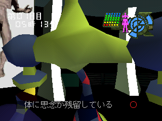 

A dead person does not block your way: you can walk into the body. When you do, a line says that thoughts remain in the body, with a circle button icon; pressing CIRCLE opens a card with the person's name, job, age, sex, height and blood type, and a few lines of what they were thinking. The translation project had found the code that draws this four-line panel but never saw it in play; it is this card. Mutants have cards too: the mine's twenty people include heights of 250 to 320 cm.

Technical details

- Proof: the walk collision (src/game/player.c) treats an object whose trigger is 0xFC0000 plus a person's id as that person; when the person's `Npc.state` is 6 (dead) the player keeps moving through it and the prompt kind becomes 0xFC, else the player stops. Entering it runs `action_run_npc_event` (0x801752F4, src/game/action.c), which for a dead person runs the scene's action set 0x400 instead of the person's own, and the prompt gets its flag 8. `dialog_draw_line` (0x80182D34) has one caller, `dialog_show_profile` (0x80183618, src/game/dialog.c), which has one caller, `building_on_action` (case 0xFC, the person trigger), reached on the action button when the current prompt (state 2 of `event_state`) has its flag 8. `dialog_show_profile` finds the person in `object_scene_tables.npc_bodies` (0xCC bytes each: id, height, sex, age, blood type, three 32-byte lines), formats "age, sex, height cm, blood type", draws four lines on sprite 0x40D and sets `0x801E05B6` the first time.
- In game: from a saved state of a changed player in the mine, person 0x0F was marked dead (its `Npc.state`, `0x80060D8B`, set to 6); after that, pad input only. Walking into the body set the prompt (`event_state` 0xFC000F, kind 0xFC, state 2, flag 8) and showed the line with the circle icon (first picture); CIRCLE opened the card with "53, male, 260 cm, AB" and its lines, and `0x801E05B6` read 1 afterwards. Since only the flag was forced, the body kept its standing pose and the card was drawn over it. The second picture is from an earlier run that forced the call itself (`dialog_show_profile` with a0 = 0x0F at the start of `event_update_hud`) and drew the same card. A real death in a fight was not played.
- Question: [27](mysteries.md#hidden-and-cut-content). Found 2026-11-16, the way to it played the same day.
- Before us: the manual and Japanese Wikipedia describe the "lingering thoughts" profile; the translation project's disc survey asked what opens the panel. Confirmed: it is that screen, not unused code. New here: you walk into the body to reach it.

### 🧩 Three civilian kills get you arrested, and five more the second time

🎮 Checked in the game (the counters forced, the arrest triggered by pad).

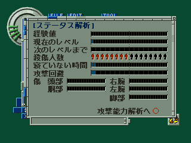 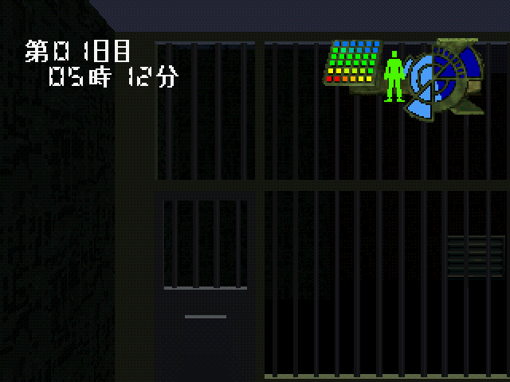

The game counts the civilians you kill, and only them: mutants and other enemies never count. With 3 kills, you are arrested the next time the game loads your office: when you come back to it, close the office computer, write the diary, or load a save made there. After that, 5 more kills give the second arrest, and this one turns the police station against you: you wake up in its cell, but the station is now its invaded version, with no guard outside the bars (picture; after the first arrest a policeman stands there), three changed officers, a boss with 1000 HP and one human left. Kill the boss and talk to that man, and the station is empty from then on (read in the scripts; the empty version was loaded in the emulator). A second arrest made after you cleared it invades it again (read in the code). While you are changed, or after the ending, nobody arrests you; kills made while changed still count, so the arrest can wait for the cure (read in the code). The office computer's status page shows your total as up to 16 red figures. After an arrest, leaving the office refills your energy bar. The office phone has one message once you have killed someone and another after the first arrest.

Technical details

- Proof: three counters in `player_status`: `humans_killed` (`0x801E0742`, the total, never reset), `kills_since_arrest` (`0x801E073E`, kills since the last arrest) and `arrests` (`0x801E0740`, 0 to 2). `actor_apply_damage` (0x80175FA8, src/game/actor.c) adds 1 to both kill counters when a hit takes a person's HP (`Npc.hp`) to 0 or below and the person's type (`Npc.kind`) is 0; other types multiply the experience the kill gives (by 2 for types 1 and 2, 3 for 3 to 5, 4 for 16 to 18, 6 for 19) and are not counted. `main_goto_ofc` (0x8018C414, src/game/main.c), the request that loads the office, returns early when game variable 0x30 (after the ending) or `player_status.mutant` is set; otherwise, with no arrest yet and at least 3 kills, it sets the arrests to 1; with one arrest, at least 5 kills and game variable 0x11 (`0x801E038A`) not 100, it sets that variable to 100 and the arrests to 2. Both reset the kill counter and load the office as its variant 1 (`main_scene_request.variant` = 1). Its callers: `action_cmd_change_scene` (case 0, one of its two forms skips the check), `dialog_menu_handle_input` (closing the computer), `object_room_run` (after the diary), the save loader and the title screen. `object_room_init` sets `object_room_heal_on_quit` in variant 1, and `object_room_quit` then calls `player_add_hp(0xFF, 0)`. `object_room_check_calls` queues phone message 0x72 when the total is above 0 with no arrest, and 0x73 after the first arrest. `dialog_menu_status_page` (0x80180D8C) draws the total.
- In game: a forced `actor_apply_damage` on a person of the mine whose type was set to 0 killed it and took both counters from 0 to 1; the same on a person of type 1 left them unchanged. In the office, the kills since the last arrest forced to 2 and the office reloaded by a forced call: no arrest; at 3: arrest. By pad only: counters forced to 3 (and the total to 8), the computer opened and closed with CIRCLE and CROSS: the office reloaded with the arrests at 1, the counter at 0 and phone message 0x73 queued (with no arrest yet, 0x72). From that state, the counter at 5 and the computer opened and closed: the arrests at 2 and variable 0x11 from 0 to 100. The status page showed the 8 red figures (picture). The office looked the same after an arrest for the 25 seconds watched, and the phone messages were not heard: the emulator ran muted.
- Proof, the police station: game variable 0x11 (17) is its state. The office's arrest version (entry 2) runs set 0, which moves you to the police station (scene 15, `PLC`) passing variable 17, as the town's police doors (scene 1, sets 15 and 16) do; `main_goto_building` (0x8018C554) loads entry 1 (calm) for 0, entry 2 (invaded) for 100 or 90, entry 3 for 10. Entry 1 has six humans (people 0, 2, 3, 4, 7 and 10, `Npc.kind` 0), person 4 guarding the cell. Entry 2 has people 2, 5 and 6 of kind 1 (changed), person 8 of kind 18 with 1000 HP (the boss, whose talk zone, trigger 0xF0461E, set 84, starts its music) and person 9, a human. The boss's death set 308 sets variable 17 to 90; cell door 7 (set 39) opens while it is 10 to 90, door 6 (set 37) only at 10; person 9 talks (set 109) and then sets it to 10 (set 1000). Entry 3 is empty in `SCE.S`. `main_goto_ofc` tests only "not 100", so a second arrest after the station was cleared puts it back to 100 (read in the code).
- In game, the police station: from the office save, the arrests forced to 1 and the kill counter to 5, the office loaded by a forced `main_goto_ofc(1, 0, 1, 0)` and its arrest script started by a forced `object_room_play_call(0)` (0x80194F08): variable 17 went to 100 and the arrests to 2, and you came to in the police cell with people 2, 5, 6, 8 and 9 loaded, nobody outside the bars (picture). The same with no arrest and 3 kills: the arrests at 1, variable 17 still 0, a policeman in front of the cell, people 0, 2, 3, 4, 7 and 10. Variable 17 forced to 10 and the station loaded by a forced scene request: the lobby with no people and no triggers. The boss fight and person 9's talk are read in the script only.
- Question: [16](mysteries.md#people-police-and-mutation). Found and checked 2026-11-16; the police station checked 2026-11-18.
- Before us: too many kills gets you arrested, and two arrests turn the police station into an enemy building (manual, GameFAQs, Japanese Wikipedia). Confirmed in the emulator. New here: the counts, which kills count, when the arrest happens, the energy refill, who is in the invaded station and how it ends empty.

### 🧩 The dead come back when you return, unless their death script records the kill

🎮 Checked in the game (a death forced from a saved state, then the place reloaded by a forced scene request).

A person you kill stays dead only while you stay in the place. Every time a place loads, its people are read again from the disc at full health, so when you leave and come back they stand where they stood. There is no "respawn" rule and no list of the dead: the only memory of a death is a story value that the person's death script writes and that the place's scripts test when it loads, to hide that person or change the scene. Of the 412 person records of all places (the same character often has one in several versions of a place), only 55 have a death script that writes a story value, and that value does not always hide the person: some only change what others say, or count kills. 225 records have no death script at all. Everyone else comes back, which is what players saw in the hospital, where one worker always returns.

Technical details

- Proof: the people of a scene are the `ACTR` records (`Npc`, 0x4C bytes) of the loaded variant, read from `SCE.S` at every scene load by `object_load_other` (0x801907C8, src/game/object.c) and freed by `actor_free_all` (0x801762A0) when the scene ends. A dying person has `Npc.mode` 2; `actor_update_all` (0x801759B0, src/game/actor.c) then sets `Npc.state` to 6, runs the person's death set (`Npc.death_set`, through `action_find_set`) and plays sound 0x14. Nothing outside the scene's tables keeps that state. A survey of the `ACTR` chunks and their death sets in `SCE.S`: 412 person records, 55 death sets that write a game variable (script command 10), 225 records with no death set. Examples: in the cathedral's variant 1, persons 6 to 9 clear bits of variable 72 when they die, and sets 66 to 70 hide them by those bits; the warehouses (scene 9) count kills in variable 67; in scene 12's variant 1, death set 301 adds 1 to variable 65, which the scene's sets 33 and 34 test to change a line, not to hide anyone. The 55 count death sets with a write, not people who stay dead.
- In game: from the changed mine save where person 0x0F had been forced dead (`Npc.state` = 6), the mine requested again (scene 21, `CMN`, entry 7) by a forced scene request: after the reload the same person stood at the same place with state 0 and 400 hit points. Its death set (315) only switches a trigger and writes no variable.
- Question: [17](mysteries.md#people-police-and-mutation). Found and checked 2026-11-16.
- Before us: most changed people in the hospital come back when you re-enter, and one worker always does (Japanese Wikipedia, nico sm1144846). Confirmed, and new: why, and that it is the rule everywhere, not a hospital oddity.

### 🧩 Faceless people were built without a face, not left blank

🎮 Checked in the game (only the scene loads forced).

 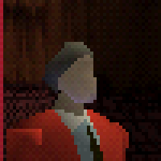

Most people in the game have no face, and on the disc that is how their heads are made. A faceless head is a plain shape painted in flat colour, with no place for a picture on it at all; there is no blank face picture waiting to be filled and no code that swaps faces. Only 14 of the 201 people models have a head built for a face picture, and every figure the story places by script (Naomi and the other five stage figures) has one. The same body exists in both forms, one with a face and one without, so the faceless heads on the disc were modelled for flat colour, not faces that went missing from these models. Whether faces were planned for everyone at an earlier stage of the work cannot be told from the disc.

Technical details

- Proof: people models are `MOD` records built by `mod_create` (0x8018D5F8, src/game/mod.c): people from the room files (type 5 records, ids below 0x440), stage figures from `SCE.S` `MOD` chunks (ids 0x440 to 0x445, 1088 to 1093). No code in src/game/mod.c, src/game/actor.c or src/game/npc.c picks or changes a texture: what a polygon shows comes from its TMD packet, textured or flat. A survey of the 201 person models in the M and A room files, taking the head as the highest part: 14 have a fully textured head, 175 have no textured polygon at all, 12 have texture on another part only. A faceless head is a flat-shaded mesh with no texture coordinates; in `TOU`, models 0 and 2 have the same 45 vertices, one with 82 flat polygons, the other with 38 flat and 44 textured. Every stage figure (1088 to 1093, in scenes 0, 2, 3, 5, 7, 10, 16, 20, 21 and 23) has a textured head. The face pictures sit in one texture page loaded per scene from `SCE.S`.
- In game: the chiropractor's receptionist, loaded from a save state, shows eyes, nose and hair; a man in a red suit at Grand Station, loaded by a forced scene request from the town, shows a plain grey head (pictures, enlarged).
- Question: [25](mysteries.md#people-police-and-mutation). Found and checked 2026-11-18.
- Before us: most people have no face texture, a few key ones have photo faces (atwiki, HG101); a player guessed in 2011 that every face was planned at first (nico sm15696464). The first confirmed; the guess not borne out by the disc, whose faceless heads were modelled for flat colour; whether it held at an earlier stage cannot be settled here.

## Combat

### 🔄 The blue wheel is the weapon's hit rate, and the five classes are levels up to 100

🎮 Checked in the game (values forced, the rate recomputed by a forced call).

 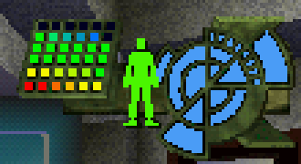 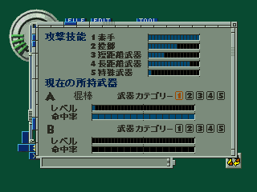

Each of the five weapon classes (bare hands, throwing, short range, long range and special weapons) has a level from 1 to 100 and an experience count toward the next level; a sixth pair of the same kind is your skill at evading attacks. A hit adds twice the damage that got through to the class of the weapon used, and being hit adds to evasion. Going from level 1 to 2 takes 324 points, from 2 to 3 takes 405, and each later level 162 more than the one before, so reaching level 100 from level 1 takes 810,000 points. The blue ring on the HUD is not this experience: it shows the current weapon's hit rate, from 20 to 100 %, in 16 cells. That rate is the weapon's accuracy, lowered when your level, one of your four stats or the class level is below what the weapon asks for; above those requirements (5 to 50 for the class) more levels add nothing. The class levels are the bars on the second status page of the office computer. The known cheat value `0x3B2A005D` is level 93 with 15,146 points, one point short of level 94, not the maximum, which is `0x00000064`. The classes: hand to hand holds the baton, knife, stun gun, morning star and katana; throwing only the boomerang; short range the self-defence pistol, crossbow, Beretta and MP5K; long range the Ithaca M37, M47 Dragon and M16A1; special the five special weapons.

Technical details

- Proof: the six pairs are `player_status.weapon0_level`/`weapon0_exp` to `weapon4_level`/`weapon4_exp` and `defense_level`/`defense_exp` (`0x801E0724` to `0x801E073B`, a 16-bit level then 16-bit experience each). `player_add_skill_exp` (0x80197BB0, src/game/player.c) adds to one pair, does nothing at level 100, and levels up when the experience reaches 324 (0x144) at level 1, else 405 + 162 x (level - 2), keeping the rest; a level-up of classes 0 to 4 recomputes both carried weapons' rates. Writers: `actor_apply_damage` (0x80175FA8) adds twice the damage left after the target's defence to the weapon's class; `player_take_hit` (0x801981D0) adds 10 times its defence roll to pair 5; `player_finish_death` and `card_load`. `effect_weapon_calc_rate` (0x80187978, src/game/effect.c) stores into `Inventory.weapon_rate` (`0x801E0778`): accuracy (weapon record +0x50) x (2 x L + S + K) / 4, clamped to 20..100, where L is the player level over the required level (+0x30), S the stat chosen by +0x38 over the required stat (+0x3C), K the class level over the required class level (+0x48), each capped at 1 (see [the weapon record](#-the-weapon-record-three-requirements-accuracy-damage-and-three-ranges)). `event_update_hud` and `event_draw_hud` (src/game/event.c) light `weapon_rate x 16 / 100` ring cells (palette 0x400, entries 0x50 to 0x5F). `dialog_menu_status_page` (0x80180D8C) draws the five class bars as `level x 16 / 100 + 1` cells. The class of each weapon is its record's +0x02, read in the emulator's memory.
- In game: in the office at the start of a game, `0x3B2A005D` written to `0x801E0724`: level 93, experience 15,146, the rate still 59 (it is only recomputed on a level-up or a weapon change); a forced `player_add_skill_exp(0, 1)`: level 94, experience 0, rate 79, as the formula gives. Class level 3 and a forced `effect_weapon_calc_rate(0)`: rate 69 (formula 69). Stat 1 and class 0 at 100: rate 100, the whole ring lit (second picture); stat 1 at 1 and the Hieronymus Machine in hand: rate 20, the floor, three cells lit (first picture). Class levels 100, 50, 25, 75 and 1 written, then the status page opened by pad: bars full, half, a quarter, three quarters and one cell (third picture).
- Question: [13](mysteries.md#combat). Found and checked 2026-11-16.
- Before us: "each weapon class has experience shown on a blue wheel; two weapons of one type share it" (fandom Weapons) and "one point below the maximum" (the cheat file). Corrected here: the wheel is the hit rate, a class holds one to five weapons, and the cheat value is level 93 of 100.

### 🧩 Every shot is a roll against the hit chance, and range cuts both chance and damage

🎮 Checked in the game (aim and fire forced, walking and side-stepping by pad; Naomi's absence from the people tables and her model's animations seen in memory; the running state and the height limit are read in the code).

When your attack animation reaches its firing frame, the game picks the nearest person in your aim who has noticed you and rolls a number from 0 to 99; the shot hits when the number is below the hit chance. Each weapon has three distances. Closer than the first, the chance is only 20 %, but a hit does full damage. Between the first and the second, the chance is the weapon's hit rate (the [blue wheel](#-the-blue-wheel-is-the-weapons-hit-rate-and-the-five-classes-are-levels-up-to-100)) and the damage is full. From the second to the third, chance and damage both fall off in a straight line. Beyond the third the shot only alerts the target, and so does a shot so close to the third distance that the chance rounds down to 0 (an MP5K at 29,999 of its 30,000 units). Otherwise, within range, the chance never drops below 20 %, but two penalties come after that floor: 10 % less while you walk (forward, back, or forward while side-stepping) or side-step, none while you stand or run, and 10 % or 30 % less when the arm on the left of the body figure is red or blue. Hand-to-hand weapons also need the target at about your height. A hit then loses a random part of the target's defence, two thirds of it unless the target resists that class. Three special weapons have favourite targets: the electromagnetic wave gun does double damage to one kind of mutant, and the Crystal and the Hieronymus Machine half damage to humans and to that same kind.

Naomi can never be aimed at, and no flag is needed for that: to the game she is not a person at all. The aim only ever picks from the place's table of people; Naomi is one of six stage models that the scene scripts place, show, animate and hide like scenery. Her profile card is in the data, but a card opens only from a person, so hers can never show. Her model has no hit animation either: it holds three animations, a still pose and two gestures used while she talks, and the scripts play all three.

Technical details

- Proof: `player_shoot_target` (0x80198720, src/game/player.c) runs every frame and acts once when player flag 0x400 (`player_character.flags`, `0x801E0662`) is set, which `effect_weapon_check_fire_frame` does on the weapon's fire frame (record +0x4C). The target is `player_status.target_npc`, picked by `player_pick_target` (0x801985AC): the nearest person in the aim cone (`ai_in_aim_cone`) that is not dead (`Npc.mode` 2), lacks flag 0x200 of `Npc.flags` and has its flag 2. Distance: `dist = max(0, Npc.target_dist - (actor_get_radius(target) + 600))`. With a, b, c the record's +0x54, +0x58, +0x5C times 10: below a, chance 20 and full damage; a to b, factor 1 and the chance is `Inventory.weapon_rate`; b to c, factor (c - dist) / (c - b) on both; c and beyond, or a chance that rounds down to 0 in the falloff band, `actor_apply_damage(target, class, 0, 0)` and no roll (the MP5K at dist 29999: factor (1 << 12) / 20000 = 0, so chance 0). Class 0 weapons return without effect unless the target's height is inside a window of 3200 units around the player's. A chance from 1 to 19 becomes 20, a chance of 0 returns before the roll; then `Player.move_state` 1 or 3 multiplies it by 9/10, `limb_state[1]` at 2 or 3 by 9/10 or 7/10. Roll: `rand() % 100 < chance`. Damage: record +0x52 times the factor; weapon 14 doubles it against `Npc.kind` type 4, weapons 16 and 17 halve it against types 0 and 4. `actor_apply_damage` (0x80175FA8) subtracts `rand() % defence`, cut to 2/3 unless the target's resist bit for that class is set.
- Proof, the movement states: `player_update` clears `Player.move_state` each frame and `player_check_ground` (0x80195098, static in src/game/player.c) sets it: 0 standing or stopped by a person, a closed trigger or a doorway; 1 walking (TRIANGLE or CROSS, with or without a side step); 2 running (player flag 0x1000, TRIANGLE with L2 held, in the town only); 3 a side step (L1 or R1) with no forward move; 4 stopped by the edge of the floor (a bump sound); 5 sliding along a wall. Only 1 and 3 cost 10 %.
- Proof, Naomi: `player_pick_target` scans only `object_scene_tables.npcs`, the `ACTR` people of the variant (`Npc`). A person's `Npc.body_id` picks its profile in the `CHAR` table (`NpcBody`, 0xCC bytes). Naomi's profile is body 2 (height 167, age 31), present in the shared data of scenes 5, 6, 7, 16, 20, 21 and 23 (`F1H`, `SB1`, `GST`, `HTL`, `HPL`, `CMN`, `CM2`); none of the people records of the 67 `ACTR` chunks of `SCE.S` uses body 2 (ordinary people use bodies 100 and up). Where she appears, the scripts use command 7 (`npc_rec_cmd`, 0x8018EED4), which drives the six stage records (`NpcRecord`: id, on or off, model, position, rotation; no energy and no flags): on mine level 2, set 52 (when variable 2 is 1) places record 2, shows it and plays its animation; in the hotel, set 501 places and shows the same record. `dialog_show_profile` (0x80183618) starts with `actor_find` and returns when no person has the id.
- In game: in the mine as a changed player (every stat 100), the MP5K written into the hand (ranges 3000, 10000, 30000) and the rate recomputed (90), the player's heading turned each frame toward one mutant and the fire flag set, with breakpoints in `player_shoot_target` and `actor_apply_damage`: at distance 4625, chance 90, roll 56, a hit for 200; with the left arm forced to blue, chance 63, roll 80, a miss; with the baton (reach 2000) at distance 4442, no roll and a hit for 0. With the second range of the MP5K's record changed in memory to 2000, the same shot fell in the falloff band: chance 81, damage 181, as computed; with the first range changed to 6000, the target was too close: chance 20, two misses on rolls of 80 and 71. The movement states, on 2026-11-18, from the mine save with the MP5K forced into the hand and the rate recomputed (90), the aim held on one person and fire forced: standing still, state 0, chance 90, roll 56, a hit; TRIANGLE held by pad, state 1, chance 81, roll 80, a hit; L1 held, state 3, chance 81, roll 23, a hit. Running (state 2) exists only in the town, where nobody can be shot, and was not tried. Naomi: the people table dumped after loading `CM2`, `HPL`, `HTL`, `GST`, `F1H` and `CMN` by forced scene requests held no body 2; on mine level 2 with variable 2 forced to 1 and set 52 run by hand, stage record 2 (model 1090) was switched on while the people table still held only bodies 100 to 104 and the target slot (`0x801E075C`) stayed 0.
- Proof, Naomi's animations: a person's hit is animation 7: `actor_update_anim` (0x8017546C, src/game/actor.c) state 4 calls `mod_set_anim(model, 7, 5)`, the first 5 frames of the fall that a death plays in full (`actor_update_all`, `mod_set_anim_by_id(model, 7, 0)`). Every script command 7 on stage record 2 in `GST`, `HTL`, `HPL`, `CMN` and `CM2` (form 4, `npc_rec_cmd` to `mod_set_anim_by_id`) plays animation 0, 1 or 2, and none changes the record's model. In game, on 2026-11-18: stage record 2 shown by a forced `npc_rec_show(2, 1)` (0x8018F428) in `CM2`, `HTL`, `HPL` and `GST`, then the loaded models listed from `mod_list` (0x801DFF0C): model 1090 has `Model.anim_count` 3 (1, 48 and 36 frames), the people models 10. In `CM2`, with her moved into view and animations 1 and 2 played by forced calls, she moved her arms out, then her hands toward her head.
- Question: [12](mysteries.md#combat), and [24](mysteries.md#hidden-and-cut-content) (Naomi). Found and checked 2026-11-16, Naomi the same day; the movement states and her animations checked 2026-11-18. Cannot be settled here: what the fandom author saw in PSXPrev, a viewer that can pair her mesh with animations found anywhere on the disc; no other copy of her mesh was searched for.
- Before us: no hitbox, a marker over a target in range, a roll against the weapon's accuracy that grows with use (Japanese Wikipedia, atwiki, GameFAQs). New here: the three ranges, the 20 % floor, the arm and movement penalties, the special weapons' targets, and that use raises the class level, which raises the rate only up to the weapon's requirement. Naomi "cannot be targeted, yet has a profile and a hit animation" (fandom Naomi Scully): confirmed, and new: why, and that her profile can never open. The hit animation is busted for the model the game loads: it has none.

### 🧩 The gun shop has three fixed lists of six, and seven weapons are never sold

🎮 Checked in the game (the level forced, the shop's pick called by hand; the shop screen opened on a forced counter prompt, the weapons picked by pad).

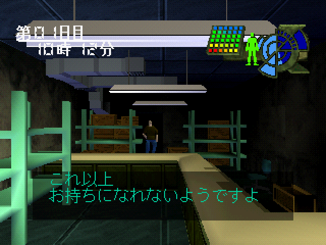

The gun shop shows six weapons chosen by your level: under 20, 20 to 39, or 40 and up, and each band always shows the same six. The shop sorts the eleven weapons it can sell by the level each asks for and takes six in a row from the bottom, the middle or the top. Under level 20: the crossbow, the boomerang, the self-defence pistol, the knife, the stun gun and the Beretta. From 20 to 39: the knife, the stun gun, the Beretta, the Ithaca M37, the M16A1 and the morning star. From 40 on: the Beretta, the Ithaca, the M16A1, the morning star, the MP5K and the katana. There is no fourth band and no list for a changed player: a changed player's level is 100, so the shop shows the 40 list, the "better weapons" players saw. Seven weapons are on no list at all: the baton, the M47 Dragon, which only Kouda gives ([Kouda's reward](#-koudas-reward-needs-an-agent-tally-of-exactly-7-before-the-ending)), and the five special weapons. Nothing can be sold back: the game has no money at all, the shop opens straight onto its list of six, the clerk says there are no returns, and with a weapon in both hands it refuses to give a third (picture). The only place to put a weapon down is the storage in your office, which keeps any number but will not take your last one.

Technical details

- Proof: `shop_pick_weapons` (0x801A0820, src/game/shop.c) stores `player_status.level` (`0x801E0712`) / 20, at most 2, at +0xE of the shop state, builds a table of weapons 1 to 12 without 10 with their required level (`WeaponRecord.req_level`, +0x30, see [the weapon record](#-the-weapon-record-three-requirements-accuracy-damage-and-three-ranges)), sorts it with `qsort` and `shop_cmp_weapon_level`, and copies sorted places 0 to 5, 3 to 8 or 5 to 10 into `shop_weapons` (0x801D7A68). It reads no changed flag. Required levels, read in memory: crossbow 5, boomerang 5, self-defence pistol 10, knife 15, stun gun 15, Beretta 20, Ithaca 25, morning star 30, M16A1 30, katana 35, MP5K 35; equal levels always fall inside one band, so their order changes nothing. Weapon 0 (the baton), 10 (the M47 Dragon) and 13 to 17 (the specials) never enter the table.
- In game: from a new game in the office, the level written to 1, 25, 40 and 100, each followed by a forced call `shop_pick_weapons(0x801E1058)` (`shop_state`): the list read back was weapons 6, 12, 5, 1, 2, 7 at level 1; 1, 2, 7, 9, 11, 3 at 25; 7, 9, 11, 3, 8, 4 at 40 and at 100, with the band byte at 2.
- Proof, no selling: the gun shop is shop type 7 in `shop_open_menu` (0x801A1AB8), reached from the town's gun shop door triggers (scene 14, `SH1`, entry 4). It opens one menu of six weapons and no other. CIRCLE on a row (`shop_update_input`, 0x801A14A0, case 7) gives the weapon with `player_set_weapon` (0x80199D18) only if `effect_inventory_has_room` (0x80187D24) finds one of the two hands free; otherwise `shop_say_reply` (0x801A0B48) shows the refusal and nothing changes. No shop code (types 3 to 9) reads or writes money. The office storage (`object_room_storage_input`, 0x80193880, src/game/object.c, through `effect_weapon_swap_stock`, 0x80187BE4) moves a carried weapon to `Inventory.weapon_stock` and back, and refuses your last weapon.
- In game, no selling: from the office save, the hour forced to 10 and the gun shop loaded by a forced scene request, one hand empty; the counter's prompt forced and CIRCLE on the first row: the weapon went into the free hand and the clerk's line after it says there are no returns. The same prompt again with both hands full and CIRCLE: the refusal line, the weapons unchanged (picture). The menu had no sell entry.
- Question: [14](mysteries.md#combat). Found and checked 2026-11-16; selling checked 2026-11-18.
- Before us: six weapons by level bands 0 to 19, 20 to 39 and 40 and up (fandom Weapons, atwiki, manual), better weapons while changed (nico sm986645), "a normal player would never see some of the weapons" (Romhack Plaza), and one purchase at a time (manual). Confirmed; new: the exact lists, no fourth band, which weapons are never sold, and that one at a time means a free hand, with no money and no selling back.

## The town

### 🧩 Each building's invasion state is one number, and the computer's dots show it

🎮 Checked in the game (the values forced, the cards opened by pad).

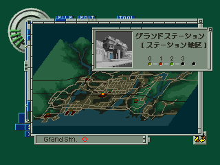 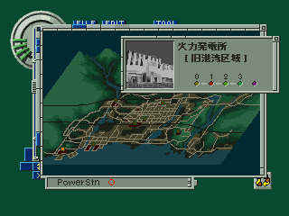

The office computer's town overview has a card for eight buildings, each with five dots. Behind them the game keeps one number per building, and the dots simply show it: one dot lit for 0, not yet invaded; two for any other value, usually 100, invaded; three for 10, freed; four for 1000, the town at peace after the ending; five for 2000, you have changed. The same number picks which version of the building you walk into, so each building has up to five versions on the disc: calm, invaded, freed, at peace and changed. Inside an invaded building the scripts also move the number in small steps (the power plant takes 10, 20 or 40 off its 100, `F1H` sets 80, 85, 90 or 95), so values from 1 to 99 exist too; they all show as two dots. A new game starts with the power plant, `PSG`, `F1H` and the second mine level already invaded. The shops share one more number, which is your own state: 100 as a human, 1000 after the ending and 2000 while changed.

Technical details

- Proof: `dialog_menu_list_page` (0x80180B04, src/game/dialog.c), case 1, reads the game variable `dialog_menu_list_vars[row]` (0x801D7694: 16, 18, 19, 15, 11, 23, 24, 14, the rows Indenco, Hotel Seasons, Grand Station, the seaside warehouses, the thermal power plant, the hospital, the coal mine and the cathedral) and lights colour entries of sprite 0x239: entry 2 for any non-zero value, entries 2 and 3 for 10, 2 to 4 for 1000, 2 to 5 for 2000; the first dot is always lit. `main_goto_building` (0x8018C554, src/game/main.c), called by `action_cmd_change_scene` for script command 6 forms 1 and 3 with the variable number from the door's command, turns 0, 10, 1000, 2000 and any other value into variants 0, 2, 3, 4 and 1; `object_load_scene` loads `SCE.S` directory entry variant + 1 of the scene. The door variables, from the town script: 9 `SB1` and `RW1`, 10 every shop (`FMR`, `RTN`, `SH1`, `MPS`), 11 the power plant `PSN`, 12 `PSG`, 13 `F1H`, 14 the cathedral `CDL`, 15 the warehouses `SHD`, 16 Indenco `IDC`, 17 the police `PLC`, 18 the hotel `HTL`, 19 Grand Station `GST`, 21 `OMH`, 22 `TOU`, 23 the hospital `HPL`, 24 the coal mine `CMN`, 25 `UND`, 26 `STH`, 27 `CM2`.
- Every writer of variables 9 to 27: a new game (`main`, src/game/main.c) sets 10, 11, 12, 13 and 27 to 100; the second arrest sets 17 to 100 (`main_goto_ofc`); the change (`player_finish_death`) saves 9 to 27 and sets them to 2000, the cure (`player_recover`) restores them; the ending (`object_room_init` in office mode 2, src/game/object.c) sets them to 1000; everything else is script command 10 (`action_cmd_var`, 0x80173250), 77 commands in `SCE.S`. The invaded version of a building sets its own variable to 10 when you free it (Grand Station scene 7 set 22, the hotel scene 16 set 324, the mine scene 21 set 318).
- In game: from the office computer screen of a new game, the eight row variables forced to 0, 100, 10, 1000, 2000, 5, 10 and 1000, then each card opened by pad (DOWN, CIRCLE): every card lit the dots predicted, 5 and 100 alike (pictures: Grand Station at 10, the power plant at 2000).
- Question: [18](mysteries.md#people-police-and-mutation). Found and checked 2026-11-16.
- Before us: five states, before invasion, invaded, freed, the whole city at peace and 4 if you have changed (manual p.2, fandom Indenco). Confirmed; new: the numbers behind them, where they are kept, and that they pick the version of the building.

### 🆕 Time alone never spreads the invasion: buildings fall on a schedule when you pass a door

🎮 Partly checked: the door checks and an idle clock were run with the clock forced; the chain between buildings is read in the scene scripts.

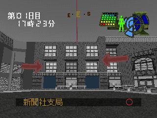 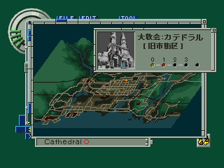

The clock never touches the invasion: sit in the office for days and every building stays as it was. Five buildings have a day and hour from which they fall, but the change happens only when you step out of the newspaper office into the town (the spot by its town door, first picture) or reach that building's own door: the cathedral from day 1 at 17:00, Indenco from day 1 at 20:00 (at its own doors only), the place the code calls `STH` from day 2 at 12:00, Hotel Seasons from day 3 at 14:00 and the coal mine from day 4 at 12:00. A building only falls from "not yet invaded", so one you already freed stays freed. Everything else spreads as a chain: leaving the office for the first time invades Grand Station; freeing the cathedral invades the Temple of the Universe and the underground waterway; freeing the hotel invades the Temple; freeing the mine invades the hospital; beating the hospital's boss frees the hospital, the waterway and Indenco at once, and another hospital script invades `OMH`; a script in `F1H` invades the seaside warehouses (read in the scripts).

Technical details

- Proof: the clock's `event_clock_add_minute` (src/game/event.c) writes only variables 61 to 64, and `mail_check_schedule` only mail state. The invasion writes are script command 10 (`action_cmd_var`, 0x80173250) in scene scripts. In the town (scene 1), set 0, the enter set of trigger 0x506400 (the town side of the office door), runs four tests, each setting the variable to 100 only while it is 0: the cathedral (14) when the day counter is 1 or more or the hour 17 to 23; `STH` (26) when the counter is 2 or more, or 1 with the hour 12 to 23; the hotel (18) when it is 3 or more, or 2 with 14 to 23; the mine (24) when it is 4 or more, or 3 with 12 to 23. The building's own doors run the same test (the cathedral set 21, `STH` sets 58 and 60, the mine sets 144 and 146). Indenco (16) is tested only at its doors (sets 62 and 162 run 164 and 165): counter 1 or more, or the hour 20 to 23. The chain: scene 0 set 104 (leaving the office) invades 19; the cathedral's sets 38 and 39 (scene 4) invade 22 and 25 when they are 0; the hotel's set 324 (scene 16) invades 22; the mine's set 318 (scene 21) invades 23; the hospital's set 323 (scene 20, its boss's death) sets 23, 25 and 16 to 10, its set 448 invades 21; `F1H`'s set 106 (scene 5) invades 15.
- In game: in the office on day 4 with the clock period forced to 6 refreshes a minute, from 11:50 to 19:42, variables 9 to 27 read at four points never changed. From a town save on day 4 at 19:40 by the office door, walking backward into the door zone by pad: write breakpoints caught variables 26, 18, 14 and 24 going from 0 to 100 in that order, within 25 refreshes, each written by `action_cmd_var`. From a new game with the clock forced to day 1 17:20, the office's exit prompt forced (`event_state` = 0xD0FF00) and CIRCLE, then CROSS held into the door zone: only the cathedral (14) went to 100 (first picture); back in the office, the computer showed the cathedral with two dots (second picture) and the hotel with one.
- Question: [3](mysteries.md#time-and-days). Found and checked 2026-11-16.
- Before us: players knew there is no fixed order and that an action in one building can change another (manual p.2, Japanese Wikipedia); nobody said whether waiting makes a building fall. New here: the schedule, the doors that apply it, and the chain.

### 🔄 The town is a grid of 50 m blocks, about 4.8 km across

🎮 Partly checked: the unit and the block lookup were seen in the emulator; the block counts are read from the town's map file.

The town is cut into square blocks of 50 m that stream in around you as you move. The map's grid is 108 by 128 blocks (5.4 by 6.4 km), but only 2,717 blocks hold anything, about 6.8 km². The town itself spans 95 by 98 blocks, about 4.75 by 4.9 km, with 2,401 blocks in use, about 6 km²; a separate strip of 316 blocks lies 500 m beyond its edge (not visited). So the box's "2.5 km square" is right for the area, about that of a 2.45 km square, but the town is not a square: it is nearly 5 km across. The "3 km square" of the manual matches neither. One unit of the game's world is one centimetre: your eyes are 1.70 m above the street, and you walk at 2.4 m a second.

Technical details

- Proof: `kaj_map_world_to_cell` (0x801D4D24, src/kaj/map.c) reads the header of `C/CITY.MP`: one corner at +4 and +8, the other at +0xC and +0x10, the grid size at +0x14 and +0x18; a cell is the span over the count. It is called through `kaj_map_update_city` (0x801D4FA0) by `block_set_mode` and `block_stream_update` (src/game/block.c) with the player's `Player.world_z` and `Player.world_x`, which `player_update_view` (src/game/player.c) sets to (position + cell x 12500) / 100, in metres. Read from the file: corners (3175, -2425) and (-2225, 3975), a grid of 108 by 128, so a cell is 50 by 50; the grid from +0x20, 4 bytes a cell, has 2,717 cells in use (18 with two layers): columns 12 to 106 and rows 0 to 97 for the town (2,401 cells), and 316 cells at rows 108 to 111. The unit: the eye in town is at y = -170 over a street at 0, and the car's turning radius in `vehicle_car_drive` (0x801AA360) is 0xFE000 / (4096 x tan(steer)), 254 / tan(steer), a 2.54 m wheelbase.
- In game: from a town save on day 4, the player at 233 m, -50 m (`0x801E0680`, `0x801E0688`) is cell (64, 53) by the header's formula, and the game's current cell record `kaj_map_cells[0]` (0x801E7950) held (64, 53). TRIANGLE held for 120 refreshes (2 seconds) moved the player 480 units, CROSS for 120 brought it back.
- Question: [34](mysteries.md#data-and-formats). Found 2026-11-16, the unit and the lookup checked the same day.
- Before us: 50 m blocks loaded around the player (Japanese Wikipedia, GameFAQs); 2.5 km square (back insert, KAJ brochure); 3 km square (manual, Japanese Wikipedia, GameFAQs). Corrected: 2.5 km square is the area, the town is about 4.8 km across. New: the grid and the counts.

### 🧩 Seventeen buildings have a door spot on the street and nothing behind it

🎮 Checked in the game (the hour and your place in the town forced; the last steps onto a door and the button by pad).

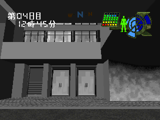

The town's ground marks the spot in front of each door you can use. Seventeen buildings have such a spot too, 28 door spots in all, but nothing on the disc stands behind them: no place to load, no room, no script, no destination for the car. Walk onto one and press the button and nothing happens, while the same move on a real door loads the building (picture). City Hall, the Yamasaki mansion and the South End buildings of the bus map are candidates for these seventeen, but the data has no names, so whether they are among them, and which spot would be which, can only be guessed from the map: two of them stand next to the coal mine at the south end, the likeliest the mansion and the South End buildings; one, an arcade with arches near the centre, is a candidate for City Hall. The "blue door" players saw behind City Hall's arches is no special door: it is the one slate-blue texture of the town's facades, used on 1,593 surfaces all over town, most of them far from any door spot.

Technical details

- Proof: door spots are floor polygons of the town blocks (`C/CITY.F` index, `C/CITY.BC` data) whose floor code is 0x50BBdd, BB the building number and dd the door. The town's `AREA` chunk (scene 1, entry 1) has a trigger record for each live door. 28 door codes on 17 building numbers have none: 03, 05, 06, 09, 0A, 0B, 0C, 0D, 0E, 10, 11, 13, 15, 19, 1A, 1B and 1D. `player_check_ground` (0x80195098) still sends the enter event for such a code with no trigger; `event_handle_enter` (0x80189350) passes it to `action_run_trigger_enter` (0x80174D6C), which returns 0 when the trigger is missing: no prompt, no load. The `B`, `F` and `M` area files exist only for the 22 scripted places, and `SCE.S` has 24 scenes, none spare ([scene files](#-the-game-still-names-scene-files-the-disc-does-not-have)). The car's destination table `vehicle_navi_dest_xz` (0x801D7FC4, read by `vehicle_navi_update`, 0x801AB774) holds 15 points, none a dead building. The bus stops (`building_bus_stops`, 0x801D74B0) are positions and headings with no building number; three stand near dead spots only because they are on the same streets. Positions (x, z, in metres): 10 at -1172, 2461 and 11 at -1214, 2356, beside the mine's door (0F, -1146, 2518); 03 at -438, -57. The blue texture is one palette (VRAM 0, 488) among the facade palettes, with one blue entry, used by 1,593 town polygons, 1,289 of them more than 80 m from any door spot.
- In game: from a town save on day 4, the hour forced to 12 and the player moved in front of each of the 19 dead spots by a forced position, each photographed. In front of dead spot 0500, CROSS held to walk onto it, then CIRCLE: the scene request stayed on the town and the view on the shut doors (picture), while the same inputs in front of the live door of `TOU` changed the scene request and faded to black.
- Question: [23](mysteries.md#hidden-and-cut-content). Found and checked 2026-11-18. Cannot be settled here: whether City Hall and the mansion are among the 17 and which spots they would be, since nothing in the data names them, and whether more was planned behind these spots before the disc was made.
- Before us: City Hall cannot be entered, a blue door texture sits behind its arches, and the bus map marks it, the Yamasaki mansion and two South End buildings as buildings (fandom City Hall). Not settled for City Hall and the mansion, which are only candidates; new: there are 17 buildings with a door spot and nothing else on the disc, and the blue door is the town's common blue panel.

### 🧩 No colour version of the town is left on the disc

🎮 Checked in the game (the hour forced to reach the evening).

The town is grey because its data is grey, not because a colour picture is turned grey on the way to the screen. Its textures use grey palettes and its models grey or white vertex colours, while the rooms inside buildings are in colour. The drawing code would show a coloured town as it is: it passes any coloured vertex through. The few colours outside are signs, arrows, one blue panel, and at night the windows, which light up warm yellow (picture). So nothing on the disc backs the rumour of a town in colour early in development; whether an earlier build was in colour cannot be settled from this disc alone.

Technical details

- Proof: `roadmap_draw_frame` (0x801A0418, src/game/roadmap.c) sets the shared polygon colour `roadmap_ft_color_r`, `_g`, `_b` (0x801DFF70) to 0x60 grey by day; in the dark it sets r = g = (dusk x 0x1334 >> 12) - 0x80 and b = (dusk x 0x2CD >> 10) - 0x80, with dusk 0x3D minus the daylight step: about 201, 201, 170, a warm yellow. `roadmap_draw_ft3` (0x8019BE6C) and the other polygon handlers draw a vertex colour FFFFFF with the shared colour, draw FEFEFE (a window) only in the dark, and pass any other colour through unchanged. `event_update_daylight` (0x8018A3F8) always sets the fog colour with r = g = b. A survey of `C/CITY.BC`: 886,812 grey vertex colours, 28,530 white (FFFFFF or FEFEFE), 41,263 lit, 0 coloured; the room model files are about 95 % coloured. Town textures come from `RES.R` TIMs: the main facade palettes are 15 greys and black; coloured palettes are used by about 2.4 % of the textured polygons (signs, two 256-colour rows and the blue panel).
- In game: the same street at 12:44 and at 19:01 (the hour forced to 18 and the minute to 59, then the clock rolled over): grey by day, the windows warm at night (pixels 248, 248, 208), the street and walls grey at both hours (picture).
- Question: [26](mysteries.md#hidden-and-cut-content). Found and checked 2026-11-18. Cannot be settled here: whether an earlier build was in colour, since only this disc exists.
- Before us: outdoors is grey with brightness changing by the hour, interiors in colour (Japanese Wikipedia, fandom, HG101): confirmed in the data. "The town was in colour early on" (atwiki, no source): no trace on the disc.

## The story

### 🔄 Kouda's reward needs an agent tally of exactly 7, before the ending

🎮 Partly checked: the reward and its failure were seen with the meetings' tally forced and Kouda's talk run by hand, and the door back from mine level 2 was walked by pad after a forced arrival; the meetings and what loses the reward are read in the scene scripts.

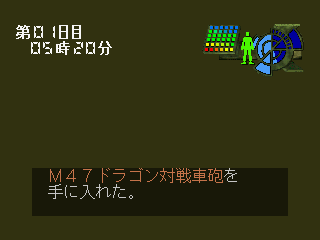 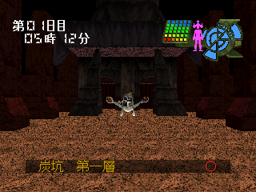

Kouda, whom you first meet at Grand Station, later waits in Hotel Seasons, and gives you the M47 Dragon when you come back after meeting the three other agents: the one in the seaside warehouses, the one in a hotel room and the one in the hospital. The game keeps one tally to which they add 1, 2 and 4, and Kouda tests only that it reads exactly 7. The normal way is one talk with each: 1 + 2 + 4. The hotel room agent counts once, and the hospital agent's spot switches off once the tally reaches 4. The warehouse agent's talk has no "already met" check: each talk while the warehouses are still invaded adds 1 again. So three warehouse talks and the hospital agent also make 7, without the hotel room agent, while a second warehouse talk after all three meetings makes 8. Nothing ever takes from the tally, so a total above 7 loses the reward for good. Two other things lose it. The ending: after it, the hotel no longer has the reward scene. And the hospital agent's window: that agent exists only while the hospital is invaded, so beating the hospital's boss first removes the agent, until beating mine level 1's boss invades the hospital again. Killing Kouda is not one of them in the data: the death only switches Kouda's spot off for that visit, records nothing, and the spot is switched on again by the hotel's script (read in the scripts, not played). The trip from the hospital to mine level 2 that players call one way is not: a few steps from where you arrive on level 2, a door prompt offers the coal mine's first level, and CIRCLE takes you back up to level 1's stairs (picture). What makes it risky is that the last boss and the ending wait at its end.

Technical details

- Proof (read in the scene scripts of `SCE.S`): Kouda's zone in the hotel (scene 16, `HTL`) is trigger 0xF02164, enter set 600, switched on by set 45 of variants 1 and 2 when variable 19 is 10 (met at the station, scene 7 set 22) and variable 83 is 0. Set 600 runs 601 (a line and stop) when variable 75 is 0, else 602, 605 and 603 (one line per agent met, each tested on a bit), then 606. Set 606 of variants 1 and 2 needs variable 75 at exactly 7; it gives weapon 10 (script command 8), sets variable 83 to 1 and sends a mail. Variants 0, 3 (after the ending) and 4 (changed) have no set 606. Variable 75: the warehouse agent (scene 9 set 564, zone 0xF01BA0, when variable 15 is 40 to 100) runs 566 when variable 19 is 10, which adds 1 and takes 10 off variable 15, with no bit test (else 565 makes the agent hostile); the hotel room agent (scene 16 set 613, guarded by variable 130) adds 2; the hospital agent, in hospital variant 1 only, adds 4 in the leave set 451 of zone 0xF0238C, and set 402 switches that zone off once variable 75 is 4 or more. The hospital boss's death set (scene 20 set 323) sets variable 23 to 10 (variant 2, no agent); the mine level 1 boss's (scene 21 set 318) sets it to 100. Kouda's death set (319) switches the zone off and writes no variable; set 45 switches the zone on again while variable 19 is 10 and variable 83 is 0, and like every person Kouda is read again from `SCE.S` at the next load. Variable 75 is only ever added to (script command 10 form 2), so the warehouse set 566 can run while variable 15 stays 40 or more: three runs and the hospital agent's 4 also give 7. The way to mine level 2: the hospital basement leads to the waterway (scene 20 set 5), whose door goes to mine level 1 entry 5 (scene 22 set 1); mine level 1's variant 2 has the door to level 2 (scene 21 set 7), and level 2's door back is set 1 of its only version, on floor code 0x500F06, the floor polygon that covers x -25.5 to 2.5 m and z -11.5 to 11.5 m of `CM2`, just ahead of the arrival point at x 16.5 m; it sends you to `CMN` entry 6.
- In game: from a new game in the office, variable 18 set to 50 (hotel variant 1), 19 to 10 and 75 to 7, the hotel loaded by a forced scene request, the arrival set 500 and then Kouda's set 600 run by hand (`object_room_play_call`, 0x80194F08), bit 0x4 of `player_character.flags` (`0x801E0662`) forced on 10 refreshes later so that CIRCLE closes the text, and CIRCLE pressed through the lines: the arrival set decoded the three agent bits, the reward chime played, variable 83 went to 1, weapon 10 appeared in the second weapon slot (`0x801E0776`) and the line said the M47 Dragon was obtained (picture). With variable 75 at 8 (one agent counted twice): no bit decoded, no reward, variable 83 stayed 0. Re-entering the warehouses for a real second talk was not played. The door back, on 2026-11-18: from a save on mine level 1 (day 1, 05:11, a changed player), only the arrival on level 2 forced (scene request to `CM2` entry 0); CROSS held 40 frames walked the player from x 16.5 m to 1.3 m, the trigger 0x500F06 came up with its prompt (picture), and CIRCLE requested `CMN` entry 6 at once, which loaded on level 1's stairs.
- Question: [28](mysteries.md#hidden-and-cut-content). Found 2026-11-16, the reward checked the same day; the door back checked 2026-11-18.
- Before us: clearing the hospital sends you one way from the morgue to mine level 2 and skips the reward; go back after meeting the third agent (nico sm1148359). Confirmed: Kouda must be visited after the third agent and before the ending. Corrected: the way is not one way, walked in the emulator. New: the exact test, the hospital agent's window and the warehouse double count.

### ❌ The game has an ending: a narration in the office, then a town at peace

🎮 Checked in the game with the ending forced: the office's ending request was made by hand; the last boss was not fought.

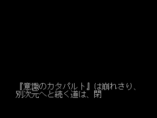 

When the last boss on mine level 2 dies, it opens an exit that takes you to the office, and the ending plays there: a narration on a black screen, with no music. Then the game resets the town for good: every building goes to its "at peace" state, every wound is healed, the energy bar is set to 201 of 255, and the clock moves to 05:00: of the next morning if it was already 05:00 or later, of the same day otherwise. Then you play on from the office with the clock running. From then on nobody arrests you, any death is game over, the burger shop always serves normal food and no mail comes by time. Indenco, `OMH`, `STH`, the coal mine, the waterway and mine level 2 have no "at peace" version, so their doors stay shut (seen at Indenco); the hotel's Kouda scene is gone. The sixteen buildings that open again are quiet: 37 people in all, none hostile, 29 of them with something to say. The cathedral keeps 2 people, the hotel 6, the gun shop 6, the police station 5; `F1H`, `SB1`, the warehouses and the railway station `RW1` are empty. The only infected person left in town is one hotel guest upstairs, and that guest only talks.

Technical details

- Proof: on mine level 2 (scene 23, `CM2`, variant 1), the last boss's death set 304 fades the music, sets variable 27 to 70 and switches on zones 0xF02714 (enter set 54) and 0xF0271E (enter set 59) (read in the script). Set 54 runs script command 6 form 0 with argument 0, which `action_cmd_change_scene` (0x80173054, src/game/action.c) turns into `main_goto_ofc(1, 1, 1, 2)` (0x8018C414): the office in mode 2, at `main_scene_request` +0x16 (`0x801E0356`, the "scene id 2" of the translation project). `object_room_init` (0x8019430C, src/game/object.c) in mode 2 sets `player_status.energy` to 0xC9 and `hours_awake` to 2, variable 0x30 (48) to 1 and variables 9 to 27 to 1000, zeroes the five body parts and their levels, adds one to the day counter when the hour is 5 or more (at most 98), and sets the clock to 05:00. `object_room_main` (0x80194780) then blacks the screen and starts narration `object_scene_tables.texts[1]`; in mode 1, the opening, it also starts the music. Variable 0x30 stops the arrests (`main_goto_ofc`), the timed mails (`mail_check_schedule`) and the mine wake-up (`player_finish_death`), and gives the burger shop its normal list. Indenco's door set 62 needs variable 16 at 0 to 100 and falls to its closed line at 1000.
- In game: from a new game in the office, the hour forced to 14 and hours awake to 9, then a forced call `main_goto_ofc(1, 1, 1, 2)`: 700 refreshes later variables 9 to 27 were all 1000, variable 48 was 1, the day counter had gone from 0 to 1, the clock read 05:01, energy 201, hours awake 2, and the narration ran on black (first picture). The same request written straight into `main_scene_request` without the debugger: 5,800 refreshes later the narration was over and the office playable on day 2 at 05:09 with the clock running (second picture). From that state, the town loaded by a forced request, the hour forced to 12 and Indenco's door set 62 run by hand: the closed line.
- Proof, after the ending: the "at peace" version is variant 3, `SCE.S` directory entry 4 of each scene. Its `ACTR` people (`Npc`: `kind` 0 a human, `mode` 1 hostile, `talk_set`): power plant `PSN` 4, `PSG` 1, cathedral `CDL` 2, `F1H`, `SB1`, the warehouses `SHD` and `RW1` 0, Grand Station `GST` 1, the family restaurant `FMR` 3, the Italian restaurant `RTN` 3, `SH1` 6, the police station `PLC` 5, the hotel `HTL` 6, `TOU` 1, `MPS` 2, the hospital `HPL` 3: 37, none with `mode` 1, 29 with a talk set. The one not human is the hotel's person 28 (`kind` 1, upper floor), with talk set 128. `OMH`, `STH`, `IDC`, `CMN`, `UND` and `CM2` have no entry 4.
- In game, after the ending: from the after-ending save (day 2, 05:15), a forced scene request with variant 3 to `HTL`, `GST`, `HPL` and `CDL`: each loaded and could be walked, with 6, 1, 3 and 2 people loaded (`object_scene_tables`, 0x801E02D8), the counts of their entry 4; in the hospital a person stands behind the reception desk. The hotel guest was not reached and no talk was played.
- Question: [20](mysteries.md#the-ending). Found and checked 2026-11-16, with the ending forced; the open buildings read and four of them loaded 2026-11-18.
- Before us: "no ending" (atwiki, nico sm1123083), "no real ending" (HG101), against a closing narration followed by free roam with buildings closed (fandom, GameFAQs, Big Picture Mode). Busted: "no ending". Confirmed: the narration and free play. New: what the ending resets, which buildings stay shut, and who is left in the others.

## Data

### 🧩 The weapon record: three requirements, accuracy, damage and three ranges

🎮 Partly checked: the 18 records were read in the emulator's memory and their main fields seen at work in the two combat findings; the rest is read in the code.

The disc holds one record of 96 bytes for each of the 18 weapons. After the name come: an extra energy cost taken every sixth drain of the energy bar (0 for most weapons, 20 for the Hieronymus Machine); a required player level (0 to 50), a required stat with which of your four stats it is, and a required class level (5 to 50), which together set how much of the weapon's accuracy you get; the frame of the attack animation that fires; the accuracy (60 to 100); the damage (30 to 255); and the three distances of the [hit roll](#-every-shot-is-a-roll-against-the-hit-chance-and-range-cuts-both-chance-and-damage). The gun shop uses the required level to choose and sort what it sells. Three fields are never read by the game: one always 0, one a copy of the class, and one holding values from 3 to 60 whose meaning is lost.

Technical details

- Proof: the 18 records of 0x60 bytes are loaded at `object_scene_tables.weapons` (the `WEPN` table of `RES.R`); every reader goes through `effect_weapon_find` (0x80188FEC), and none of them is left in assembly. The record type is `WeaponRecord`. Fields, with their readers and the values read in the emulator:

| Offset | Field | Read by | Values |
|---|---|---|---|
| +0x00 | id | `effect_weapon_find` | 0 to 17 |
| +0x02 | class | `effect_weapon_calc_rate`, `actor_apply_damage`, `player_shoot_target`, `effect_weapon_draw_panel`, the status page | 0 to 4 |
| +0x04 | name, 32 bytes | `shop_finish` | |
| +0x24 | extra energy cost every sixth drain | `event_drain_gauge` | 0 for most; 2 MP5K and Ithaca; 5 morning star, katana, M16A1; 10 M47 Dragon and electromagnetic wave gun; 20 Hieronymus Machine |
| +0x26 | none | | 3 to 60 |
| +0x28 | level requirement on | `effect_weapon_calc_rate` | 1 in all |
| +0x2C | none | | 0 in all |
| +0x30 | required player level | `effect_weapon_calc_rate`, `shop_pick_weapons`, `shop_finish`, the panels | 0 to 50 |
| +0x34 | stat requirement on | `effect_weapon_calc_rate` | 1 in all |
| +0x38 | which stat (0 to 3 for `player_status.stat0` to `stat3`) | `effect_weapon_calc_rate` | 0 to 3 |
| +0x3C | required stat | `effect_weapon_calc_rate` | 5 to 50 |
| +0x40 | class requirement on | `effect_weapon_calc_rate` | 1 in all |
| +0x44 | none (a copy of the class) | | 0 to 4 |
| +0x48 | required class level | `effect_weapon_calc_rate` | 5 to 50 |
| +0x4C | fire frame of the attack animation | `effect_weapon_check_fire_frame` | 4 to 25 |
| +0x50 | accuracy | `effect_weapon_calc_rate`, the panels | 60 to 100 |
| +0x52 | damage | `player_shoot_target`, the panels | 30 to 255 |
| +0x54, +0x58, +0x5C | too close, end of full power, maximum reach, in tens of units | `player_shoot_target` | hand to hand 0, 200, 200; boomerang 0, 1000, 1500; pistols up to 300, 500 to 1000, 1500 to 3000; long guns 300 to 500, 1000 to 2000, 2000; specials 0, 2000, 4000 |

- In game: the table was read from memory after loading a game; the roles of +0x30, +0x3C, +0x48 and +0x50 were seen through the [blue wheel](#-the-blue-wheel-is-the-weapons-hit-rate-and-the-five-classes-are-levels-up-to-100), those of +0x50 to +0x5C through the [hit roll](#-every-shot-is-a-roll-against-the-hit-chance-and-range-cuts-both-chance-and-damage). The extra energy cost is the weapon's share of the [energy drain](#-energy-drains-faster-the-longer-you-stay-awake).
- Question: [15](mysteries.md#combat). Found 2026-11-16.
- Before us: the translation project read the names and left the fields after +0x24 unknown. New here: every field after it.

### 🧩 A save holds 464 bytes of game state, stored twice with checksums

📖 Read in the code only.

A save keeps where you saved (the office diary or a public phone), all the game variables (story flags, building states, the clock, the body part damage, the mail count), the two settings of the options page, your energy, level, stats, weapon skills, kill and arrest counters and body part levels, your weapons and items, and your position in town. Those 464 bytes go into a 508-byte buffer whose last 44 bytes stay zero; the buffer is cut into four pieces; each is written twice with a checksum, and loading uses the second copy of a piece when the first is damaged. The state of the scene you are in and of the shops is not saved: it is rebuilt on loading.

Technical details

- Proof: `card_save` (0x8017F6F4, src/game/card.c) writes one block file: frame 0 a header with the title built from `card_str_save_title` (day, hour, minute, record number), frame 1 the icon `card_icon_image`, then a 0x1FC-byte buffer (cleared with `memset`, 464 bytes filled, the last 44 left zero) cut into four 0x7F-byte pieces, each followed by an XOR checksum byte and written to frames 2 + 2i and 3 + 2i. `card_load` (0x8017EFEC) reads frame 2 + 2i, checks the XOR, else reads 3 + 2i, else fails with message 0x68. The buffer:

| Save offset | Size | Source |
|---|---|---|
| 0x000 | 2 | where you saved: non-zero for the office diary (loads the office through `main_goto_ofc`), zero for a public phone (loads the town at the saved position through `main_goto_twn`) |
| 0x002 | 0x100 | `action_vars` `0x801E0368` to `0x801E0467`: game variables 0 to 0x59 (story and building states, the after-ending flag 0x30, the clock 0x3D to 0x40), `limb_damage`, the received-mail count (`0x801E0426`) and the phone flags |
| 0x102 | 4 | `action_vars.car_speed_setting` and `text_speed_setting`, the options page |
| 0x106 | 0x4E | `player_status` `0x801E0710` to `0x801E075D`: energy, level, experience, the four stats, the six skill pairs, `mutant`, the kill and arrest counters, `hours_awake`, `limb_state`, the redraw flags, `infected`, and the low half of `target_npc` (the copy stops two bytes into it; harmless, the target is picked again every frame) |
| 0x154 | 0x44 | `player_inventory` `0x801E0770` to `0x801E07B3`: the current slot, the two weapon ids and their hit rates, the 18 stored-weapon counts, the 8 item ids |
| 0x198 | 0x38 | the first 0x38 bytes of `player_character` (`0x801E0620`, offsets 0 to 0x37), with the town position (+0x1C, +0x20, +0x24) that `main_goto_twn` reads back; the value the loader also passes from +0x38 is outside this copy, so it is not restored by it |
| 0x1D0 | 0x2C | nothing: left zero |

- After loading, the drain counter (`action_vars.drain_count`) is reset and the drain minute set to the minute modulo 10. Not saved: the rest of `action_vars` (per-scene and shop state), `player_character` from +0x38 on, the weapon and scene tables (read again from the disc).
- In game: not checked; no memory card was written in the emulator.
- Question: [36](mysteries.md#data-and-formats). Found 2026-11-16.
- Before us: saves go to the office diary or a public phone and take one memory card block (manual, Japanese Wikipedia). New here: what is in it.

### 🧩 The scene data: four counts per place, door triggers and people records

📖 Read in the code only, with our own readers of the data: they read all 24 places without error, and the mine's person count matched the people table seen in memory.

Each of the 24 places in `SCE.S` starts with a small directory: one entry for the place's shared data, then one for each of its versions (calm, invaded, freed, at peace and changed, see [the invasion state](#-each-buildings-invasion-state-is-one-number-and-the-computers-dots-show-it)); an unused version is left empty. Besides where the data sits, each entry carries four counts. For the shared data they are how many profile cards, stage models, weapons and items it holds; for a version, how many people, triggers, scripts and fighter stat blocks. A trigger is a spot on the floor: what it is (a town door, a shop door, the office computer, a dead body), the script that runs when you step in and the one when you step out, whether it stops you like a wall, and whether it is switched on. A person record gives the person's profile card, model and stat block and three scripts: when you walk up, when you walk away, and when the person dies. A fighter's stat block holds its attack class, what it does when shot, its damage, defence, accuracy, how long it aims, its walking speed, the weapon class it resists, how often it decides to fire, the frame of its attack where the shot happens, and three ranges like a weapon's. No enemy in the game throws, and nine stat blocks are immune to your weapons.

Technical details

- Proof: `object_load_scene` (0x801926B4, src/game/object.c) opens the scene's directory (`IffEntry`, 0x18 bytes: offset, size, then four counts at +0x8, +0xC, +0x10 and +0x14) and copies the counts into `object_scene_tables`; the size is rounded to whole 0x800-byte sectors, so the counts cannot be derived from the sizes. Every building scene has six entries.

| Entry | +0x8 | +0xC | +0x10 | +0x14 |
|---|---|---|---|---|
| 0, shared data | `npc_body_count` (`CHAR`, profile cards) | `npc_record_count` (`NPC `, stage models, read by `npc_rec_cmd`) | `weapon_count` (`WEPN`, read by `effect_weapon_find`) | `item_count` (`ITEM`, read by `effect_item_find`) |
| variant + 1 | `npc_count` (`ACTR`, people) | `trigger_count` (`AREA`) | `object_aset_count` (`ASET`, scripts) | `npc_stats_count` (`ENMY`, stat blocks) |

| `SceneTrigger` (12 bytes) | Role |
|---|---|
| +0x0 `id` | the high byte is the kind: 0x50 town door, 0xF0 building spot, 0xF8 shop door, 0xFA computer, 0xD0 office exit, 0xFC dead person |
| +0x4 `enter_set`, +0x6 `leave_set` | the action sets run on stepping in and out |
| +0x8 `passable` | read only by the walk collision (src/game/player.c): 0 stops the player like a wall; script command 0 form 2 writes it. All 307 triggers of scenes 1, 4, 9 and 20 have 1 |
| +0xA `enabled` | switched on or off by script command 0 form 1 |

| `Npc` field (people, 0x4C bytes) | Role, from its readers |
|---|---|
| +0x2 `kind` | kind: 0 a civilian (counted for arrests); other values multiply the experience a kill gives |
| +0xC `hp` | hit points |
| +0xE `mode`, +0xF `state` | attitude (1 hostile, 2 dying) and pose (6 dead) |
| +0x14 `body_id` | profile card (`NpcBody` id), read by `dialog_show_profile` |
| +0x16 `model_id`, +0x18 `stats_id` | model id (`mod_find`) and stat block id (`actor_find_stats`) |
| +0x1A `talk_set`, +0x1C `leave_set` | the sets run when you walk up and walk away (`action_run_npc_event`) |
| +0x1E `death_set` | death set (`actor_update_all`) |
| +0x42 `exp` | experience base of a kill (`actor_apply_damage`) |

| `NpcStats` field (`ENMY`, 0x24 bytes) | Role, from its readers | Values in the 301 records |
|---|---|---|
| +0x0 `id` | matched with the person's `stats_id` by `actor_find_stats` (0x80176890), which returns nothing when no record matches: the AI (`ai_update_move`, `ai_fire`) then uses `ai_default_stats` (0x801D7328), and `actor_apply_damage` (0x80175FA8) returns without applying the hit | 0 to 23 |
| +0x2 `weapon_kind` | attack class, the player's five (0 bare hands, 1 throwing, 2 short range, 3 long range, 4 special): the shot sound in `ai_fire` (0x8017917C), which of your defence stats `player_take_hit` (0x801981D0) uses, a height window for class 0, and class 4 stops its looping sound in `actor_update_anim` (0x8017546C) | 0: 159, 2: 33, 3: 35, 4: 74, 1: none |
| +0x4 `on_hit` | in `actor_apply_damage`: 0 nothing, 1 turns hostile and drops a scripted walk, 2 turns hostile and starts walking | 0: 110, 1: 120, 2: 71 |
| +0x6 (2 bytes) | never read | 0 in all |
| +0x8 `damage` | damage of a hit in `ai_fire`: `damage * scale >> 12`, the range scale at least 410/4096 (about 10 %), rounded down | 0 to 255 |
| +0xA `defence` | your damage loses `rand() % defence` (two thirds of it unless resisted); 0x7FFF makes the fighter immune | 10 to 255; 32767 in 9 records (scenes 3, 7, 16 and 18) |
| +0xC `accuracy` | hit chance in `ai_fire` before the range scale, 20 at least | 50 to 90 |
| +0xE `aim_time` | screen refreshes waited before the attack animation, counted down by the refreshes each frame took (`actor_update_anim`; 0 counts as 1) | 1 to 80 |
| +0x10 `speed` | walking step per screen refresh in `ai_update_move` (0x80178E38), times the refreshes the frame took and times 4 for a calm walk, 10 for a hostile one, 6 for the other moves; 0 means 3 | 0 to 15 |
| +0x12 `resist_types` | bit 1 << your weapon class: that class meets the full defence | 0: 160, special: 75, long range: 34, bare hands: 28, the other two 2 each |
| +0x14 `fire_chance` | starting chance in `ai_decide_fire` (0x801788F8) to decide to attack, scaled by range | 5 to 90 |
| +0x16 `fire_frames` | the attack animation's frame where `ai_fire` runs; above 0x100, two frames (low and high byte) | 1 to 0x3719 (frames 25 and 55) |
| +0x18 `range_min`, +0x1C `range_mid`, +0x20 `range_max` | times 10, three range bounds. `ai_decide_fire` attacks when `rand() % 100` is at most a threshold: closer than `range_min` the threshold is 10 (11 rolls in 100); from `range_min` to `range_mid` it falls from `fire_chance` to 0; from `range_mid` it restarts at (max - mid) / (max - min) of `fire_chance` and falls to 0 at `range_max`; beyond, it keeps a random 0 to 10 % of `fire_chance`. A threshold of 0 still lets one roll in 100 through. `ai_fire`: closer than `range_min` the hit chance is 20 % at full damage; up to `range_mid` it is `accuracy`; it then falls with the damage toward `range_max`, but never under 20 % and 410/4096 of the damage, so beyond `range_max` a hit still lands one time in five for about 10 % of the damage, rounded down. Only bare hands (class 0) miss outright outside `range_min` to `range_max` | 0 to 160, 100 to 900, 150 to 2000 |

- In game: not run for its own sake; the mine's variant 4 person count (11, entry 5 field +0x8) is the size of the people table seen in memory, and the trigger kinds are those of the prompts forced in the other findings.
- Question: [35](mysteries.md#data-and-formats). Found 2026-11-16; the `ENMY` fields 2026-11-18, read in the code and in the 301 records of `SCE.S`, not watched on screen.
- Before us: the translation project rebuilt the container and named the chunks; the directory fields a to d, the `AREA` triggers, `ENMY` and `ACTR` were unknown. New: the four counts of each entry and the trigger, person and stat block fields.

## Performance

### 🧩 The game times every frame, so a slow machine makes it choppy, not slow

🎮 Partly checked: the frame times and the CPU work per frame were measured in PCSX-Redux; the effect of a faster CPU is computed from them, since that emulator has no CPU speed setting, and no real console or DuckStation was timed.

The game draws at most 30 frames a second. After each frame it measures how many screen refreshes the frame really took and moves doors, text, turning, enemies and timers by that much, and skips animation frames when it runs late. So when the console, or an emulator, cannot keep up, the game gets choppy rather than slower. The clock does not depend on it at all. In the emulator used here the office runs at full speed (30 frames a second) and the coal mine at 12 to 15. That is why players speed up the emulated CPU: the busiest scene measured, the coal mine with a changed player among mutants, needs about 3.3 screen refreshes of CPU work per frame, so it waits for the fourth and shows 15 frames a second. Computed from that measure, not run: a CPU 1.5 times as fast would give 20, and from about 1.67 times on the scene would be back to 30, so 190 % should clear it with a little margin. The office already needs 1.85 of its 2 refreshes. Walking speed stays right at any rate, but animations do not quite: when a frame takes 3 or 5 refreshes, attacks and other animations run at 67 % or 80 % of their speed (read in the code; no scene measured landed there).

Technical details

- Proof: `kaj_view_flip` (0x801D1AAC, src/kaj/view.c) waits with `VSync(2)` (never faster than every second refresh), reads `VSync(-1)` and stores the refreshes since the previous frame in `kaj_system.vsync_delta` (`0x801E6DB4`). Doors, texts, turning, enemy AI and timers add `step * speed`; `mod_set_anim` (0x8018DA2C) moves model animations 1 frame per draw for a step up to 3, 2 for 4 or 5, 3 for 6 or more. The clock counts vertical blanks in an interrupt ([the clock](#-the-clock-counts-minutes-and-stops-at-day-99)).
- Proof, animations: `mod_set_anim` fixes `Model.frame_step` when an animation starts, and `mod_update_all` (0x8018DE58) advances it once per drawn frame, so an animation runs at step x 2 / refreshes per frame: 100 % at 2, 4 and 6, 67 % at 3, 80 % at 5. The player's shot waits for its weapon's fire frame (`effect_weapon_check_fire_frame`, 0x80188E0C) and people fire on a frame of their attack (`actor_update_anim`), so at 3 or 5 fights slow down and walking does not.
- In game: `0x801E6DB4` read 2 in the office, 4 to 5 in the mine and 9 on the title screen (PCSX-Redux, dynamic recompiler). On 2026-11-18, with the interpreter and breakpoints at the flip and at the returns of its `VSync(2)`, the CPU cycles from the end of one wait to the next flip, divided by one refresh (564,398 cycles), over 600 to 900 refreshes: office 1.85 (30 frames a second), the town standing 1.52 and walking 1.19 on average with a highest frame of 1.79 (30), the mine with a changed player among mutants 3.33 every frame (15, a step of 4). A CPU s times faster flips after max(2, ceil(work / s)) refreshes: 3 at 1.5 times, 2 from 1.67 times; at 1.9 the mine's work is 1.75. PCSX-Redux has no setting that speeds up the CPU alone (its speed setting runs the whole machine faster), so that part is computed, not run.
- Question: [31](mysteries.md#bugs), partly. Found 2026-11-16; the CPU work measured 2026-11-18. Cannot be settled here: how close PCSX-Redux's cycle counts are to the console's and DuckStation's, so whether a real console also drops to 15 in that scene, and where DuckStation's own threshold lies; neither was available.
- Before us: the advice to run DuckStation at 190 % CPU (Romhack Plaza) and the translation project's "frame step, 3 normally". New here: the step is measured each frame, 2 at full speed, and what it drives; why 190 % should help, computed from the CPU work of the scenes measured; and that animations, not walking, slow down at some frame rates.

## Bugs

### 🧩 Boss music starts in the boss's talk zone, and four bosses leave it on when they die

🎮 Partly checked: in the power plant, with the boss's death and its talk run by hand (not a real kill); the other three bosses are read in the scene scripts.

A boss's music does not start with the fight: it starts with the boss's speech, when you walk into the spot where the boss talks to you, and the boss's death fades it out. Most bosses switch that spot off when they die. The bosses of the thermal power plant, `PSG`, the cathedral and the seaside warehouses do not. A spot left on is not enough: the speech also has its own condition. The cathedral's and the warehouses' speeches have none, so if you kill one of those bosses before it speaks, walking into its spot later still plays its speech and its music over the dead body. The power plant's speech needs its building's state above 50, and the death takes 40 off it, so it plays again only if the state was above 90 at the death, as in the emulator. At `PSG` the death takes 80 off a state that the speech needs between 30 and 100, so the speech, and its music, never come back.

Technical details

- Proof: each building's music bank (`object_scene_tables.bgm`, `BgmSep`) holds one or two sequences. On arrival `building_on_effect_done` (0x8017D604, src/game/building.c), effect 0, calls `sound_bgm_play(1)`, the building track (sequence 0 in building type 5, nothing in type 7). The boss track is sequence 0, started by script command 3 form 0 inside the boss's talk set; the boss's death set (`Npc.death_set`) fades it with command 3 form 1, `sound_bgm_fade_out(3)` (0x801A3CC0). Death sets that switch the talk zone off (command 0 form 1, read in the scripts): the police, the hotel, the hospital, mine level 1 and mine level 2. Those that do not: the power plant (scene 2 variant 1, talk set 55 in zone 0xF0153C, death set 317), `PSG` (scene 3, set 39 in 0xF0143C, death 302), the cathedral (scene 4, set 63 in 0xF01914, death 321) and the warehouses (scene 9, set 562 in 0xF01B96, death 319). The talk sets' own conditions: set 55 needs variable 11 between 51 and 100, and death set 317 takes 40 off it, so the talk still runs only when variable 11 was 91 or more; `PSG`'s set 39 needs variable 12 between 30 and 100, and death set 302 takes 80 off it, so the talk never runs again; the cathedral's set 63 and the warehouses' set 562 have no condition.
- In game: from a new game, variable 11 forced to 100 and the power plant's variant 1 loaded by a forced scene request: the bank had 2 sequences and played sequence 1. The death set run by hand (`object_room_play_call(317)`): `sound_bgm_fade_out(3)` was called, variable 11 went to 60 and zone 0xF0153C stayed switched on; the building track came back. The talk set 55 run by hand, as entering the zone does, bit 0x4 of `player_character.flags` (`0x801E0662`) forced on 10 refreshes later so that CIRCLE closes the text, and CIRCLE pressed through the lines: `sound_bgm_play(0)` stopped sequence 1 and the bank played sequence 0. The emulator runs muted: the music was followed through the sound calls, not heard.
- Question: [29](mysteries.md#bugs). Found 2026-11-16, the power plant checked the same day.
- Before us: killing a boss before entering its dialogue radius skips the boss music, which can then start after the boss is dead (fandom Soundtrack). Confirmed; new: why, and the three buildings where it can happen (the power plant only in part).

### 🧩 Mine level 1 has no music track of its own, so no boss fight stops its sound

🎮 Partly checked: the sound calls and the sound chip's voices were watched in the emulator with the boss's talk run by hand; the sound itself was not heard, the emulator runs with no sound output.

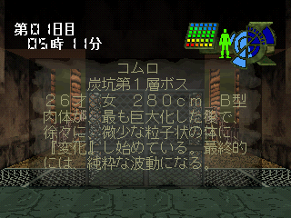

The coal mine's first level has a single music track in its bank, the boss track. On arrival the game asks for the building track, as everywhere, and gets nothing. Besides music, arriving in a building starts one held instrument note that no music command touches; leaving the place keys it off through the game's sound effect code (`sound_se_stop_all`). So when the mine's boss (the fight players call the Komuro fight) starts its track, nothing of the mine's own sound is stopped: no stop call is skipped, there is simply no mine track to stop. The note is a sample about 12 seconds long that loops forever, held on a voice of its own. When the boss track starts, the note keeps sounding under it, until the music player takes over that voice for its own notes, about 14 seconds into the boss track in the run watched here; nothing starts the note again. The boss is Komuro: its profile card names it the coal mine's first level boss (picture). That this held note is what players call the mine music, and whether its end can be heard, cannot be settled without listening. `PSG` also has a single track.

Technical details

- Proof: `sound_bgm_play(seq)` (0x801A3BCC) acts only when `seq` is below `BgmSep.seq_count`, and stops only the current sequence of the same bank (`sound_bgm_stop`, `SsSepStop`); `sound_bgm_fade_out` touches only that bank. On arrival, `building_on_effect_done` calls `sound_se_play_note(10, 0x29, 0, 0x3C, 0x7F, 0x7F, 1)` (0x801A2C60) except in building types 1 and 2: the last argument pins the voice (its age is set to 0x7FFF so no other effect the game's code allocates takes it; Sony's music sequencer does not read that table and can still take the sound chip's voice), keyed on with `SsUtKeyOnV`; only `sound_se_stop_all` (0x801A252C), called when the scene ends (src/game/building.c), keys it off.
- In game: from a new game, variable 24 forced to 50 and mine level 1's variant 1 loaded by a forced scene request: on arrival `sound_bgm_play(1)` was called and did nothing, the bank having `seq_count` 1 and staying at sequence -1; `sound_se_play_note(10, 41, 0, 60, ...)` was called. The boss's talk set 70 (zone 0xF0243C) run by hand, bit 0x4 of `player_character.flags` (`0x801E0662`) forced on 10 refreshes later so that CIRCLE closes the text, and CIRCLE pressed through the lines: `sound_bgm_play(0)` played sequence 0, and breakpoints on `sound_se_stop` and `sound_se_stop_all` never fired. The power plant and mine level 2 banks hold 2 sequences, `PSG`'s 1.
- In game, the note, on 2026-11-18, the same route with the sound chip's state read: the game's voice table (`sound_voice_table`, 0x801E1078) holds slot 2 as bank 10, program 41, note 60, keyed on, priority 0x7FFF, pinned; voice 2 of the sound chip is on, in sustain at full level, its sample 2,314 blocks long with the loop flag at its end, 11.75 s a pass at its pitch. 151 and 851 refreshes into the boss track, voice 2 still holds the note beside 11 or 12 voices of the boss track. Replayed from a saved state with write breakpoints on voice 2's volume and start address: the first write came about 867 refreshes (14.5 s) after `sound_bgm_play(0)`, from Sony's sound library (the music player, which also uses voices 0 to 7), and later voice 2 played a sample of the boss track while the game's table still marked slot 2 as pinned. The boss: person 0x12 of the place (`Npc.kind` 18, 800 HP, death set 318) uses profile body 118; its card, opened by a forced `dialog_show_profile(0x12)`, names Komuro, the coal mine's first level boss, a 26-year-old woman, 280 cm tall (picture).
- Question: [30](mysteries.md#bugs), partly. Found 2026-11-16; the voice and the boss's name checked 2026-11-18. Cannot be settled here: that this note is what players hear as the mine music, and whether the moment the music takes its voice is audible; the emulator ran with no sound output, and the steal was timed once, in one replay.
- Before us: the coal mine music keeps playing under the boss music in the Komuro fight (fandom Soundtrack). Confirmed in the code's sound calls, and that the boss is Komuro; corrected: no stop call is skipped, the mine has no track for the boss track to replace, and the held note does not last the whole fight.

### ✅ The game never asks what kind of pad is plugged in

🎮 Checked in the game (only the emulated pad's type and its analog mode set in the emulator's settings; the buttons by pad).

The game reads the pad once a frame through Sony's library, which takes the button word the console's own pad routine fills, and it never asks what kind of pad is plugged in. So the trouble with a pad in analog mode, where no button works, comes from the console routine, as the translation project said: the game has no code that could tell an analog pad apart or switch it. In the emulator, with the pad switched to analog mode, no button does anything, not even START on the title screen, although the pad and the console both see it pressed. Switch the pad back to digital and control returns at once, mid-game. The sticks are never read by anyone.

Technical details

- Proof: `kaj_pad_read` (0x801CD6B4, src/kaj/misc.c) returns 0 unless `kaj_system.pad_mode` (`0x801E6DAA`) is 1, then returns `PadRead(1)` and keeps it in `kaj_system.pad_now`, the previous one in `pad_prev`. `PadRead` (0x801CCA40, Sony's library) calls the BIOS function `PAD_dr` (B0 table, function 0x16), which hands back the button word the BIOS keeps in the buffer at `0x801E6DC0` that `PadInit` (0x801CC9F4) passed to the BIOS `PAD_init` with mode 0x20000001. `kaj_init` calls `PadInit(0)` once. No other pad function is called from `src/`: no type or status query. `0x801E6DA0` is the start of `kaj_system`, the pad words, not a handler.
- Proof, the console's side: the console keeps the pad's raw reply at `0x80007570` (status, pad type, two button bytes, then four stick bytes). Its routine at 0x61C4 to 0x6260 (SCPH-7000, read as machine code from the emulator's memory) writes -1 into the game's buffer, returns if the status is not 0, and copies the two button bytes only when the pad type is 0x41 (digital) or 0x23 (neGcon); an analog pad answers 0x73, so the buffer stays -1, which `PadRead` turns into no button.
- In game: PCSX-Redux with the pad's device type set to analog and the emulator reset, then its analog mode switched by script; nothing in memory was written. In the office with a digital pad, LEFT gave the buffer `ff 7f ff ff` and `kaj_system.pad_now` 0x8000. Analog mode on and LEFT held: the console's reply showed LEFT, the buffer stayed `ff ff ff ff`, `pad_now` 0, and the picture did not change. Analog off and LEFT: 0x8000 again on the next frame. Booted to the title with analog on: START twice and CIRCLE did nothing, while a digital pad's START loaded the game. Read breakpoints on the reply hit only the console's routine, on bytes 0 to 3; the stick bytes were never read.
- Question: [33](mysteries.md#bugs). Found 2026-11-16, checked 2026-11-18.
- Before us: with the pad in analog mode no button works, because the BIOS pad routine the game uses only fills its button word for digital pads and neGcon (hiddenblur controls.md). Confirmed in the emulator, with the console routine's test located.

### 🔄 The car climbs any kerb but stops dead when a corner leaves the ground

🎮 Checked in the game (the parked car's place, your position and the get-in prompt forced; driven by pad).

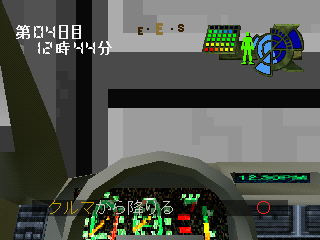

The car has no step height and no wall check of its own. It climbs any kerb: the pavements are 25 cm above the road and it simply rides up. But while any of its four corners is on a pavement it crawls at a third of its speed, and when all four are back on the road the pedal is cut to a quarter. The snag is the stop rule: if a single corner would end up where there is no ground at all, at a wall, a building or the side of a tunnel with no pavement, the whole move is undone and the pedal and gear drop to zero, so the car stops dead and the prompt to get out shows (picture). It never slides along the wall: holding the pedal only repeats the stop, and even steering at full lock for over ten seconds turned it 2 degrees. Calling it to a phone is not the only way out: backing up frees it at once, unless both ends touch.

Technical details

- Proof: `vehicle_car_drive` (0x801AA360, src/game/vehicle.c) only turns the pedals into a speed and a turn radius: in gear 1, revs = forward pedal x 30 + 800, at most 6500, and the speed divides by `vehicle_car_speed_div` (500, 400 or 300 by the car speed option), three times more while `vehicle_car_state.slowed` is set. The forward pedal is the field named `brake` (TRIANGLE), the reverse pedal `throttle` (CROSS). The move is `player_move_in_car` (static in src/game/player.c): it moves the car by the frame's step, then calls `block_fit_ground_tilt` (0x8017C234, src/game/block.c); unless that returns 0xFFFF (road) or 0xFF00 (slow ground), it puts the position and heading back and sets both pedals and the gear to 0. `block_fit_ground_tilt` tests the car's four `corners` (set in src/game/vehicle.c 75 cm left and right, 102 cm ahead and 152 cm behind) against the floor polygons of the blocks under the car, which `block_update_visibility` (0x8017A108) marks through the inline `block_car_corner_inside` (the code at 0x8017A29C). It returns 0 if any corner has no floor polygon under it, or if no corner is on road or slow ground. A corner on slow ground sets `slowed`; all four on road clear it and divide both pedals by 4. The height is the floor under the car's centre, and the tilt comes from the corners' heights: no limit on either. The town floor: 9,814 road polygons at height 0 and 31,019 of slow ground, the pavements 25 cm up; past a road edge lies road (192 km of edge), pavement (167 km) or no floor at all (4.7 km, walls and tunnel sides).
- In game: from a town save at 12:44, the parked car moved next to you, your position set and the get-in prompt forced, then CIRCLE; driven with TRIANGLE, CROSS, L1 and R1 only, `vehicle_car_state` (0x801E1158) logged every 20 frames. On the road the speed reached 33; the front corner on the pavement set `slowed` and the speed fell to 12, the car's height moving by the 25 cm of the kerb with no check. At 9.97 m it stopped; holding TRIANGLE then looped: the pedal climbed, the car crept 1 to 12 cm, the move failed, pedal and gear went to 0 and the get-out prompt showed each time (picture). CROSS backed it away at once; back on the road `slowed` cleared and the pedal fell from 118 to 44. Driven at an angle into another wall, then TRIANGLE with full left lock for 350 frames: 2 degrees of turn, still stuck.
- Question: [32](mysteries.md#bugs). Found and checked 2026-11-18.
- Before us: the car gets stuck on kerbs and in tunnels and must then be called again (atwiki, GameFAQs how-to-play); hiddenblur located the car state at 0x801E1158. Confirmed: kerbs slow it, walls and tunnel sides stop it. Corrected: a phone call is not the only way out, backing up frees it.

## The disc

### ✅ The movie on the disc can never play

📖 Read in the code only.

The disc carries two identical 50 MB video files, `M.STR` and `D.STR`, dated 1995-10-20, four years before the rest of the disc. Players who extracted them describe spacecraft flying through a canyon and into space, and say the game never shows it. The code agrees: the executable never names either file and has no code that drives the PlayStation's video decoder, so the movie cannot play.

Technical details

- Proof: the executable's strings name `\RES.R;1`, `\SCE.S;1`, `\S\%s.S;1`, `\S\OFC.S;1`, `\S\TWN.S;1`, `\B\%c\%s.B;1`, `\M\%c\%s.RM;1`, `\F\%c\%s.F;1` and the three `\C\CITY.*` files, and no string containing `STR`. Nothing in `src/` touches the decoder registers at `0x1F801820`, and no streaming or decoder library function (`StSetStream`, `StGetNext`, `DecDCT*`) appears in `config/` (which lists the linked Psy-Q functions in `symbol_addrs.psyq.txt`) or `src/`. `cmp` finds the two files identical; their ISO dates are 1995-10-20 against 1999-06-14 for `RES.R`.
- In game: nothing to check; the files play in standard STR players.
- Question: [21](mysteries.md#hidden-and-cut-content). Found 2026-11-16.
- Before us: players already said there is no way to see the movie (atwiki, GameFAQs). New here: the proof that no code can open it.

### 🆕 The game still names scene files the disc does not have

📖 Read in the code only.

All 24 scenes live in one big file, `SCE.S`. Yet the game still writes the path of a separate file for each scene, such as `\S\OFC.S` for the office and `\S\TWN.S` for the town, and these files are not on the disc. The loader ignores those paths: it opens `SCE.S` and jumps to the scene through a table of offsets. One guess is that the scenes were separate files earlier in development and were packed together late; the code does not prove it.

Technical details

- Proof: two functions in src/game/main.c store `"\\S\\OFC.S;1"` and `"\\S\\TWN.S;1"` in the scene request's `path` (`main_scene_request.path`), and src/game/building.c builds `"\\S\\%s.S;1"` with `sprintf` before calling `object_load_scene`. `object_load_scene` (src/game/object.c) calls `object_iff_open(&ctx, 0, scene)`, which only ever calls `CdSearchFile` on `"\\SCE.S;1"` (or `"\\RES.R;1"` for resources) and seeks by the offset in `object_sce_offsets[scene]` (`object_res_offsets` for `RES.R`). The other `CdSearchFile` calls, in src/kaj/cdmgr.c, take their path from their caller.
- In game: not checked.
- Question: [22](mysteries.md#hidden-and-cut-content). Found 2026-11-16.
- Before us: nobody had written about these paths.

